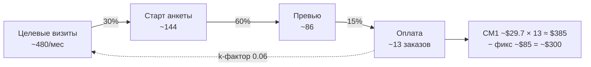

# 04. Ресерч экономики (сводка)

Дата: 2026-11-05, §10 добавлен 2026-11-06 (Q18), §11 и RU-цены в §10.3 — 2026-11-08 (ревизия цен). Цифры совпадают с [facts.md §4–8](facts.md).

- **Модель:** [models/unit_economics.py](models/unit_economics.py), запуск `python3 models/unit_economics.py`. Все таблицы ниже — её вывод.
- **Подробные отчёты:** [appendix/economics-demand.md](appendix/economics-demand.md) (рынок, каналы, воронка, AOV, повторы, B2B, RU), [appendix/economics-costs.md](appendix/economics-costs.md) (модели, COGS, платежи, фиксированные расходы).
- Цифры воронки — допущения [E]: публичных данных почти нет.

## 1. Главное

1. **Себестоимость не проблема.** COGS платного заказа **$3.6–7.1**, включая бесплатные превью для неплативших, комиссию Polar, видео реакции и поддержку. CM1 78–88%. Всё решают привлечение и средний чек, а не выбор модели.
2. **Платное масштабирование на грани окупаемости:** LTV за 24 мес. ~$37 при блендированном CAC ~$28, LTV/CAC ~1.3. Поэтому реклама — не основной канал ([05](05-decisions.md) D11).
3. **Цель основателя достижима на маленьких объёмах:** $300 чистыми ≈ **13 заказов в месяц** ≈ **480 целевых визитов в месяц** из любых источников.
4. **Тест на $300** даёт ~7 оплат. По нему можно оценить CTR и конверсию до превью, но не точный CAC.
5. **Главный риск — трафик, а не деньги.** Вся небрендовая коммерческая органика EN-ниши ~0.6–1.5k визитов в месяц, поэтому 480 визитов должна в основном дать виральность.
6. **Объём MVP v0.2 (§10, Q18):** групповой подарок и подписка почти не меняют порог цели (~12.3 заказа, ~455 визитов). Контур RU при ценах 990 / 1 790 ₽ окупается с ~12 заказов в месяц, а до этого стоит до ~$135 в месяц.

## 2. Юнит-экономика (на заказ и на дарителя, 24 мес.)

**COGS** = генерация (вкл. превью для неплативших: 1.5 попытки на дарителя, дошедшего до превью + 0.3 перегенерации у плативших) + обложка, хранение, почта ($0.017) + видео реакции ($0.05) + поддержка ($0.50) + Polar (5% + $0.50, +1.5% за не-US карты при 40% таких, 1% cross-border при выплате, диспуты) + аффилиаты.

| Сценарий | Стек | Чистый AOV | Генерация на заказ | COGS | CM1 | CM1 % | LTV 24 мес. | CAC | LTV/CAC |
|---|---|---:|---:|---:|---:|---:|---:|---:|---:|
| Bear | A. ACE-Step, serverless | $24.8 | $0.45 | $3.6 | $21.2 | 85% | $23 | $94 | 0.25 |
| Bear | L. Lyria 3.5 | $24.8 | $2.37 | $5.6 | $19.3 | 78% | $21 | $94 | 0.23 |
| **Base** | **A. ACE-Step, serverless** | **$34.1** | **$0.36** | **$4.4** | **$29.7** | **87%** | **$37** | **$28** | **1.31** |
| Base | A2. ACE-Step на fal | $34.1 | $1.00 | $5.0 | $29.1 | 85% | $36 | $28 | 1.28 |
| Base | A3. MiniMax 2.0 на fal | $34.1 | $0.88 | $4.9 | $29.2 | 86% | $36 | $28 | 1.29 |
| Base | L. Lyria 3.5 | $34.1 | $1.91 | $5.9 | $28.2 | 83% | $35 | $28 | 1.24 |
| Bull | A. ACE-Step, serverless | $51.0 | $0.27 | $5.9 | $45.1 | 88% | $65 | $6 | 10.2 |

**Допущения сценариев** ([appendix/economics-demand.md §8](appendix/economics-demand.md)):

| Параметр | Bear | Base | Bull |
|---|---:|---:|---:|
| Цена базы в сценарии (ценовая чувствительность; решение D2 — $29) | $24 | $29 | $39 |
| Доля покупок пакета $49–59 | 15% | 25% | ~43% |
| AOV до возвратов | $27 | $35.5 | $52 |
| Возвраты | 8% | 4% | 2% |
| Превью → оплата | 12% | 15% | 20% |
| Визит → оплата | 1.5% | 2.7% | 5.6% |
| Блендированный CAC (до k-фактора; в таблице §2 — после) | $95 | $30 | $8 |
| Заказов на дарителя за 24 мес. | 1.10 | 1.25 | 1.45 |
| k-фактор | 0.01 | 0.06 | 0.25 |

## 3. Чувствительность (Base, стек A)

**Конверсия превью → оплата** почти не влияет на COGS, но сильно влияет на CAC:

| Превью → оплата | LTV 24 мес. | Платный CAC в Meta | Блендированный CAC | Вывод при платном масштабе |
|---:|---:|---:|---:|---|
| 8% | $37 | $78 | $52 | убыток |
| 10% | $37 | $63 | $41 | убыток |
| 12% | $37 | $52 | $35 | около нуля |
| 15% | $37 | $42 | $28 | небольшой плюс |
| 20% | $37 | $31 | $21 | хорошо |

**Средний чек** (при конверсии 15%):

| AOV | CM1 | LTV 24 мес. |
|---:|---:|---:|
| $24 | $19.6 | $25 |
| $29 | $24.0 | $30 |
| $35.5 | $29.7 | $37 |
| $45 | $38.1 | $48 |
| $59 | $50.4 | $63 |

Вывод: цена $19–24 не окупает даже минимальное привлечение. Пакет $49–59 — главный рычаг маржи.

## 4. План запуска в цифрах ([05-decisions.md](05-decisions.md))

| Показатель | Значение |
|---|---|
| CM1 на заказ | $29.7 |
| Фиксированные расходы | ~$85/мес: инфраструктура ~$75 (serverless без тёплого GPU, хостинг, R2) + домен и почта ~$10. Polar Starter без абонентской платы. Налоги, бухгалтерия и юрлицо — по резидентству основателя (Q5) |
| Заказов в месяц для $300 чистыми | **~13** |
| Целевых визитов в месяц (при визит → оплата 2.7%) | **~480** |
| Тест на $300 в Meta, US+GB+CA+AU (CPC $1.13) | ~265 визитов → ~80 анкет → ~48 превью → **~7 оплат** |

### Воронка плана в цифрах

Тест на $300 по той же воронке: ~265 визитов → ~80 стартов → ~48 превью → ~7 оплат.

## 5. Сценарий платного масштаба (справочно, не план)

| Сценарий | Заказов в год 2 | Выручка | Прибыль до зарплат (стек A) |
|---|---:|---:|---:|
| Bear | 16k | $0.40M** | −$1.0M* |
| Base | 55k | $1.87M | +$0.38M |
| Bull | 115k | $5.86M | +$4.6M |

\* Bear показывает, что будет, если продолжать покупать трафик при LTV/CAC 0.25. На практике рекламу останавливают после теста.

\*\* Выручка в таблице чистая (после возвратов). SOM в facts.md ($0.45–5.9M) — валовой.

Рынок: SAM (US+GB+CA+AU) $128M в год (диапазон $43–390M), SOM на 2-й год $1.9M при платном масштабе.

## 6. Тест на $300: что меряем и пороги

При ~265 визитах статистически значимы только верхние шаги воронки. Конверсия превью → оплата (~48 превью) даёт лишь грубый сигнал.

| Метрика | Kill | Base | Go |
|---|---:|---:|---:|
| CTR по ссылке в Meta | < 1.0% | 1.5% | > 2% |
| Визит → старт анкеты | < 20% | 30% | > 40% |
| Старт → превью | < 40% | 60% | > 70% |
| Превью → оплата (грубо) | 0–1 оплата из ~48 | ~7 | ≥ 10 |
| Доля пакета $49–59 | < 10% | 25% | > 35% |

Kill не означает закрыть проект. Это сигнал менять оффер, лендинг или креатив до Mother's Day.

## 7. Стек и платежи

- **Генерация:** ACE-Step 1.5, MiniMax 2.0 на fal или Lyria 3.5 — по итогам слепого теста (Q1) и проверки условий (Q2). Разница в COGS между ними до $1.5 на заказ, на решение это не влияет. Решает качество.
- **Тексты:** Claude Sonnet 5.5, модерация — Claude Haiku 5.5.
- **Как снизить затраты на бесплатный уровень:** превью 30–45 с вместо полной песни; превью второй версии генерируется по клику (попытка остаётся «до 2 версий»); email до генерации; Turnstile; лимит попыток на email, IP и устройство; удалять неоплаченные треки через 30 дней.
- **Платежи:** Polar (весь мир), запасной — Paddle; Россия — ИП + ЮKassa (RU-whitelabel, D7).

## 8. Доставка и мессенджеры

- **Вручение (D14):** email получателю через Resend Free (3k писем в месяц) или SES ($0.10 за 1k) плюс напоминание дарителю с кнопками отправки в мессенджеры. Стоимость **~$0 на заказ**, абонентских платежей нет. SMS и WhatsApp API не используем.
- **Почему не продаём через Telegram Stars:**

| Канал оплаты | Цена для дарителя | Продавцу остаётся |
|---|---|---|
| Polar (сайт) | $29 | ~$26.6–27.05 (92–93%) |
| Telegram Stars | 1 450 ⭐ (~$29 в iOS) | ~$18.3–18.9 (63–65%), в крипте через 21 день |
| ЮKassa (RU, карта) | 790 ₽ | ~707 ₽ после УСН 6% (~90%) |
| ЮKassa (RU, СБП) | 790 ₽ | ~737 ₽ (~93%) |
| Telegram Stars (RU) | 400 ⭐ | ~380 ₽ (~48%) |

На Stars продавец теряет ~27% чека против Polar: CM1 падает с ~$29.7 до ~$20, и для цели $300 в месяц нужно ~19 заказов вместо ~13. Поэтому в ботах оплата через ЮKassa в Mini App (D15).

## 9. Россия (RU-whitelabel, входит в MVP)

Чек 990 ₽ (база) и 1 790 ₽ (пакет), P14 после ревизии цен 08.11 (было 790 / 1 490 ₽). Стек отдельный: ACE-Step на российском GPU, YandexGPT или аналог для текста, ЮKassa и СБП, ИП. Входы: сайт плюс боты в MAX и Telegram на общем адаптере (D15). Экономика — в §10.

## 10. Объём MVP v0.2: групповой подарок, подписка, RU (Q18, 2026-11-06)

Блок Q18 в конце [models/unit_economics.py](models/unit_economics.py). Каноническая EN-часть (§2–6) не менялась. Все входы — оценки [E], кроме отмеченных источников.

### 10.1 Групповой подарок (организатор платит, цены как у одиночного, P17)

Допущения: доля групповых среди оплат 5% / 10% / 20%; пакет в группе берут чаще (30% / 40% / 50%: организатор собирает деньги с участников сам); 3 / 6 / 10 участников кроме организатора; участник становится покупателем в течение года в 1% / 3% / 6% случаев. Дополнительные расходы на групповой заказ ~$0.6 (длиннее текст, модерация вкладов, фото, письма участникам, поддержка).

| Сценарий | Доля групп | AOV группы | CM1 группы | CM1 в среднем | k группы | k общий |
|---|---:|---:|---:|---:|---:|---:|
| Bear | 5% | $36.8 | $30.2 | $29.7 | 0.04 | 0.01 |
| **Base** | **10%** | **$39.4** | **$32.5** | **$30.0** | **0.24** | **0.08** |
| Bull | 20% | $42.0 | $34.8 | $30.7 | 0.85 | 0.37 |

**Вывод.** На марже групповой подарок почти не сказывается (+$0.3 к среднему CM1). Его ценность — виральность: в base k растёт с 0.06 до 0.08, в bull — до 0.37. Это единственная функция MVP, которая может заметно сократить нужный внешний трафик.

### 10.2 Подписка «Календарь поводов» (P13)

**Дыра в цене P13 v0.2.** Если помесячная даёт кредит при каждом продлении, одна песня стоит **$19.98**: подписаться за $9.99, дождаться продления, забрать кредит и отменить. Это на 31% дешевле базы, а дату подарка обычно знают заранее. В RU так же: 2 × 290 = 580 ₽ против 790 ₽. **Исправлено в PRD v0.3:** кредит за каждые 3 оплаченных месяца. Самый дешёвый путь к одной песне — $29.97 (3 месяца). Цена подписчика $19 с 08.11 есть только у годовой (§11), иначе месяц помесячной и 2–3 песни по $19 выходили на 17–23% дешевле базы. В RU при P14 (ревизия 08.11): 3 × 350 = 1 050 ₽ против базы 990 ₽.

Допущения base: подписку оформляют 3% плативших (1–5%, economics-demand §5.1); 60% берут годовую; из 4 кредитов годовой за год используют 2.2; отток помесячной 12% в месяц (~6.5 оплаченных месяцев в первый год); 0.2 песни сверх кредитов по $19 (только годовая); без подписки этот человек купил бы 0.8 песни за год. Себестоимость песни по кредиту $0.63 — нет бесплатных превью неплательщиков.

| Показатель (base, за 12 мес. на подписчика) | Значение |
|---|---:|
| Комиссия Polar за списание | $9.99 → $1.23 (12%); $59 → $4.47 (8%) |
| CM подписчика: годовая / помесячная | $68 / $64 |
| CM того же человека без подписки (0.8 песни × $29.7) | $24 |
| **Прирост на подписчика** (годовая / в среднем) | **+$45** / +$43 |
| Прирост, если сам купил бы 2 песни за год | +$7 |
| Прирост, если сам купил бы 3 песни за год | **−$23** |
| Вклад в цель при 13 заказах в месяц: доля подписки 1% / 3% / 5% | +$6 / **+$17** / +$29 в месяц |

**Вывод.** Подписка в плюсе, пока её берут не самые активные дарители: те, кто и так покупает 3+ песни в год, получают скидку и снижают выручку. На малом объёме это не рычаг для цели $300: +$17 в месяц в base, и только через год, когда накопятся подписчики. Её смысл — повторные заказы и календарь, который возвращает людей к поводам. Главная метрика — доля песен по кредитам (06-prd §9).

### 10.3 Контур RU (P14, D7)

Входы: курс 80.5 ₽/$ (ЦБ, 02.11.2026) [S]; оплата 50% картой (3.8%) и 50% через СБП (0.7%), плюс НДС 22% на комиссию — в среднем 2.74% чека [S/E]; текст — YandexGPT 5.1 Pro ~0.80 ₽ за 1k токенов [S] × ~4k токенов ≈ 3.2 ₽ на попытку; воронка, возвраты и поддержка — как в EN base (поддержка 40 ₽ ≈ $0.5).

**GPU — главная неизвестная.** Варианта два:
- **R1 — serverless с оплатой за использование.** Cloud.ru ML Inference заявляет масштабирование до нуля; по тарифу ~6–9 ₽ за GPU-минуту [S, проверить]. Это ~11 ₽ на попытку с холодным стартом.
- **R2 — выделенный GPU класса RTX 4090.** ~30 тыс. ₽ в месяц [S: рыночный диапазон, toolfox.ru]. Аренда A100 по часам у Cloud.ru ~300–360 ₽/ч [S] — держать её включённой ещё дороже.

**Фикс контура в РФ** ~6 050 ₽ в месяц [E]: серверы и база в РФ 3 500 ₽, почта 500 ₽, облачная касса и ОФД (54-ФЗ) 1 500 ₽, банк 500 ₽, домен. Плюс взносы ИП 57 390 ₽ в год (4 783 ₽ в месяц) [S]. ИП на УСН «доходы» без работников уменьшает налог 6% на всю сумму взносов. Поэтому налог и взносы вместе — это max(взносы, 6% дохода): до ~1 млн ₽ дохода в год платятся только взносы.

| Показатель | R1 serverless | R2 выделенный GPU |
|---|---:|---:|
| AOV (990 / 1 790 ₽, пакет 25%) | 1 190 ₽ ($14.8) | 1 190 ₽ |
| Генерация на заказ (10.3 попытки) | 146 ₽ | 33 ₽ |
| **CM1 до налога** | **918 ₽ ($11.4)** — в 2.6 раза меньше EN | 1 032 ₽ ($12.8) |
| Фикс в месяц с взносами ИП | 10.8k ₽ ($135) | 40.8k ₽ ($507) |
| **Безубыточность** | **12 заказов/мес (~444 визита)** | 40 заказов/мес (~1 480 визитов) |
| $300 в месяц только из RU | 39 заказов/мес (~1 444 визита) | 64 заказа/мес (~2 370 визитов) |

Чувствительность R1 (безубыточность / заказов для $300 из RU): ИП и так есть, взносы не добавляются — 8 / 36; прежние цены 790 / 1 490 ₽ — 16 / 50 (CM1 709 ₽); цены 590 / 1 190 ₽ — 22 / 71.

**Вывод.** Контур RU окупается только при ~12 заказах в месяц (~444 визита), при прежних 790 ₽ — при ~16. У лидера ниши pesinka органика ~148 визитов в месяц (facts §2), поэтому RU, скорее всего, первые месяцы работает в минус до ~$135 в месяц. Условия, без которых запускать RU не стоит:
1. **Serverless GPU в РФ** — проверить в Q11. С выделенным GPU безубыточность только с 40 заказов в месяц.
2. **Цена 990 ₽, а не 790 ₽** (P14 после ревизии 08.11): безубыточность с 12 заказов вместо 16. Спрос на эту цену проверить в Q11.
3. Если ИП у основателя уже есть по другим причинам, безубыточность — 8 заказов (Q19).

### 10.4 Цель $300 в месяц с объёмом MVP v0.2 (base)

| Конфигурация | CM на заказ EN | Заказов EN в месяц | Визитов EN в месяц | Из них внешних (без пришедших через подарки) |
|---|---:|---:|---:|---:|
| Только EN (канон, §4) | $29.7 | 13.0 | 480 | 453 |
| EN + групповой подарок | $30.0 | 12.8 | 476 | 441 |
| **EN + групповой подарок + подписка** | **$31.3** | **12.3** | **455** | **422** |

С контуром RU (R1) нужное число заказов EN зависит от продаж в RU:

| Заказов RU в месяц | Прибыль RU | Нужно заказов EN | Визитов EN |
|---:|---:|---:|---:|
| 0 | −$135 | 16.6 | ~615 |
| 10 | −$20 | 13.0 | ~480 |
| 20 | +$94 | 9.3 | ~345 |
| 30 | +$207 | 5.7 | ~211 |
| 50 | +$432 | 0 | 0 |

Цены RU — 990 / 1 790 ₽ (P14 после ревизии 08.11).

**Итог Q18.**
1. Групповой подарок и подписка почти не меняют порог цели: 12–13 заказов в месяц, ~455 визитов. Их польза — k-фактор и повторные заказы, а не маржа.
2. Контур RU до ~12 заказов в месяц (при 990 ₽) — расход до ~$135 в месяц.
3. В подписке P13 была дыра — исправлена (§10.2).
4. Модель EN «до налогов» (Q5); RU посчитан после УСН и взносов, потому что они возникают только из-за контура RU.

## 11. Ревизия цен (2026-11-08)

Блок `pricing_review()` в конце [models/unit_economics.py](models/unit_economics.py). Проверены тарифы PRD v0.5 и экраны оплаты на холсте; правки вошли в PRD v0.6. Канонические EN-цифры §2–6 не менялись.

| Что нашли | Расчёт | Что изменили в PRD |
|---|---|---|
| **Годовая подписка на экране выбора** рядом с пакетом: «$59 — песня сейчас и ещё 3, около $15 за песню» против базы $29 и пакета $55 | Переход с пакета на годовую сейчас даже выгоднее (CM $47 → $52), но покупатель отказывается от будущих заказов по базе, а «$15 за песню» обесценивает базу для всех, кто видит экран. Апгрейд после оплаты (+$30, заказ становится первым кредитом) добавляется к уже выбранному пакету: CM апгрейда $28.6; прирост за год **+$20**, если человек сам купил бы 0.3 песни сверх текущей, −$1 при 1 песне, −$31 при 2 | P28, FR-6.1a, FR-7.8a |
| **Цена подписчика $19 у помесячной** | Месяц подписки + 2 песни = $47.99 против $58 (−17%), + 3 песни = $66.99 против $87 (−23%). Q18 проверял только одну песню | P13: цена $19 только у годовой |
| **3 попытки за $3 с зачётом в цену песни** | Комиссия Polar с $3 — $0.77 (26%), попытки — $0.11. У покупателя $3 вычитаются из цены, и каждый такой заказ стоит **~$0.88** | P27: «Ещё 2 попытки бесплатно» один раз на анкету |
| **В базе почти все фото** (обложка, фото на странице подарка, фото участников у записок) | Пакету остаются смена фото под музыку, вторая версия и постер; доля пакета 25% — допущение, на котором стоит AOV $35.5 | P20: в базе одно фото (обложка), остальные — в пакете |
| **RU-цены 790 / 1 490 ₽** | CM1 709 ₽, безубыточность 16 заказов; при 990 / 1 790 ₽ — 918 ₽ и 12 (§10.3) | P14: 990 / 1 790 ₽, годовая 2 990 ₽, помесячная 350 ₽ |
| **Групповой подарок по цене одиночного** | На участника выходит $4–8. При ценах $39 / $69 для группы и доле групп 10% — около +$1 к среднему чеку | P17: A/B цены после запуска |
| **Попыток больше, чем в модели** (3 бесплатные + исправление имени + 2 дополнительные + вторая версия по клику) | 1.5 → 2.5 попытки на дошедшего до превью: COGS $4.38 → $4.61 на стеке A, $5.92 → $7.16 на Lyria; CM1 $29.7 → $29.5 / $26.9. Дневной лимит $15 — ~214 превью в сутки на стеке A и ~41 на Lyria | Канон не меняем: влияние в пределах диапазона §2. Если по Q1 выберем Lyria, допущение пересчитать |

**Помесячная подписка убрана из MVP** (решение основателя 09.11, D17, P37). Она давала около +$40 за год на подписчика, но требовала автоплатежей ЮKassa в RU и напоминаний о продлении. Оценка потери [E]: при 13 заказах в месяц — 156 плательщиков в год, 3% подписчиков = 4.7, из них 40% помесячных = 1.9 человека × CM $64 ≈ $120 в год, то есть до ~$10 в месяц, если никто из них не возьмёт годовую. Расчёты §10.2 и блок Q18 в модели сделаны с помесячной и не пересчитаны.

