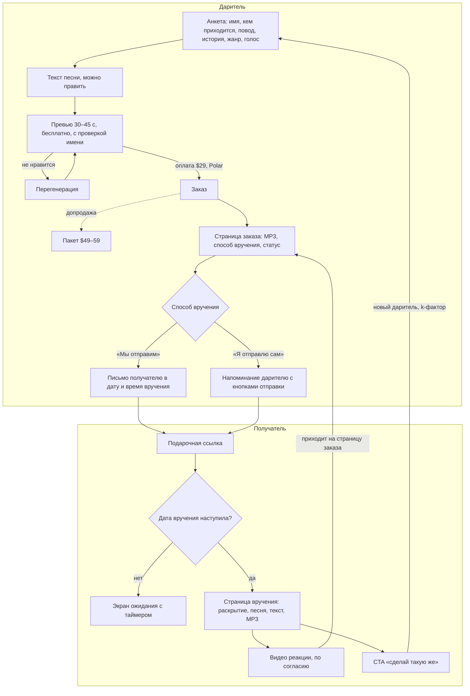
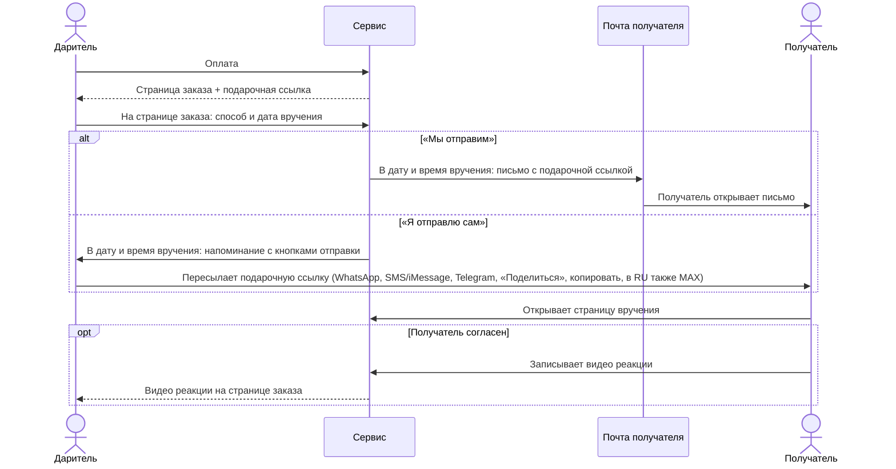
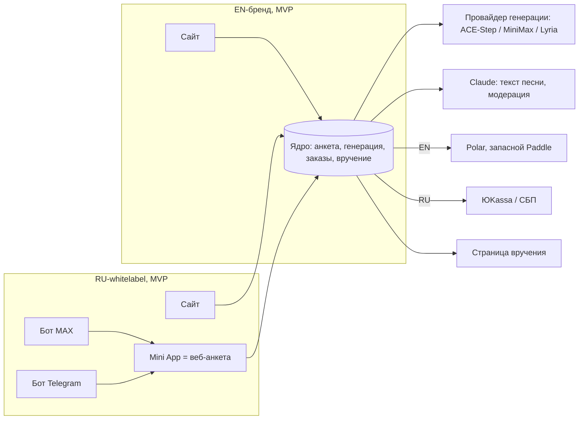

# 05. Решения и гипотеза продукта

Дата: 2026-11-05. Это главный документ стратегии: решения основателя и выводы из ресерча (01–04). PRD строится на нём. Цифры взяты из [facts.md](facts.md).

## 1. Вводные основателя

| Параметр | Значение |
|---|---|
| Маркетинговый бюджет | ~$300 на старт (разово, не в месяц) |
| Цель | ≥ $300 в месяц чистыми, до личного налога |
| Ресурсы | Своей аудитории, опыта в рекламе, инфлюенсеров и дизайнера нет |
| Россия | Отдельный продукт на общем ядре (whitelabel), входит в MVP (D7) |
| Сроки | Не фиксируются; MVP — весь объём D4 (D19) |

## 2. Гипотеза продукта

**Для кого:** люди в англоязычных странах (EN-бренд) и в России (RU-whitelabel), которым нужен личный подарок к поводу (день рождения, годовщина, Valentine's, Mother's / Father's Day; в RU — также 8 Марта, 23 Февраля, юбилей), часто в последний момент. Отдельно — семьи и компании друзей, которые дарят вместе (групповой подарок), и те, у кого много поводов в году (подписка «Календарь поводов»).

**Ценность:** песня по их истории с именем получателя, которую вручают как событие: в нужную дату и время, с красивым раскрытием, а реакцию получателя даритель получает обратно на видео.

**Почему это может сработать:**
- спрос на подарочные песни растёт на 23% в год;
- лидер (Songfinch) стоит $179+ и отказался от AI;
- AI-конкуренты продают «файл», а полного сценария вручения нет ни у кого ([facts.md §2](facts.md)).

**Почему может не сработать:**
- нет защиты от клонов;
- маленькая органическая ниша;
- качество open-source вокала не проверено;
- широкий объём MVP (два бренда, боты, подписка, групповой подарок) откладывает первую выручку и первую проверку спроса.

## 3. Принятые решения

| # | Тема | Решение |
|---|---|---|
| D1 | Позиционирование | **C, «через впечатление»**: продаём вручение подарка, а не файл |
| D2 | Цена | **База $29**, пакет **$49–59** (видео со слайдшоу фото, принт текста песни, вторая версия песни в полном качестве — MP3 и на странице вручения). Ожидаемый AOV ~$35.5 |
| D3 | Пейвол | **Бесплатно:** превью 30–45 с с именем получателя. **За $29 (база):** полная песня, MP3, страница вручения с раскрытием, вручение в дату и время (D14), видео реакции (D4, Q6), PDF-открытка с QR на подарочную ссылку |
| D4 | Объём MVP | **Весь объём ниже входит в MVP** (решение основателя 05.11, D19). **Ядро:** анкета → текст песни (можно править) → превью с проверкой произношения имени (решение 09.11: без отдельного шага) → оплата → страница заказа и подарочная ссылка (D16) → вручение в дату и время (D14) → получатель открывает страницу вручения: раскрытие, песня, скачивание MP3 → **видео реакции** (с согласия получателя) приходит дарителю → CTA «сделай такую же». Допродажа — пакет $49–59. **Плюс:** групповой подарок (D18), подписка «Календарь поводов» с аккаунтами (D17), RU-whitelabel с сайтом и ботами MAX и Telegram (D7, D15). **После MVP:** физическая открытка с QR/NFC, B2B, складчина в групповом подарке |
| D5 | Прозрачность про AI | **Честно говорим, что песня сделана с помощью AI** («AI + ваша история»). Это снимает жалобы «подозреваю AI» и объясняет цену и скорость |
| D6 | Рынки и языки | **i18n-архитектура с первого дня. EN — первый язык контента** (US, GB, CA, AU). 1–2 дополнительных языка выбираем по выгрузкам Ahrefs с местными seed-ключами (кандидаты DE, PL, PT/BR, ES; аргументы: personalisierter-song.de, Flippa-кейс). Пустые языковые разделы не публикуем |
| D7 | Россия | **Whitelabel, входит в MVP** (решение основателя 05.11). Своё юрлицо (ИП), ЮKassa и СБП, генерация без зарубежных API (ACE-Step на российском GPU). Ядро сразу поддерживает конфигурацию бренда, домена, языка, платёжки и провайдера генерации. Каналы RU — D15 |
| D8 | Генерация | **Только оплата за использование, без абонентских планов.** Кандидаты: ACE-Step 1.5 (serverless GPU или fal), MiniMax 2.0 на fal, Google Lyria 3.5. Выбор — по слепому тесту (Q1). ElevenLabs исключён (нужен план $299/мес). Suno — только по партнёрскому договору |
| D9 | Тексты | Claude Sonnet 5.5 (~$0.025 за попытку), модерация — Claude Haiku 5.5 |
| D10 | Платежи | **Весь мир: Polar** (MoR, Starter, 5% + $0.50; +1.5% за не-US карты), запасной — Paddle. **Россия:** ИП + ЮKassa |
| D11 | Каналы роста | **Органика:** SEO на длинном хвосте (повод × получатель, «song with name», страницы цены и сравнений), виральность страницы вручения и видео реакций, органический TikTok и Reddit, каталоги и Product Hunt. Платная реклама — только тест на $300 (D12) |
| D12 | Тест на $300 | Meta (US, GB, CA, AU — одни EN-креативы), ~2 недели перед ближайшим сезонным пиком после запуска EN. Креативы — запись экрана с раскрытием подарка и реальной песней (дизайнер не нужен). Ожидаемо ~265 визитов → ~48 превью → ~7 оплат. Пороги — в [04-economics.md §6](04-economics.md) |
| D13 | Отклонено | Цена $19–24 (не окупается); премиум «AI + проверка человеком» за $49–79 (нет команды); Россия как «полигон для тестов» вместо полноценного бренда (требует отдельного юрлица, поэтому RU — полноценный whitelabel, D7); Telegram Stars как способ оплаты (продавцу остаётся 48–65%, вывод в крипте); прямая отправка получателю через WhatsApp API / SMS / ботов (D14); полный паритет бота с сайтом до проверки спроса (~2.5–3 недели вместо 1–1.5) |
| D14 | Способ вручения | **Гибрид.** Ни один мессенджер не разрешает сервису написать первым человеку без его согласия ([facts §8](facts.md)), поэтому даритель выбирает: **«Мы отправим»** — email получателю в выбранные дату и время по часовому поясу получателя; **«Я отправлю сам»** — в выбранный момент присылаем дарителю напоминание с кнопками отправки в один тап: WhatsApp (`wa.me`), SMS/iMessage (`sms:`), Telegram (`t.me`), системное «Поделиться», «Копировать ссылку», QR; в RU-whitelabel ещё MAX. PDF-открытка доступна на странице заказа при любом способе. Способ и дату вручения даритель выбирает на странице заказа после оплаты и может изменить до даты вручения. Подсказываем запланировать отправку в самом мессенджере (iMessage Send Later, Telegram). Стоимость ~$0 на заказ. **Не делаем:** WhatsApp Business API, SMS и Telegram-ботов для отправки получателю (нужно согласие получателя, риск TCPA/GDPR, фиксированные платежи) |
| D15 | Боты MAX и Telegram | **Боты — только канал продаж.** Получателю бот ничего не отправляет: подарочную ссылку пересылает даритель (D14). **EN-запуск: ботов нет** — аудитория US/GB/CA/AU не покупает подарки в ботах, Stars забирают ~35%; Telegram есть только среди кнопок отправки у дарителя. **RU, в MVP: сайт — ядро, боты MAX и Telegram — второй вход в ту же воронку, оба сразу** (решение основателя; подтверждено 05.11: Telegram-бот — только в RU). Бот тонкий (~1–1.5 недели, второй мессенджер +3–5 дней на общем адаптере): ссылка на бота (deep link) → Mini App = та же веб-анкета → превью аудио в чате → оплата → уведомления дарителю «песня готова / пора отправить подарок (для «Я отправлю сам») / подарок открыт / пришла реакция» → кнопка «Переслать подарок» (даритель сам отправляет подарочную ссылку) → CTA «сделай такую же». Ядро и Mini App одни, различаются только транспорт сообщений, deep links и кнопки отправки. Риски Telegram в РФ принимаем осознанно: де-факто работает через VPN, аудитория падает (33.8 млн в день в августе 2026), реклама в нём, по позиции ФАС, незаконна (мораторий на штрафы до 31.12.2026) — поэтому Telegram-бот растим органикой и пересылкой подарочных ссылок, без платной рекламы. MAX легален для ИП и больше по аудитории (69 млн в день). **Оплата в ботах — ЮKassa/СБП через Mini App** (с чеком 54-ФЗ); в Telegram это нарушает правила Stars — риск принимаем осознанно. Stars не используем |
| D16 | Две ссылки и таймер | После оплаты создаются **две разные ссылки**. **Страница заказа** (только для дарителя): скачать MP3, выбрать или изменить способ вручения, статус («отправлено / открыто»), видео реакции, повторный заказ. **Подарочная ссылка** (её получает получатель): открывает страницу вручения без анкеты и служебных данных. Если подарочную ссылку открыть **до даты вручения**, показывается **экран ожидания с таймером** («Откроется 14 февраля»), без спойлера; поэтому ссылку можно отправить заранее. Превью ссылки в мессенджерах — обложка и нейтральный заголовок («Для тебя подарок»), без текста песни (Q12) |
| D17 | Подписка «Календарь поводов» | **В MVP одна подписка — годовая** (решение основателя 09.11; до этого, с 05.11, — годовая и помесячная). Подписчик ведёт календарь близких и поводов, получает напоминания и кредиты на песни. Нужны аккаунты (вход по ссылке из письма или через бота, без паролей). Цены и состав — предложение PRD P13–P15; риск каннибализации базы $29 — в [06-prd §13](06-prd.md). Экономика — [04 §10.2](04-economics.md) (Q18) |
| D18 | Групповой подарок | **В MVP, платит организатор** (решение основателя 05.11). Организатор создаёт подарок и рассылает ссылку-приглашение; участники без регистрации добавляют воспоминания и записки; текст песни собирается из всех вкладов; на странице вручения — «From Kate, Dad, Tom and 4 others». Складчина (каждый платит долю) — после MVP |
| D19 | Сроки | **Сроки запуска не фиксируем** (решение основателя 05.11). MVP — весь объём D4. Сезонные окна (§5) — ориентир для маркетинга, не дедлайны |

## 3a. Схемы

Термины — по [glossary.md](glossary.md).

### Путь дарителя и получателя (D3, D4, D14, D16)

### Вручение: два способа (D14)

### Каналы продаж и общее ядро (D6, D7, D10, D15)

Боты — только канал продаж: получателю они ничего не отправляют, подарочную ссылку пересылает даритель.

### Сроки

Сроки не фиксируются (D19). Порядок сборки по зависимостям — в [06-prd §12](06-prd.md).

## 4. Экономика плана

Подробно — в [04-economics.md](04-economics.md).

- С заказа после всех переменных расходов остаётся ~$29.7. Фиксированные расходы ~$85 в месяц (инфраструктура, домен, почта).
- **Цель $300 чистыми ≈ 13 заказов в месяц ≈ 480 целевых визитов в месяц** из любых источников.
- **С объёмом MVP v0.2 (Q18, [04 §10](04-economics.md)):** групповой подарок и подписка снижают порог до ~12.3 заказа и ~455 визитов в месяц; их польза — k-фактор (0.06 → 0.08) и повторные заказы. Контур RU при ценах PRD P14 (990 / 1 790 ₽, ревизия 08.11) окупается с ~12 заказов в месяц: CM1 918 ₽ ($11.4), фикс ~$135/мес с взносами ИП; при прежних 790 / 1 490 ₽ — с ~16. Пока в RU нет продаж, EN нужно ~16.6 заказа и ~615 визитов в месяц.
- **Главный риск плана:** вся сегодняшняя небрендовая коммерческая органика EN-ниши — ~0.6–1.5k визитов в месяц. SEO даст только часть трафика и не раньше чем через 3–6 месяцев. Основной трафик должен идти из виральности (страницы вручения, видео реакций) и органических соцсетей. Поэтому k-фактор и доля бесплатного трафика — главные метрики после запуска.

## 5. Сезонные окна

Ориентир для маркетинга и SEO, не дедлайны разработки (D19). SEO-страницы к окну публикуем за 1–2 месяца, чтобы успели проиндексироваться.

| Окно | Дата | Рынок | Что важно |
|---|---|---|---|
| Valentine's | 14.02.2027 | EN | Пик заказов «в последний момент» |
| 23 Февраля | 23.02.2027 | RU | Поводы «для папы», «для мужа», «коллегам» |
| UK Mother's Day | 07.03.2027 | GB | Страницы с британским написанием (personalised) |
| 8 Марта | 08.03.2027 | RU | Главный подарочный день RU: мама, жена, коллеги — групповой подарок |
| US Mother's Day | 09.05.2027 | EN | Главный пик года в EN |

## 6. Открытые вопросы

Единый список. Других списков открытых вопросов в docs/research/ нет.

| # | Вопрос | Кто | Приоритет |
|---|---|---|---|
| Q1 | Слепой тест моделей: 10 реальных анкет × 3 модели (ACE-Step 1.5, MiniMax 2.0 на fal, Lyria 3.5). Критерии: вокал, произношение имени, разборчивость текста, время генерации и холодный старт | Основатель даёт ключи fal и Google Cloud, Claude собирает стенд | Блокер MVP |
| Q2 | Коммерческие условия выбранной модели: ToS fal и MiniMax (можно ли продавать песни дарителям), Gemini API ToS для Lyria, происхождение датасета ACE-Step | Claude читает ToS, основатель решает про риск | Блокер запуска |
| Q3 | Выгрузки Ahrefs Matching terms по местным seed-ключам: DE, PL, PT/BR, ES (готовые seed — в [seo/global_report.md](seo/global_report.md)) → выбрать 1–2 языка | Основатель делает выгрузки, Claude анализирует | Высокий |
| Q4 | Polar: из какой страны основатель получает выплаты (Polar платит через Stripe; Россия не поддерживается) | Основатель | Блокер запуска |
| Q5 | Налоги и годовые расходы (бухгалтерия, юрлицо) по резидентству основателя — сколько из этого входит в «$300 чистыми» | Основатель | Высокий |
| Q6 | Согласие и приватность для видео реакции: явное согласие получателя, хранение, удаление, noindex по умолчанию, GDPR | Claude в PRD → **предложено в [06-prd §6.11](06-prd.md)** (P5; показ в маркетинге — P19); юрпроверка — Q17 | Высокий (до разработки) |
| Q7 | Выгрузка Ahrefs по именам («happy birthday <name> song», топ-200 имён) для программатика | Основатель → Claude | Средний |
| Q8 | После запуска: k-фактор, доля допродаж, эластичность цены | Тест | Средний |
| Q9 | Site Explorer по недостающим доменам (makecustomsongs.com, customsonggift.com, hitou.site и др.) | Основатель → Claude | Низкий |
| Q10 | Запросить у продавца на Flippa разбивку по каналам, CAC и определение «лида» | Основатель | Низкий |
| Q11 | RU-whitelabel: проверка спроса в Wordstat (на цену 990 ₽ из PRD P14 — безубыточность 12 заказов вместо 16 при 790 ₽), **serverless GPU в РФ с оплатой за использование** (Cloud.ru ML Inference: масштабирование до нуля, ~6–9 ₽ за GPU-минуту — проверить; с выделенным GPU контур окупается только с ~40 заказов в месяц), тарифы ЮKassa (включая автоплатежи для подписки), CPC «песня на заказ», качество русского вокала; **модель для русского текста песни без зарубежных API** (Claude из РФ недоступен, D7) — слепой тест; цены RU (предложение PRD P14) | Claude + тест | Блокер RU-запуска |
| Q12 | Проверить на устройствах, как iMessage, WhatsApp, Telegram и email-клиенты показывают превью ссылки на страницу вручения (обложка, без спойлера); там же — работает ли камера для видео реакции во встроенных браузерах | Требования — [06-prd §6.9](06-prd.md) (FR-9.2, FR-9.7); тест на устройствах — основатель + Claude | Средний (до запуска) |
| Q13 | До RU-запуска: может ли бот MAX писать первым и принимать оплату (СБП/ЮKassa), есть ли share-ссылка MAX, практика модерации Telegram за внешнюю оплату, свежие данные Mediascope по обоим (для прогноза трафика, не для выбора платформ), тарифы российских ESP | Claude | Блокер RU-запуска |
| Q14 | Название и домены: EN — рекомендация openyoursong.com, RU — откройпесню.рф или otkroipesnyu.ru ([appendix/domains.md](appendix/domains.md)); проверить ещё раз доступность и товарные знаки (USPTO, EUIPO), купить, настроить почту и начать прогрев | Основатель | Блокер запуска |
| Q15 | Утвердить предложения PRD P1–P38 ([06-prd §14](06-prd.md)); утверждённые перенести сюда как D20+ | Основатель | Высокий |
| Q16 | Возможности Polar: встроенный checkout, налог сверху или внутри цены для US/GB/CA/AU, местные валюты, доплата разницы до пакета, возвраты через API, Apple Pay и Google Pay; для GB и AU — цена с налогом внутри (VAT 20% сверху превращает $29 в $34.80) | Claude читает документацию Polar | Высокий |
| Q17 | Юридическая проверка: письма о брошенном превью без маркетингового согласия (GB, PECR); текст согласия на видео реакции и на его показ в маркетинге (P19: сайт и соцсети, реклама, отзыв; в US — пометка поощрённых отзывов по FTC; в RU — ст. 152.1 ГК РФ и согласие на распространение ПДн), запись несовершеннолетних (COPPA, UK Children's Code), ToS и Privacy Policy; правила автопродления подписок (California ARL, UK, РФ); для RU — оферта, 152-ФЗ (локализация, согласие на обработку ПДн), 54-ФЗ — юрист разово или шаблон Termly | Основатель решает, Claude готовит черновики | Высокий |
| Q18 | ~~Пересчитать экономику подписки, группового подарка и RU~~ → **посчитано 06.11**, [04 §10](04-economics.md), блок Q18 в [models/unit_economics.py](models/unit_economics.py). Найдена дыра в P13/P14 (одна песня через помесячную за $19.98 / 580 ₽) — исправлено в PRD v0.3. Входы по RU уточнить после Q11 | Claude | ✅ Закрыт |
| Q19 | ИП в РФ: может ли основатель открыть ИП (гражданство, регистрация по месту жительства), подключение ЮKassa с автоплатежами, верификация бота MAX на ИП | Основатель | Блокер RU-запуска |
