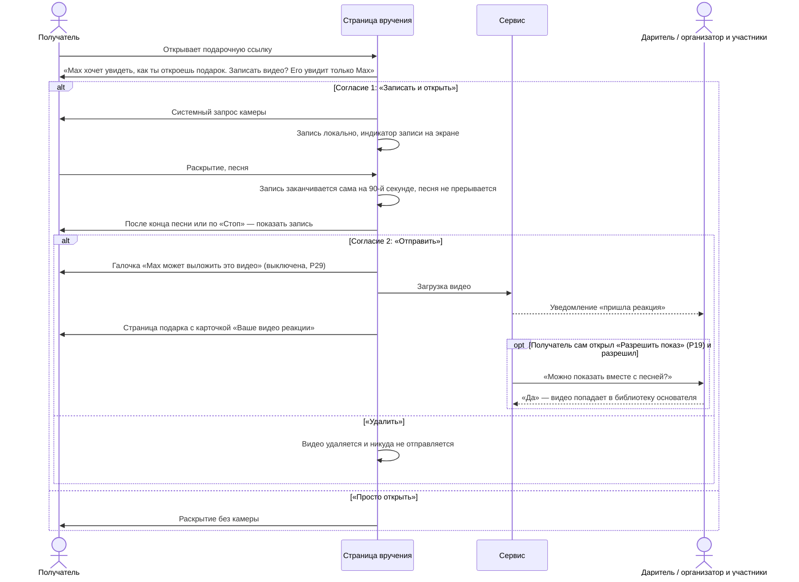
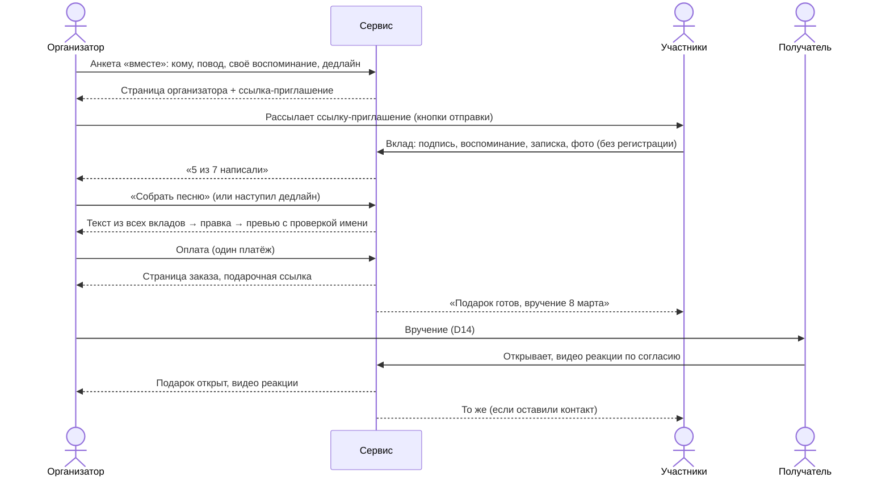

# 06. PRD: MVP песни-подарка

| | |
|---|---|
| Статус | **Черновик v0.8**, ждёт утверждения основателем (§14) |
| Дата | 2026-11-05, обновлён 2026-11-09 (v0.8) |
| Основа | [05-decisions.md](05-decisions.md) (D1–D19), цифры — [facts.md](facts.md), термины — [glossary.md](glossary.md) |
| Бренды | **EN** — рабочее название OpenYourSong (`openyoursong.com`); **RU** — откройпесню.рф или otkroipesnyu.ru. Рекомендации — [appendix/domains.md](appendix/domains.md), выбор — Q14 |
| Изменения v0.2 | По решениям основателя 05.11: RU-whitelabel с ботами MAX и Telegram, групповой подарок, подписки и аккаунты входят в MVP (D4, D7, D15, D17, D18); сроки не фиксируются (D19) |
| Изменения v0.3 | Пересчёт экономики (Q18, [04 §10](04-economics.md)): у помесячной подписки кредит — за каждые 3 оплаченных месяца (P13, P14); цель $300 с учётом контура RU (§2); риск контура RU (§13). Видео реакций с согласия — в маркетинг (P19, FR-11.6, FR-11.11–11.15) |
| Изменения v0.4 | Убраны архитектурные и технические решения: раздел «Архитектура», модель данных, названия технологий и форматы внутри требований. Они пойдут в отдельную техспецификацию (её пока нет; прежние формулировки — в истории git, версия v0.3). Номера удалённых FR не переиспользуются |
| Изменения v0.5 | По дизайну Cut Paper (холст, версия 65): фото и имя дарителя — в анкете до генерации; проверка имени и повод — отдельными экранами; групповой подарок получил email организатора и сборку звука после дедлайна; EN-кнопки отправки без Telegram; «Напомнить в следующем году» стало «Добавить в календарь»; новые письма; новые предложения P20–P27 (§14); экран «Что получит Anna» до оплаты; фото и записки во время песни и страница подарка после неё |
| Изменения v0.6 | Ревизия цен ([04 §11](04-economics.md)): годовая подписка ушла с экрана выбора на страницу заказа как апгрейд заказа за +$30 (P28); цена подписчика $19 — только у годовой (P13); вместо 3 попыток за $3 — 2 бесплатные один раз на анкету (P27); в базе одно фото (обложка), все фото — в пакете (P20); RU-цены 990 / 1 790 ₽ (P14); групповой подарок — A/B цены после запуска (P17); на карточке базы видно видео реакции. Холст v70: экран выбора без подписки, «2 more tries, free», новый экран 2.1.8 «Make this a yearly plan» |
| Изменения v0.7 | Ревизия флоу, раздел A ([appendix/flow-review-2026-11-09.md](appendix/flow-review-2026-11-09.md)): записку даритель пишет на экране «Что получит Anna» (FR-5.10); дата повода в анкете (FR-2.14, P30); одно правило для ссылки с датой при любом способе вручения (FR-8.2, FR-9.4); проверка имени — до генерации (FR-4.1); запись реакции не прерывает песню (FR-11.3); даритель и участники публикуют видео только с разрешения получателя (FR-11.16, P29); модерация фото (FR-21.6); ответ текстом «Поблагодарить» — в MVP (FR-11.10, P31); страница заказа начинается с полной песни и ссылки на переделку (FR-7.11). Холст v72: экраны 1.2.3, 1.2.4, 1.3.1–1.3.4 (новый порядок), 1.3.6, 2.1.2–2.1.4, 2.1.7, 3.2.1, 4.1.1, 4.1.6, 5.1.2 и новый 3.2.9 «Thank Max» |
| Изменения v0.8 | Ревизия флоу, разделы B–D ([appendix/flow-review-2026-11-09.md](appendix/flow-review-2026-11-09.md)), решение основателя 09.11 «внести всё»: анкета начинается с экрана «Кому и по какому поводу», имя дарителя спрашиваем один раз, подпись подарка — на экране «Что получит Anna» (P32); проверка имени — на превью, отдельного шага нет (P33); после песни один экран, согласие на показ и «поделиться» — со страницы подарка (P34); письма о брошенном превью и о неоткрытом подарке, страховочное письмо — переключателем (P35); возврат после скачивания MP3 — через поддержку, апгрейд в годовую — 14 дней без условия «пока не открыт» (P36); одна подписка — годовая, D17 изменено (P37); Apple Pay и Google Pay (P38); организатор только скрывает вклады; запись реакции предлагаем один раз. Холст v73: до первого звука 8 экранов вместо 11, удалены «Alone or together», «Occasion», «Check the name»; новые письма 5.2.15 и 5.2.16 |

**Как читать.** PRD детализирует решения из 05 до уровня требований. Если PRD противоречит 05, facts или glossary, верны они ([README, иерархия](README.md)). Цифры повторяются из facts без изменений. Всё, что PRD добавляет сверх 05, собрано в §14 «Предложения на утверждение» (P1–P38): после утверждения они переносятся в 05 как новые D. Открытые вопросы ведутся только в [05 §6](05-decisions.md); здесь — ссылки на них. PRD описывает, что делает продукт; как это устроено технически — в отдельной техспецификации.

**Приоритеты:** **M** — без этого MVP не запускается; **S** — желательно к запуску; **C** — после запуска. Сроков в PRD нет (D19): MVP — весь объём с приоритетом M. Требования нумеруются `FR-<раздел>.<номер>` по номеру раздела §6.

---

## 1. Кратко

Сервис превращает историю о близком человеке в персональную песню и вручает её как событие: в выбранную дату и время получатель открывает страницу вручения, видит раскрытие и слышит песню со своим именем, а даритель получает обратно видео реакции.

- **Даритель платит за вручение, а не за файл** (позиционирование C, D1). EN: база $29, пакет $49–59 (D2). Бесплатно до оплаты — превью 30–45 с с именем получателя (D3). Честно про AI (D5).
- **Два бренда.** EN — сайт для US, GB, CA, AU. RU — whitelabel: сайт плюс боты MAX и Telegram, ЮKassa и СБП, данные пользователей остаются в РФ (D7, D15).
- **Групповой подарок:** несколько человек пишут историю вместе, платит организатор (D18).
- **Подписка «Календарь поводов»:** годовая, с напоминаниями о поводах и кредитами на песни; для неё — аккаунты без паролей (D17).
- **Рост — органика и виральность** страницы вручения и группового подарка; платная реклама — только тест на $300 в EN (D11, D12). В Telegram платной рекламы нет (D15).

## 2. Цели и метрики успеха

### 2.1 Бизнес-цель

**≥ $300 в месяц чистыми.** Для EN без подписки и группового подарка это ≈ 13 заказов ≈ 480 целевых визитов в месяц при фиксированных расходах ~$85/мес ([facts §7](facts.md)). С групповым подарком и подпиской — ≈ 12 заказов ≈ 455 визитов. Контур RU до ~12 заказов в месяц убыточен (фикс ~$135/мес); без продаж в RU он поднимает потребность EN до ~16.6 заказа и ~615 визитов ([04 §10](04-economics.md), Q18). Цель оцениваем по итогам первого сезонного пика после запуска ([05 §5](05-decisions.md)).

### 2.2 Продуктовые метрики

Метрики считаются по каждому бренду отдельно.

| Метрика | Цель | Как считаем | Источник цели |
|---|---|---|---|
| Визит → старт анкеты | 30% | `questionnaire_started` / визиты | facts §6 |
| Старт анкеты → превью | 60% | `preview_ready` / `questionnaire_started` | facts §6 |
| **Превью → оплата** | **15%** | `order_paid` / `preview_ready` | facts §6, главная метрика теста на $300 |
| Доля пакета | 25% | заказы с пакетом / все заказы | facts §6 |
| Возвраты | ≤ 4% | `refund_issued` / `order_paid` | facts §6 |
| **k-фактор** | 0.06 | заказы с `referrer_gift_id` / заказы | facts §6, главная метрика после запуска |
| Доля открытых подарков | ≥ 80% через 7 дней после вручения | `opened` / заказы с наступившей датой вручения | [E] |
| Доля открытых подарков с видео реакции | ≥ 20% | `reaction_received` / `opened` | [E] |
| Доля видео с разрешением на показ | замеряем | видео с `showcase_level` ≠ none и согласием дарителя / `reaction_received` | нет данных; от неё зависит контент для соцсетей (D11) |
| Доля групповых подарков | замеряем | групповые / все заказы | нет данных |
| Участников на групповой подарок | 5–15 | среднее число вкладов | economics-demand §5.2 [E] |
| Доля подписчиков среди плативших дарителей | 3% | активные подписки / плательщики за 12 мес. | economics-demand §5.1 [E] |
| Доля песен по кредитам | замеряем | `credit_redeemed` / все заказы | проверка каннибализации базы (§13) |
| Доля RU-заказов из ботов | замеряем | заказы с `sales_channel` = бот / заказы RU | нет данных |
| COGS на платный заказ | ≤ $5 (EN) | сумма затрат по заказу | facts §7 ($4.4) |
| Время до превью, p90 | ≤ 3 мин | от `preview_requested` до `preview_ready` | [E], проверяется в Q1 |

### 2.3 Тест на $300 (D12)

Пороги Kill / Base / Go — без изменений из [04-economics.md §6](04-economics.md). Ожидаемо ~265 визитов → ~80 анкет → ~48 превью → ~7 оплат. Только EN-бренд.

### 2.4 Не цели MVP

- Боты в EN-бренде, Telegram Stars (D15, D13).
- Платная реклама в Telegram (D15).
- Прямая отправка получателю в WhatsApp, SMS или ботом (D14).
- Физическая открытка, B2B (D4).
- Складчина в групповом подарке: платит только организатор (D18).
- Пароли: вход только по ссылке из письма или через бота.
- Ручная проверка песен человеком (D13).
- Языки кроме EN и RU — до Q3 (D6).
- Платный поиск (02 §1).

## 3. Пользователи и сценарии

| Кто | Ситуация | Что ему нужно от нас |
|---|---|---|
| **Даритель «в последний момент»** | Повод сегодня или завтра, сидит с телефона | Анкета за 3 минуты, превью, оплата и сразу подарочная ссылка («Я отправлю сам», вручение «сейчас») |
| **Даритель «планирует»** | Повод через 1–4 недели | Выбрать дату и время, чтобы письмо пришло само («Мы отправим») или напоминание пришло в нужный момент |
| **Даритель «на расстоянии»** | Не может быть рядом | Вручение в дату и время + видео реакции |
| **Организатор группового подарка** | Юбилей мамы, свадьба друга, 8 Марта в отделе | Собрать воспоминания от 5–15 человек без регистрации, не испортить сюрприз, заплатить один раз |
| **Участник** | Получил ссылку-приглашение в семейном чате | Написать пару строк за минуту, увидеть, что подарок открыт, и посмотреть видео реакции |
| **Подписчик** | 5–8 поводов в году (economics-demand §5.1) | Не забыть даты, получить напоминание заранее, платить за песню меньше |
| **RU-даритель в мессенджере** | Пришёл по ссылке на бота из MAX или Telegram | Пройти ту же анкету в Mini App, услышать превью в чате, оплатить по СБП, получать уведомления в боте |
| **Получатель** | Получил ссылку от знакомого человека | Открыть без регистрации, понять, что это подарок, а не спам; раскрытие, песня, скачивание; по желанию записать видео реакции; сделать такую же песню кому-то ещё |

Основной путь дарителя и получателя — схема в [05 §3a](05-decisions.md).

## 4. Объём MVP

| Блок | Пр. | Решение | Раздел |
|---|---|---|---|
| Лендинг и SEO-страницы обоих брендов | M | D11 | §6.1 |
| Анкета → текст песни → превью с проверкой имени, две версии, лимиты | M | D3, D4 | §6.2–6.5 |
| Оплата: EN — Polar, RU — ЮKassa и СБП; база и пакет | M | D2, D10 | §6.6 |
| Страница заказа и подарочная ссылка | M | D16 | §6.7, §6.9 |
| Вручение: «Мы отправим» и «Я отправлю сам» | M | D14 | §6.8 |
| Экран ожидания, превью ссылки без спойлера | M | D16, Q12 | §6.9 |
| Страница вручения с раскрытием | M | D4 | §6.10 |
| Видео реакции с согласием получателя | M | D4, Q6 | §6.11 |
| Согласие на показ видео реакции в маркетинге, библиотека видео | M | D11, P19 | §6.11 |
| CTA «сделай такую же» с атрибуцией | M | D4 | §6.12 |
| PDF-открытка | M | D3 | §6.13 |
| Пакет: слайдшоу, принт текста, вторая версия | M | D2 | §6.14 |
| **Групповой подарок, платит организатор** | M | D18 | §6.15 |
| **Аккаунты, годовая подписка, календарь поводов** | M | D17 | §6.16 |
| **RU-whitelabel: данные в РФ, контент, оплата, генерация** | M | D7 | §6.17 |
| **Боты MAX и Telegram** | M | D15 | §6.18 |
| Записка дарителя | S | P8 | §6.10 |
| Страховочная автоотправка письма в «Я отправлю сам» | S | delivery-channels §4.2 | §6.8 |
| Доплата до пакета после оплаты | S | D2 | §6.6 |
| Публичные примеры песен с согласия (SEO) | C | 02 §7 | §15 |
| Ответ получателя текстом («Поблагодарить») | M | P31 | §6.11 |

## 5. Карта экранов

```mermaid
flowchart LR
    subgraph IN["Входы"]
        L[Лендинг / SEO-страница]
        BOT[Бот MAX / Telegram → Mini App]
        INV[Ссылка-приглашение]
        CAL[Напоминание календаря]
    end
    subgraph Q["Анкета"]
        A1[Кому, повод, дата повода] --> PH[Фото, можно пропустить] --> A2[История, имя дарителя] --> A3[Жанр, голос]
    end
    L --> A1
    BOT --> A1
    CAL --> A1
    A2 -->|«Дарите вместе?»| GI[Email организатора, дедлайн, приглашение]
    GI --> GO[Страница организатора: вклады и фото участников]
    INV --> CT[Вклад участника: воспоминание, записка, фото]
    CT --> GO
    GO -->|«Собрать песню»| A3
    A3 --> LY[Текст песни: правка]
    LY --> EM[Email или вход через бота]
    EM --> PV[Превью]
    PV -.->|«Имя звучит не так?»| NF[Написание по звукам] -.-> PV
    PV --> PK[«Что получит Anna», записка и подпись]
    PK --> CO[База / пакет / кредит → оплата]
    CO --> OP[Страница заказа]
    OP --> ACC[Аккаунт: заказы, календарь, подписка]
    OP -.->|«Сделать годовой: +$30»| ACC
    OP --> GL[Подарочная ссылка]
    GL --> CD[Экран ожидания]
    GL --> RC[Согласие на видео реакции] --> RV[Страница вручения]
    RV --> SD[Видео: «Отправить / Удалить»] --> GP[Страница подарка]
    GP --> CTA[CTA «сделай такую же»]
    CTA --> A1
```

---

## 6. Функциональные требования

### 6.1 Лендинг и SEO-страницы

Основа — [seo/top-pages-report.md §9.4–9.5](seo/top-pages-report.md) и [02 §7](02-seo-demand.md).

| ID | Требование | Пр. |
|---|---|---|
| FR-1.1 | Главная: ценность за 5 секунд («Песня с именем, которую вручают в нужный момент»), встроенный **пример песни** с плеером, видео раскрытия, цена базы видна сразу, CTA в анкету; блоки «Подарок от всей семьи» и «Календарь поводов» | M |
| FR-1.2 | EN: `/pricing` (база, пакет, подписки), `/how-it-works`, `/create`, `/group-gift`, `/faq` с явными фактами: цена, сроки, что получит получатель, что сделано с помощью AI (D5). Разметка FAQ и Product | M |
| FR-1.3 | EN: матрица `/occasions/{occasion}` и `/for/{relation}` — не меньше 6 поводов и 8 получателей на запуск, у каждой страницы свой текст и свой пример песни. `occasion` и `relation` из URL передаются в анкету | M |
| FR-1.4 | EN: варианты personalized (US/CA) и personalised (GB/AU), `hreflang` en-US / en-GB | M |
| FR-1.5 | EN: `/birthday-song-with-name` с реальным аудиопримером; программатик по именам — после Q7 | S |
| FR-1.6 | EN: сравнения `/vs/songfinch`, `/songfinch-alternatives`, «how much does a custom song cost» | S |
| FR-1.7 | RU: матрица по образцу pesinka — `/podarok/{komu}-na-{povod}`, `/povod/*`, `/komu/*`, URL латиницей; страницы 8 Марта, 23 Февраля, юбилей, свадьба, «песня маме / мужу / жене»; кластер «песня с именем» | M |
| FR-1.8 | Не публикуем пустые языковые разделы, блоги «синонимов happy birthday», массовые машинные переводы (02 §7, D6) | M |
| FR-1.9 | Подарочные ссылки, страницы заказа, вручения, организатора и участника — `noindex`, вне sitemap | M |

### 6.2 Анкета

| ID | Требование | Пр. |
|---|---|---|
| FR-2.1 | Анкета начинается с экрана «Кому и по какому поводу» (FR-2.2). По умолчанию подарок от одного дарителя. Групповой подарок начинается по ссылке «Дарите вместе?» на экране истории, со страницы `/group-gift` и из бота (§6.15, P32) | M |
| FR-2.2 | **Первый экран** — «Кому и по какому поводу»: имя получателя (до 40 символов), необязательная ссылка «Пишется не так, как звучит?» (фонетическое написание, FR-4.2), кем приходится (12 вариантов + «другое»), повод (10 вариантов + «просто так») и дата повода (FR-2.14). **Имя дарителя** спрашиваем один раз, на экране истории: оно нужно тексту песни, письмам и странице подарка («Max made you something»). **Подпись подарка** («Max and the whole flat») даритель задаёт на экране «Что получит Anna» (FR-5.10); по умолчанию она равна имени (P32). Списки поводов, получателей и жанров — свои у каждого бренда (EN: Valentine's, Mother's Day…; RU: 8 Марта, 23 Февраля, юбилей, Новый год…) | M |
| FR-2.3 | «История»: свободный текст 50–1 500 символов с подсказками-чипами (как познакомились, что любит, общая шутка, любимая фраза, чем гордитесь) | M |
| FR-2.4 | «Звук»: 8–10 жанров по бренду (EN: pop, acoustic, ballad, country, R&B, rock, hip-hop, jazz, kids; RU: поп, баллада, шансон, рок, рэп, диско 80-х, акустика, детская), настроение, голос (мужской / женский). У каждого жанра — пример 10 с | M |
| FR-2.5 | Без регистрации до оплаты. Если закрыть вкладку или Mini App, заполненное не теряется | M |
| FR-2.6 | Анкета без фото заполняется за ≤ 3 минуты на телефоне, с фото — за ≤ 4 (проверяем на 5 людях до запуска) | M |
| FR-2.7 | Язык песни = язык бренда: EN-бренд — английский, RU-бренд — русский (P10) | M |
| FR-2.8 | Из напоминания календаря анкета открывается с заполненными получателем, кем приходится и поводом | M |
| FR-2.9 | Повод, получатель, рекламная метка и источник бота подставляются из ссылки, по которой пришёл даритель | M |
| FR-2.10 | **Фото** — шаг сразу после повода, до истории и до email: 0–20 фото с телефона или компьютера, «Пропустить, добавлю позже». Объясняем, куда они пойдут: первое фото — обложка страницы подарка (FR-10.11); все фото играют под песню и лежат на странице подарка, если даритель возьмёт пакет (§6.14, P20). Фото видят только даритель и получатель (P20) | M |
| FR-2.11 | Сводка «Песня для Anna» рядом с анкетой (десктоп): заполненное, текущий шаг («Заполняется сейчас») и будущие шаги в порядке вопросов — кому, повод, фото, история, от кого, звук, текст; после шага фото вместо стандартной обложки — первое фото дарителя | S |
| FR-2.12 | В анкете не показываем цену и длительность превью; первое упоминание цены — на экране выбора после превью (P21). На лендинге и `/pricing` цена остаётся (FR-1.2) | M |
| FR-2.13 | Пол получателя не спрашиваем. Интерфейс и письма обращаются к получателю по имени («Never miss Anna’s birthday»), без «her/his»; в песне местоимения выбирает текст по истории дарителя | M |
| FR-2.14 | **Дата повода** на экране «Повод»: день и месяц. В одиночном подарке — по желанию, в групповом — обязательно (FR-15.1). Дата подставляется во вручение (FR-8.3) и в «Добавить в календарь» (FR-16.10); приглашение и страница участника показывают её как день, когда получатель откроет подарок (P30) | M |
| FR-2.15 | Счётчик «шаг N из 4» — на четырёх шагах анкеты: кому и повод (вместе с фото), история, звук, текст песни. На экране email и дальше счётчика нет (P32) | M |

### 6.3 Текст песни

| ID | Требование | Пр. |
|---|---|---|
| FR-3.1 | Текст песни готов за ≤ 20 с. Модель — по D9 (EN) и Q11 (RU); в RU данные анкеты не уходят за рубеж (D7) | M |
| FR-3.2 | Структура: куплет — припев — куплет — припев (бридж по жанру), длина под песню 2–2.5 мин. Имя получателя звучит в первых 30 секундах (чтобы попасть в превью) | M |
| FR-3.3 | Даритель правит текст по секциям; «Переписать» с пожеланием («смешнее», «добавь про собаку») — новый текст без генерации музыки, до 10 раз на анкету | M |
| FR-3.4 | Для группового подарка текст собирается из всех вкладов: самые яркие детали в куплетах, общий образ в припеве. Имена участников в песне не обязательны — они есть на странице вручения | M |
| FR-3.5 | В тексте песни нет: имён реальных артистов и «в стиле X», цитаты чужих песен, оскорбления получателя, сексуальный контент. Правки проходят модерацию (§6.21) | M |

### 6.4 Проверка произношения имени

| ID | Требование | Пр. |
|---|---|---|
| FR-4.1 | Имя проверяется на превью: даритель слышит его в первых 30 секундах песни (FR-3.2, FR-5.3) выбранным голосом. Отдельного шага проверки до генерации нет (P33). Порядок шагов: текст песни → email → генерация музыки → превью | M |
| FR-4.2 | Под превью — ссылка «Имя звучит не так?». Она открывает **экран исправления**: поле фонетического написания с примерами, «Спеть ещё раз» (новая попытка превью) и подсказка «исправление имени даёт одну попытку сверх лимита». То же поле можно заполнить заранее по ссылке на первом экране анкеты (FR-2.2) | M |
| FR-4.3 | Имя хранится в двух видах: как пишется (текст песни на странице вручения, письма, превью ссылки) и как произносится (по нему поётся песня) | M |
| FR-4.4 | Отдельный фрагмент ~10 с с именем до генерации песни не делаем: фрагмент и песня записываются независимо, и одинаковое звучание имени не гарантировано. Вернуться к нему можно по итогам Q1, если у выбранного провайдера фрагмент звучит так же, как песня, а жалоб на имя много | C |

### 6.5 Генерация, превью и версии

| ID | Требование | Пр. |
|---|---|---|
| FR-5.1 | Email запрашиваем после текста и до генерации музыки (P12); имя дарителя к этому шагу уже известно (FR-2.2). В ботах вместо email — аккаунт мессенджера. Согласие на маркетинговую рассылку — отдельный чекбокс, выключен по умолчанию | M |
| FR-5.3 | **Превью — начало той же песни,** которую даритель получит после оплаты: 30–45 с с именем, с затуханием, в пониженном качестве. Полную песню до оплаты получить нельзя | M |
| FR-5.4 | Попытка = текст + до 2 версий; вторая версия — по клику «Послушать другой вариант» | M |
| FR-5.5 | Экран ожидания генерации с прогрессом; если дольше 5 минут — письмо или сообщение бота со ссылкой на превью. На экране ожидания — «Пока записываем, вот что получит Anna» (FR-5.10) с пометкой, что музыка ещё записывается. Интерфейс никогда не предлагает закрыть страницу или вкладку: вместо этого — «Пока ждёте, посмотрите, что получит Anna» | M |
| FR-5.6 | Лимиты (P2): до оплаты — 3 попытки на анкету + 1 за исправление имени + 2 дополнительные один раз (FR-5.6a); после оплаты — ещё 2 до открытия подарка | M |
| FR-5.6a | Когда бесплатные попытки кончились: выбрать лучшую из готовых и оплатить (после оплаты ещё 2 переделки, P2) или **«Ещё 2 попытки бесплатно»** — один раз на анкету, без оплаты, сразу запускается следующая попытка; история, фото и текст сохраняются (P27). Лимиты FR-22.2 и дневной лимит расходов действуют. Когда кончились и они — только «Выбрать и оплатить». Не предлагаем «вернуться завтра» | M |
| FR-5.7 | Если генерация не удалась, даритель видит «Пришлём, когда будет готово» и получает письмо или сообщение бота, когда песня готова; основатель — алерт | M |
| FR-5.8 | Неоплаченные попытки и загруженные к ним фото удаляются через 30 дней (04 §7) | M |
| FR-5.10 | **«Что получит Anna»** — экран после превью, до выбора базы и пакета: три кадра страницы подарка из данных дарителя — открытие (обложка из его первого фото, «Max made you something», «Open»), песня с текстом и подсвеченным именем, записка дарителя. **Записку даритель пишет здесь же**, в поле под кадрами (до 300 символов, FR-10.5); пустая записка получателю не показывается. Там же — поле подписи подарка («От кого, как увидит Anna»), по умолчанию имя дарителя (FR-2.2). Четвёртый кадр с остальными фото под песней помечен «В пакете» (P20). Главная кнопка «Продолжить», тихая ссылка «Послушать превью ещё раз». Это не режим просмотра FR-7.5: настоящая страница подарка появляется после оплаты (P26) | M |
| FR-5.9 | Песня после оплаты: MP3 не ниже 256 kbps, одинаковая громкость, в свойствах файла — кому и от кого («for Anna from Max» / «from Kate & family») | M |

### 6.6 Оплата, цены и пакет

| ID | Требование | Пр. |
|---|---|---|
| FR-6.1 | Экран выбора после превью — две карточки: **база** и **пакет** со списком, что входит (D2, D3). На карточке базы явно: песня и MP3, страница подарка и вручение в выбранный день, PDF-открытка, **видео реакции получателя**. EN: $29 / $55 (P1); RU: 990 ₽ / 1 790 ₽ (P14). У годового подписчика с кредитом — «Оплатить кредитом»; без кредитов — цена для подписчика (P13) | M |
| FR-6.1a | Подписку на экране выбора не показываем: карточка «песня сейчас и ещё 3 за $59» ставит рядом с базой «$15 за песню» и отбирает выбор у пакета. Годовую предлагаем после оплаты как апгрейд заказа (FR-7.8a, P28). Социальное доказательство на экране — только реальные цифры и цитаты; до запуска блок скрыт (P22) | M |
| FR-6.1b | Пакет продаём чувством, а не списком: на карточке пакета (выбор, оплата кредитом, доплата) — «Ваши фото играют, пока Anna слушает песню» и три фото дарителя; пакет выделен цветом и выбран по умолчанию | M |
| FR-6.2 | EN: Polar (D10), оплата без ухода с сайта, если Polar это позволяет (Q16); Apple Pay и Google Pay — первыми кнопками на экране оплаты, если Polar их даёт (P38, Q16); цены в USD, местные валюты — по Q16 | M |
| FR-6.3 | RU: ЮKassa, карты и СБП, чек 54-ФЗ на email или телефон. В Mini App — тот же платёжный экран | M |
| FR-6.4 | Заказ считается оплаченным только после подтверждения от платёжного провайдера; одна оплата — один заказ, даже если подтверждение пришло дважды; после оплаты — страница заказа и письмо (или сообщение бота) со ссылкой на неё | M |
| FR-6.5 | **Доплата до пакета** (Q16 для Polar): даритель платит разницу ($26 / 800 ₽), песня и подарочная ссылка не меняются. Предложение продаёт содержимое, а не цену: «Добавьте слайдшоу»; сумма — на экране оплаты доплаты. Где предлагаем: на странице заказа у купивших базу — на месте слайдшоу, с их фото из анкеты («Ваши 6 фото могут играть с песней»); письмом за 2 дня до вручения, если фото есть; на странице заказа после открытия подарка. После доплаты слайдшоу готово за ≤ 10 минут; если подарок уже открыт — появляется на странице подарка | S |
| FR-6.6 | Возвраты — по P3, через платёжного провайдера; после возврата подарочная ссылка и страница заказа отключаются | M |
| FR-6.7 | Промокоды основателя (для знакомых и инфлюенсеров) | S |
| FR-6.8 | Себестоимость каждого заказа (генерация, слайдшоу, письма, комиссия) видна основателю | M |

### 6.7 Страница заказа

Только для дарителя или организатора (D16). Открывается по секретной ссылке, которую нельзя угадать, или из аккаунта.

| ID | Требование | Пр. |
|---|---|---|
| FR-7.1 | Блок «Когда и как вручить» (при первом заходе после оплаты — сразу под блоком песни, FR-7.11): способ вручения, дата и время, часовой пояс получателя (§6.8) | M |
| FR-7.2 | Блок отправки: подарочная ссылка, кнопки отправки, QR, PDF-открытка | M |
| FR-7.3 | Песня, MP3, текст; для пакета — вторая версия, слайдшоу, принт текста | M |
| FR-7.4 | Статус заказа по шагам (§8) | M |
| FR-7.5 | «Посмотреть, как увидит получатель» — режим просмотра: не считается открытием, камеру не запрашивает | M |
| FR-7.6 | Видео реакции: плеер, скачивание, удаление | M |
| FR-7.7 | Правка текста и перегенерация до открытия подарка (в пределах FR-5.6); правка записки дарителя — до открытия подарка | S |
| FR-7.8 | «Добавить в календарь» (P15, FR-16.10) и предложение подписки | M |
| FR-7.8a | **Годовая подписка апгрейдом заказа** (P28): «Сделайте этот заказ годовой подпиской: +$30 (RU +2 000 ₽), ваши $29 засчитываются». Этот заказ становится первым кредитом, ещё 3 кредита и календарь — сразу; пакет, если куплен, остаётся. Предложение действует 14 дней после оплаты, в том числе после открытия подарка (P36); показываем на странице заказа под блоком отправки, на странице заказа после открытия подарка и в письме «Заказ оплачен» | M |
| FR-7.9 | «Сделать ещё одну песню» — анкета с заполненным дарителем | M |
| FR-7.10 | Если даритель открывает подарочную ссылку на устройстве, где открывал страницу заказа, это не засчитывается как «подарок открыт» | M |
| FR-7.11 | Первый блок страницы заказа, пока подарок не отправлен, — **полная песня**: «Сначала послушайте песню целиком» (до оплаты даритель слышал только превью) и ссылка «Не то? Переделать» на экран переделки и возврата (FR-20.2) с числом оставшихся переделок | M |

### 6.8 Вручение (D14)

| ID | Требование | Пр. |
|---|---|---|
| FR-8.1 | Два способа: **«Мы отправим»** и **«Я отправлю сам»**. Выбор и дата — на странице заказа после оплаты, меняются до даты вручения | M |
| FR-8.2 | По умолчанию (P9) — «Я отправлю сам», вручение «сейчас»: подарочная ссылка работает сразу. Если выбрана дата, ссылка до неё показывает экран ожидания при любом способе вручения (FR-9.4); отправить ссылку можно заранее | M |
| FR-8.3 | Дата и время вручения задаются в часовом поясе получателя; по умолчанию — пояс браузера дарителя, выбор — поиском по городу; дата по умолчанию — дата повода из анкеты (FR-2.14), если она указана; максимум 365 дней вперёд | M |
| FR-8.4 | «Мы отправим»: email получателя обязателен; письмо уходит в дату и время вручения, но с 08:00 до 21:00 по поясу получателя; «сейчас» — сразу (P9). Отправитель «Max via <бренд>», нейтральная тема («Max sent you a gift 🎁»), кнопка «Open your gift», без текста песни | M |
| FR-8.5 | «Я отправлю сам»: напоминание дарителю за 10 минут и в момент вручения — письмом, в RU также сообщением бота, если даритель пришёл из бота. Ведёт на блок отправки. Через 2 часа без отметки «Отправил» — повторное напоминание | M |
| FR-8.6 | Страховка — **только по явному выбору дарителя** (P35): переключатель «Написать Anna, если через 2 часа подарок не открыт» в «Я отправлю сам», выключен по умолчанию; при включении просим email получателя. Тогда, если через 2 часа после времени вручения подарок не открыт и не отмечен как отправленный, получателю уходит письмо (delivery-channels §4.2) | S |
| FR-8.7 | Кнопки отправки — свой набор у каждого бренда, «Ещё» (системное меню «Поделиться») всегда последней. EN (US, GB, CA, AU): Messages (iMessage/SMS), WhatsApp, Messenger, Email, «Копировать ссылку», «Ещё»; QR — только в PDF-открытке. RU (P18): MAX (через «Поделиться», пока нет share-ссылки — Q13), Telegram, VK, SMS, «Копировать», QR; WhatsApp выключен (заблокирован в РФ, facts §8). Текст сообщения без спойлера, даритель может его изменить | M |
| FR-8.8 | Подсказка «Хотите ровно в полночь?» с готовым текстом: EN — «Запланируйте в iMessage (Send Later)»; RU — «Запланируйте в Telegram» | M |
| FR-8.9 | Вручение и напоминания срабатывают с точностью ±2 минуты на любую дату до 365 дней вперёд; письмо получателю уходит ровно один раз, сбой отправки виден основателю (§7) | M |
| FR-8.10 | Email получателя удаляется через 30 дней после вручения (P6); телефоны получателей не собираем | M |
| FR-8.11 | Если через 24 часа после времени вручения подарок не открыт, даритель получает одно письмо «Anna ещё не открыла» (в RU также в бот) с подарочной ссылкой и кнопками отправки. Повторов нет (P35) | M |

### 6.9 Подарочная ссылка, превью ссылки, экран ожидания (D16, Q12)

| ID | Требование | Пр. |
|---|---|---|
| FR-9.1 | Подарочная ссылка — на домене бренда, с именем получателя, короткая; подобрать чужую ссылку перебором нельзя; без сокращателей ссылок | M |
| FR-9.2 | Превью ссылки в мессенджерах и почте: обложка с надписью «A gift for Anna from Max» (группа: «from Kate & family»); нейтральный заголовок; без текста и названия песни; без аудио и видео в превью до проверки Q12 | M |
| FR-9.3 | Когда мессенджер или почта строит превью ссылки, это не считается открытием. «Подарок открыт» = нажато «Open» после даты вручения | M |
| FR-9.4 | До даты вручения — **экран ожидания**: обложка, от кого, таймер и «Opens February 14 at 9:00 AM» в поясе вручения. Песню, текст и записки нельзя получить раньше даты, даже зная ссылку. Правило одно для «Мы отправим» и «Я отправлю сам» | M |
| FR-9.5 | «Добавить в календарь» (.ics) на экране ожидания | C |
| FR-9.6 | Ссылка работает не меньше 3 лет (P4); даритель может её отключить | M |
| FR-9.7 | Проверка на устройствах до запуска (Q12): iMessage, WhatsApp, Telegram, MAX, VK, Gmail, Apple Mail, Outlook, Яндекс Почта; iOS и Android | M |

### 6.10 Страница вручения

| ID | Требование | Пр. |
|---|---|---|
| FR-10.1 | Первый экран: «Max made you something» (группа: «Kate, Dad, Tom and 4 others made you something»), обложка, кнопка «Open». Нажатие запускает раскрытие и звук | M |
| FR-10.2 | Перед раскрытием — предложение записать видео реакции (§6.11); отказ не мешает открыть подарок | M |
| FR-10.3 | Раскрытие: анимация 2–4 с, затем песня | M |
| FR-10.4 | Во время песни: сверху — фото, под ними текст песни (`name_display`) с подсветкой текущей строки и плеер с перемоткой. С пакетом все фото дарителя (и участников группы) сменяются под музыку, как слайдшоу; с базой стоит одно фото — обложка (FR-10.11). Текст на фото не кладём | M |
| FR-10.5 | Записки: в проигрышах и в конце песни записки появляются по одной, с именем автора, а с пакетом — и рядом с его фото (для одного дарителя — его записка до 300 символов в конце песни). После песни все записки — на странице подарка (FR-10.12) | S (один), M (группа) |
| FR-10.6 | Скачивание MP3; для пакета — вторая версия и слайдшоу | M |
| FR-10.7 | После песни: «Поделиться песней» и CTA «сделай такую же» | M |
| FR-10.8 | Подпись «Made with AI + Max's story» и ссылка «Как это сделано» (D5) | M |
| FR-10.9 | Работает во встроенных браузерах WhatsApp, Instagram, Telegram, MAX, VK, Facebook, Gmail; LCP первого экрана ≤ 2.5 с на 4G | M |
| FR-10.10 | Синхронная подсветка строк (караоке) | C, зависит от Q1 |
| FR-10.11 | Обложка страницы подарка и экрана ожидания — первое фото дарителя (FR-2.10); если фото нет — шаблон по поводу с именем получателя (P7). В превью ссылки (FR-9.2) — всегда шаблон: превью видят в общих чатах | M |
| FR-10.12 | **После первого прослушивания** та же ссылка — страница подарка, куда получатель возвращается: «Послушать ещё раз» (с текстом), обложка; с пакетом — все фото и «Посмотреть слайдшоу»; текст песни, записки, скачать MP3, поблагодарить дарителя (FR-11.10), поделиться (FR-12.5), CTA «сделай такую же» | M |

### 6.11 Видео реакции (решение по Q6)

| ID | Требование | Пр. |
|---|---|---|
| FR-11.1 | **Два согласия:** до включения камеры (с текстом, кто увидит видео) и после записи («Отправить» / «Удалить»). До второго согласия видео не покидает устройство | M |
| FR-11.2 | В групповом подарке текст согласия называет круг зрителей: «Видео увидят Kate и ещё 6 участников подарка». Участники видят видео только если оставили email или пришли из бота | M |
| FR-11.3 | Запись: фронтальная камера и микрофон, до 90 с, на iPhone и Android; индикатор и «Стоп» видны всегда. На 90-й секунде запись заканчивается без экранов и звуков, гаснет только индикатор. Экран просмотра записи (согласие 2) показываем после конца песни или по «Стоп», не раньше | M |
| FR-11.4 | Если камера недоступна — подарок открывается без записи; подсказка «Откройте в браузере, чтобы записать видео реакции» | M |
| FR-11.5 | Видео доходит, даже если связь прервалась во время отправки. Видео приватное: его видят только те, кого назвал текст согласия. В бот приходит ссылка на видео | M |
| FR-11.6 | По умолчанию видео приватное: не индексируется и не используется в маркетинге. Показ другим людям — только по отдельным согласиям FR-11.11–11.15 (P19) | M |
| FR-11.7 | Отзыв согласия: «Удалить моё видео» на странице вручения (то же устройство) и адрес поддержки; удаление ≤ 72 часов | M |
| FR-11.8 | Хранение 12 месяцев; за 14 дней — уведомление «скачайте видео» (P5) | M |
| FR-11.9 | Возраст: «Мне 16 или больше, или рядом мой родитель»; для детских поводов и получателей — формулировка для родителя. Финальный текст — после Q17 | M |
| FR-11.10 | **Ответ текстом** (P31): «Поблагодарить Max» на странице подарка — сообщение до 300 символов, проходит модерацию (FR-21.1). Доступно всем получателям, с видео и без. Даритель (в группе — организатор и участники с контактом) получает его письмом и на странице заказа | M |
| FR-11.11 | **Согласие на показ** (P19) — отдельный экран, но не в потоке после песни: получатель открывает его сам со страницы подарка, из карточки «Ваше видео реакции» (FR-11.17). «Можно показать ваше видео другим людям?» Три ответа: «Нет» (по умолчанию выделено), «Да, на сайте и в соцсетях бренда», «Да, и в рекламе». Отказ ничего не меняет в подарке: видео всё равно у дарителя | M |
| FR-11.12 | Согласие на показ даёт только человек в кадре и только 18+: «Мне 18 или больше, и все в кадре согласны». Если повод или получатель детский (FR-11.9) — экран не показываем | M |
| FR-11.13 | **Согласие дарителя:** в песне его история и имена, поэтому после «Да» получателя на странице заказа (и в боте) дарителю приходит вопрос «Получатель разрешил показать видео. Можно показать вместе с песней?» Без «Да» дарителя видео в маркетинг не идёт. В групповом подарке отвечает организатор | M |
| FR-11.14 | **Отзыв:** «Убрать моё видео из публикаций» — на странице вручения, по ссылке из письма-подтверждения и через поддержку. Срок: убираем со страниц сайта и из своих постов, останавливаем рекламу — ≤ 7 дней. Текст согласия честно говорит, что копии, которые другие люди уже сохранили или переслали, мы удалить не можем | M |
| FR-11.15 | **Библиотека видео** на внутренней странице основателя: только видео с обоими согласиями, уровень («сайт и соцсети» / «реклама»), дата и текст согласий, отметки «опубликовано где». Видео из библиотеки хранится до отзыва согласия, а не 12 месяцев (FR-11.8). Поощрение за согласие — только если подарок без согласия ничем не хуже; в рекламе в US такие видео помечаем как поощрённые (FTC). Тексты согласий — Q17 | M |
| FR-11.16 | **Публикация видео дарителем и участниками** (P29): по умолчанию они могут смотреть и скачивать видео, но не публиковать. Блок «поделиться» (FR-12.5) у дарителя и участников делится карточкой песни без видео. На экране согласия 2 у получателя есть галочка «Max может выложить это видео» (в группе — «Kate и участники могут…»), выключена по умолчанию; только с ней блок «поделиться» предлагает карточку с реакцией. Обещание согласия 1 «увидит только Max» остаётся правдой | M |
| FR-11.17 | **После песни — один экран** (P34): «Отправить / Удалить» (согласие 2, с галочкой FR-11.16), затем сразу страница подарка (FR-10.12). Если видео отправлено, на ней есть карточка «Ваше видео реакции»: «Выложить самому» (блок FR-12.5 с версией для Stories), «Разрешить показ» (FR-11.11), «Удалить моё видео» (FR-11.7). Между песней и страницей подарка других просьб нет | M |
| FR-11.18 | Запись видео реакции предлагаем один раз — при первом открытии подарка после даты вручения. Следующие посетители ссылки и повторные заходы сразу попадают на страницу подарка | M |

### 6.12 CTA «сделай такую же» и атрибуция

| ID | Требование | Пр. |
|---|---|---|
| FR-12.1 | CTA после окончания песни и внизу страницы вручения, а также на странице участника группового подарка | M |
| FR-12.2 | Заказ, сделанный в течение 30 дней после перехода с подарка по CTA, засчитывается этому подарку (первый переход) | M |
| FR-12.3 | Считаем зрителей подарочной ссылки — для проверки допущения «4 зрителя на страницу» (economics-demand §5.2) | M |
| FR-12.4 | Поощрение получателю (скидка на первую песню) — эксперимент после запуска | C |
| FR-12.5 | На всех экранах «поделиться» (получатель после песни и после реакции, даритель с реакцией, участник группы) — один блок «Отметьте нас»: аккаунт бренда в Instagram и TikTok, готовая подпись с отметкой, затем главная кнопка «В Stories» (на десктопе — «Сохранить видео» и QR на телефон) и остальные сети иконками. Даритель и участники делятся карточкой песни; видео получателя — только по FR-11.16 | M |

### 6.13 PDF-открытка

| ID | Требование | Пр. |
|---|---|---|
| FR-13.1 | PDF для печати на A4 и US Letter: обложка, «For Anna, from Max», QR на подарочную ссылку, без текста песни | M |
| FR-13.2 | Доступна на странице заказа при любом способе вручения (D14) | M |

### 6.14 Пакет (D2)

| ID | Требование | Пр. |
|---|---|---|
| FR-14.1 | **Слайдшоу:** 5–20 фото под длину песни. Играет на странице вручения во время песни (FR-10.4) и доступно отдельно — «Посмотреть слайдшоу» и видео 1080p для скачивания и публикации, готово за ≤ 10 минут. Также на странице заказа | M |
| FR-14.2 | В групповом подарке фото для слайдшоу могут загружать участники; организатор отбирает | M |
| FR-14.3 | **Принт текста:** PDF-постер (A4, US Letter), текст, имя, дата, QR | M |
| FR-14.4 | **Вторая версия** в полном качестве: MP3 и на странице вручения | M |
| FR-14.5 | Фото для слайдшоу берём из анкеты (FR-2.10) и из вкладов участников (FR-15.3); слайдшоу делаем после оплаты пакета. Если даритель пропустил фото — экран «Добавить фото» на странице заказа и письмо (§6.19); если фото нет к дате вручения — слайдшоу не показывается | M |

### 6.15 Групповой подарок (D18)

| ID | Требование | Пр. |
|---|---|---|
| FR-15.1 | Групповой подарок начинается по ссылке «Дарите вместе?» на экране истории, со страницы `/group-gift` или из бота (FR-2.1). Организатор проходит те же шаги анкеты до истории включительно (свои фото и воспоминание), затем на экране приглашения оставляет **email** (уведомления о вкладах и дедлайне, исключение из P12) и задаёт дедлайн сбора: по умолчанию 3 дня, максимум 30 (P17). Дата повода для группового подарка обязательна (FR-2.14); дедлайн сбора — не позже неё | M |
| FR-15.2 | **Ссылка-приглашение** `/join/{код}`: открывается без регистрации, показывает, для кого подарок, от кого приглашение и дату повода (FR-2.14), предупреждает «Это сюрприз — не пересылайте получателю». Песня и текст не видны | M |
| FR-15.3 | **Вклад участника:** подпись (обязательно), воспоминание до 500 символов, записка получателю до 200 символов (на странице вручения), фото (если организатор возьмёт пакет — рядом с запиской участника и в слайдшоу; в базе фото участников не показываем, P20), email — необязательно, только для уведомлений об этом подарке. Каждый вклад проходит модерацию | M |
| FR-15.4 | До 20 участников (P17). После отправки вклада участник получает свою **страницу участника** (секретная ссылка): статус подарка, позже — «подарок открыт» и видео реакции (FR-11.2), CTA «сделай такую же» | M |
| FR-15.5 | **Страница организатора:** список вкладов и число фото, скрыть вклад (править чужой вклад нельзя: записка идёт под именем участника), «Напомнить тем, кто не написал» — открывает кнопки отправки с готовым текстом (адресов участников у нас обычно нет), «Собрать песню» — доступно при ≥ 1 вкладе кроме своего; по дедлайну — письмо организатору «пора собирать» | M |
| FR-15.6 | После «Собрать песню» организатор выбирает звук (FR-2.4), дальше — обычный путь: текст из всех вкладов (FR-3.4), превью с проверкой имени, оплата одним платежом организатора; цены те же, что у одиночного подарка (P17) | M |
| FR-15.7 | Страница вручения: «From Kate, Dad, Tom and 4 others», записки участников после песни (FR-10.5) | M |
| FR-15.8 | Уведомления участникам с контактом: подарок оплачен и запланирован, подарок открыт, пришла реакция | M |
| FR-15.9 | В RU-ботах: «Создать групповой подарок» и «Пригласить участников»; ссылка-приглашение может вести в Mini App | M |
| FR-15.10 | Складчина — после MVP (D18) | — |

### 6.16 Аккаунты, подписки и календарь поводов (D17)

| ID | Требование | Пр. |
|---|---|---|
| FR-16.1 | **Аккаунт** создаётся автоматически при первой оплате или подписке по email дарителя; в боте — по аккаунту мессенджера (связывается с email при наличии). Вход — ссылкой из письма (действует 15 минут) или через бота; сессия 90 дней; паролей нет (P16) | M |
| FR-16.2 | В аккаунте: заказы и групповые подарки, календарь поводов, подписка и кредиты, отписка от рассылок, удаление аккаунта и данных | M |
| FR-16.3 | «Потеряли ссылку?» — письмо со ссылкой входа; секретные ссылки страниц заказа продолжают работать | M |
| FR-16.4 | **Подписка** (P13, P14, P37) — одна, годовая: календарь + 4 кредита на год сразу + цена для подписчика на песни сверх кредитов. Кредит = база; пакет — доплата обычной разницы. Помесячной подписки в MVP нет | M |
| FR-16.5 | Кредиты действуют 12 месяцев. За 14 дней до сгорания — напоминание | M |
| FR-16.6 | Оплата подписок: EN — подписки Polar; RU — автоплатежи ЮKassa (Q11, Q19). Подписчик сам меняет способ оплаты | M |
| FR-16.7 | **Отмена в один клик** в аккаунте и в боте, действует до конца оплаченного периода. Никаких скрытых автоподписок на пробном периоде (антипример lyricgift, 03 §2) | M |
| FR-16.8 | Напоминание о продлении годовой подписки — за 30 и за 7 дней; точные требования — Q17 | M |
| FR-16.9 | **Календарь поводов:** запись = человек (имя, кем приходится) + повод + дата (день и месяц, год необязателен). Подсказки из прошлых заказов. Сверху — ближайший повод («День рождения Anna через 12 дней» и «Начать песню»). Ниже — ближайшие праздники страны аккаунта (EN: US, GB, CA, AU — даты Mother’s Day различаются) с кнопкой «Добавить»; страну можно сменить. Напоминания за 14 и за 3 дня — письмом, в RU также ботом; кнопка ведёт в анкету с заполненными полями (FR-2.8) | M |
| FR-16.10 | Без подписки: после заказа и после открытия — «Не пропустите день рождения Anna»: **«Добавить в календарь»** (событие в календаре телефона со ссылкой обратно на сервис, где анкета уже заполнена) или «Напомнить письмом за 14 дней» (одна запись, бесплатно, P15); в напоминании — предложение подписки | M |
| FR-16.11 | Где продаём подписку: `/pricing`, апгрейд заказа на странице заказа (до и после открытия подарка) и в письме «Заказ оплачен» (FR-7.8a), напоминание календаря. На экране выбора базы и пакета подписку не продаём (FR-6.1a) | M |

### 6.17 RU-whitelabel (D7)

| ID | Требование | Пр. |
|---|---|---|
| FR-17.1 | **Данные в РФ:** все данные RU-бренда хранятся и обрабатываются в РФ, включая генерацию песен и слайдшоу (152-ФЗ, локализация) | M |
| FR-17.2 | **Без зарубежных сервисов** для персональных данных RU-пользователей (D7): текст песни, модерация, почта, капча, аналитика (Q11, Q13) | M |
| FR-17.4 | Оплата: ИП + ЮKassa, карты и СБП, чеки 54-ФЗ, автоплатежи для подписок (Q19) | M |
| FR-17.5 | Цены в рублях (P14); контент, поводы, жанры, SEO-страницы — по-русски (FR-1.7, FR-2.2, FR-2.4) | M |
| FR-17.6 | Юридические документы: оферта, политика обработки ПДн, отдельное согласие на обработку ПДн, реквизиты ИП (Q17, Q19) | M |
| FR-17.7 | Качество русского вокала и произношения имён проверяется до запуска RU (Q11) | M |

### 6.18 Боты MAX и Telegram (D15)

Боты — второй вход в RU-воронку. Получателю бот ничего не отправляет.

| ID | Требование | Пр. |
|---|---|---|
| FR-18.1 | Боты MAX и Telegram умеют одно и то же; различия — только там, где их требует мессенджер (FR-18.7) | M |
| FR-18.2 | Ссылка на бота может нести источник трафика, приглашение в групповой подарок (открывает вклад) или страницу заказа | M |
| FR-18.3 | Анкета, страница заказа, аккаунт и оплата — в **Mini App**, так же как на сайте RU-бренда. Пользователь Mini App автоматически входит в аккаунт | M |
| FR-18.4 | Превью приходит в чат аудиосообщением (фрагмент 30–45 с) с кнопками «Оплатить» и «Другой вариант» | M |
| FR-18.5 | Оплата — ЮKassa/СБП в Mini App с чеком 54-ФЗ. Telegram Stars не используем; нарушение правил Telegram принимаем осознанно (D15) | M |
| FR-18.6 | Уведомления дарителю в боте: песня готова, пора отправить подарок, подарок открыт, пришла реакция (ссылкой), напоминания календаря, новый вклад и дедлайн группового подарка, продление подписки | M |
| FR-18.7 | Кнопка «Переслать подарок»: Telegram — пересылка карточки подарка в любой чат; MAX — по итогам Q13, иначе «Копировать ссылку» | M |
| FR-18.8 | Команды: `/start`, `/new` (новая песня), `/orders`, `/calendar`, `/subscription`, `/help` | M |
| FR-18.9 | Бот MAX регистрируется на ИП и проходит модерацию (до 48 ч, facts §8; Q19). Платной рекламы в Telegram нет (D15) | M |
| FR-18.10 | Лимиты бесплатных попыток действуют и на аккаунт мессенджера (§6.22) | M |

### 6.19 Письма и уведомления

Письма — с собственного домена бренда; в RU — без зарубежных почтовых сервисов (FR-17.2). Если даритель пришёл из бота, уведомления дублируются в бот. Все сообщения транзакционные; получателю — только письмо вручения.

| Сообщение | Кому | Когда | Пр. |
|---|---|---|---|
| Превью готово (с напоминанием, что текст и фото сохранены) | Даритель | Генерация завершилась, вкладка закрыта | M |
| Превью ждёт (брошенное превью) | Даритель, не оплативший превью | Через 24 ч после превью и за 3 дня до даты повода, если она указана; не больше двух писем на анкету; в письме — «Не напоминать об этой песне» (P35; правовая основа в GB — Q17) | M |
| Заказ оплачен: ссылка на страницу заказа | Даритель | Вебхук оплаты | M |
| Подарок для вас | Получатель | Дата и время вручения, «Мы отправим» | M |
| Пора отправить подарок / повторное напоминание | Даритель | За 10 мин и в момент вручения / через 2 ч | M |
| Подарок ещё не открыт | Даритель | Через 24 ч после времени вручения, один раз (FR-8.11) | M |
| Подарок открыт | Даритель, участники | Первое открытие | M |
| Пришла реакция | Даритель, участники | Видео загружено | M |
| Получатель ответил (текст «Поблагодарить», FR-11.10) | Даритель, участники | Сообщение отправлено | M |
| Добавьте фото для слайдшоу | Даритель с пакетом, пропустивший фото | Через 24 ч после оплаты и за 2 дня до вручения | M |
| Добавьте слайдшоу (доплата до пакета) | Даритель с базой, у которого есть фото | За 2 дня до вручения | S |
| Новый вклад / сбор закончен — пора собирать песню | Организатор (email с экрана приглашения, FR-15.1) | Вклад добавлен / дедлайн наступил | M |
| Подарок оплачен и запланирован | Участники | После оплаты организатором | M |
| Напоминание календаря | Подписчик / даритель с «Напомнить в следующем году» | За 14 и 3 дня до повода | M |
| Продление подписки / кредиты сгорают | Подписчик | FR-16.5, FR-16.8 | M |
| Ссылка для входа | Даритель | По запросу | M |
| Видео реакции скоро удалится | Даритель | За 14 дней | M |
| Оставьте отзыв | Даритель | Через 2 дня после открытия | C |

### 6.20 Поддержка и возвраты

| ID | Требование | Пр. |
|---|---|---|
| FR-20.1 | Поддержка по email (в RU — также в боте), ответ в течение 24 часов, AI-черновики ответов | M |
| FR-20.2 | Возвраты за песню (P3): до 2 бесплатных перегенераций, затем полный возврат в течение 14 дней после оплаты, пока подарок не открыт (что считается открытием — P23) и MP3 не скачан. После скачивания MP3 возврат — только через поддержку (P36) | M |
| FR-20.3 | Возврат подписки (P3): в течение 14 дней, если не использован ни один кредит; кредит, которым стал заказ при апгрейде (FR-7.8a), не считается. Иначе — отмена продления без возврата. Песня, оплаченная кредитом, возвращается по правилам FR-20.2: кредит возвращается на счёт; если это заказ, превращённый в подписку, — возвращаем его $29, подписка остаётся с 3 кредитами | M |
| FR-20.4 | Внутренняя страница основателя: поиск по email или аккаунту мессенджера, перегенерация, возврат, отключение подарочной ссылки, удаление видео и аккаунта, начисление кредитов | M |

### 6.21 Модерация и контент

| ID | Требование | Пр. |
|---|---|---|
| FR-21.1 | Анкета, вклады участников и текст песни (включая правки) проходят автоматическую модерацию до генерации музыки; записка дарителя и ответ получателя (FR-11.10) — до показа | M |
| FR-21.2 | Блокируем: сексуальный контент, сексуализацию несовершеннолетних, ненависть, угрозы, травлю получателя, призывы к насилию. Отказ — с причиной и предложением переписать | M |
| FR-21.3 | Не используем имена реальных артистов и «в стиле X»; не воспроизводим тексты существующих песен | M |
| FR-21.4 | Песни для публичных людей — отказ | S |
| FR-21.5 | «Пожаловаться» на странице вручения | S |
| FR-21.6 | **Фото** дарителя и участников проходят автоматическую проверку до показа получателю и до сборки слайдшоу. Блокируем сексуальный контент, любую сексуализацию несовершеннолетних, жестокость. Отклонённое фото не показывается; тот, кто его загрузил, видит причину и может заменить фото | M |

### 6.22 Защита от злоупотреблений и контроль затрат

| ID | Требование | Пр. |
|---|---|---|
| FR-22.1 | Капча перед генерацией превью; в Mini App вместо неё — проверка, что пользователь настоящий | M |
| FR-22.2 | Лимиты неоплаченных попыток: 5 в сутки на email или аккаунт мессенджера, 8 на IP, 5 на устройство | M |
| FR-22.3 | **Дневной лимит расходов** на генерацию — свой у каждого бренда (по умолчанию $15 в сутки для EN): при 80% — алерт, при 100% — бесплатные превью ждут следующих суток, оплаченные заказы, кредиты и групповые подарки после оплаты обслуживаются всегда | M |
| FR-22.4 | Одноразовые email-домены блокируются | S |

---

## 7. Нефункциональные требования

| Область | Требование |
|---|---|
| **Устройства** | Mobile-first. iOS Safari 16+, Chrome Android (2 последние версии), evergreen-десктоп; Mini App в Telegram и MAX; встроенные браузеры мессенджеров — для страницы вручения обязательно |
| **Скорость** | Лендинг и страница вручения: LCP ≤ 2.5 с на 4G, первый экран ≤ 300 КБ без аудио |
| **Надёжность** | Вручение — критичный путь: повторы и алерты, сбой письма получателю виден основателю за ≤ 15 минут. Оплата не теряется и не задваивается; расхождения с платёжным провайдером видны основателю. Продление подписки и начисление кредита не повторяются дважды |
| **Безопасность** | Секретные ссылки страниц заказа, организатора и участника и подарочные ссылки нельзя угадать или подобрать; ссылки входа одноразовые, 15 минут; песни и видео реакций недоступны без ссылки |
| **Приватность** | Минимум данных о получателе: имя, история (её пишет даритель), email только для «Мы отправим» (удаляется через 30 дней), видео реакции только с двумя согласиями. Контакты участников — только для уведомлений об их подарке. Политика описывает обработку данных третьих лиц (получателя и участников). Для EN — DPA с обработчиками; для RU — данные в РФ (FR-17.1, FR-17.2) |
| **Cookies** | EN: аналитика без cookies (P11); Meta Pixel для теста на $300 — после согласия в GB (P11). RU: баннер о cookies и согласие по 152-ФЗ |
| **Доступность** | WCAG 2.1 AA для анкеты, вклада участника и страницы вручения |
| **i18n** | Все тексты интерфейса, писем и ботов переводимы; даты, время и цены — в формате локали. Локали: en-US, en-GB, ru-RU (D6) |
| **Whitelabel** | Бренды отличаются доменом, названием, логотипом, цветами, языком, валютой, ценами, способами оплаты, набором кнопок отправки, каналами продаж и юридическими страницами (D7). Функции у брендов одинаковые, кроме ботов (только RU) |
| **Наблюдаемость** | Ошибки и алерты основателю в обоих брендах: сбой генерации, оплаты, вручения, продления подписки, бота; дневной лимит расходов |
| **Хранение** | Песни и подарочные ссылки ≥ 3 лет (P4); неоплаченные попытки 30 дней; видео реакции 12 месяцев (P5); незавершённые групповые подарки без оплаты — 60 дней после дедлайна |

## 8. Статусы заказа

Коды статусов — по [glossary §2](glossary.md). Модель данных — в техспецификации.

Групповой подарок до оплаты живёт в статусах анкеты: `collecting` (идёт сбор вкладов) → `lyrics` → `preview` → `paid`.

## 9. Аналитика

EN — без cookies (P11); RU — без передачи данных за рубеж (FR-17.2). Каждое событие несёт `brand`, `sales_channel`, `locale`, `utm_*`, `bot_start`, `referrer_gift_id`.

| Этап | События |
|---|---|
| Вход | `landing_viewed`, `seo_page_viewed`, `bot_started{messenger, source}`, `mini_app_opened` |
| Анкета | `questionnaire_started{kind}`, `questionnaire_step_completed{step}`, `photos_added{count, step}`, `photos_skipped`, `questionnaire_completed` |
| Групповой подарок | `group_gift_created`, `invite_shared{channel}`, `invite_opened`, `contribution_added`, `contribution_hidden`, `group_collect_closed{contributors}` |
| Текст | `lyrics_generated`, `lyrics_edited`, `lyrics_rewritten`, `moderation_blocked{reason}` |
| Имя и превью | `email_captured`, `name_check_shown`, `name_fixed`, `preview_requested`, `preview_ready{duration_s, provider}`, `preview_played`, `gift_peek_viewed{where}`, `bot_preview_sent`, `version2_requested`, `extra_tries_granted`, `regeneration_requested`, `generation_failed` |
| Оплата | `checkout_started{tier}`, `order_paid{tier, price, paid_with}`, `credit_redeemed`, `bundle_upgrade_offered{where}`, `bundle_upgrade_paid`, `annual_upgrade_offered{where}`, `annual_upgrade_paid`, `refund_issued{reason}` |
| Аккаунт и подписка | `account_login{method}`, `subscription_started{plan}`, `subscription_renewed`, `subscription_canceled`, `credit_expired`, `calendar_entry_added{source}`, `calendar_event_exported{source}`, `calendar_reminder_sent`, `calendar_reminder_clicked` |
| Вручение | `delivery_scheduled{mode, lead_time_h}`, `delivery_email_sent`, `gifter_reminder_sent{channel}`, `share_clicked{channel}`, `gifter_marked_sent`, `pdf_card_downloaded` |
| Получатель | `gift_link_opened{state}`, `reveal_started`, `note_shown{during}`, `song_completed`, `gift_page_revisited`, `slideshow_played`, `mp3_downloaded` |
| Реакция | `reaction_prompt_shown`, `reaction_consent_given`, `reaction_camera_denied`, `reaction_recorded`, `reaction_sent`, `reaction_discarded`, `reaction_deleted`, `reaction_showcase_consent{level}`, `gifter_showcase_consent{answer}`, `reaction_showcase_revoked` |
| Виральность | `make_your_own_clicked{from}`, `gift_shared_by_recipient`, `tag_caption_copied{who}` |
| Затраты | `spend_cap_warning`, `spend_cap_hit` |

**Дашборд основателя (по брендам):** воронка визит → анкета → превью → оплата по источникам и каналам продаж; доля пакета; k-фактор и зрители подарочной ссылки; групповые подарки и участники на подарок; подписки, продления, отмены, доля песен по кредитам; доля открытых подарков; доля реакций; COGS на заказ; p90 времени генерации; чистая прибыль за месяц против цели $300.

## 10. Юридические требования

| ID | Требование | Пр. |
|---|---|---|
| FR-23.1 | EN: Terms of Service — лицензия на личное некоммерческое использование песни (после Q2), правила контента, возвраты (P3), условия подписок и автопродления | M |
| FR-23.2 | EN: Privacy Policy — данные дарителя, получателя и участников, видео реакции, обработчики, сроки хранения, права по GDPR, UK GDPR, CCPA | M |
| FR-23.3 | RU: оферта, политика обработки ПДн, отдельное согласие на обработку ПДн, условия автоплатежей, чеки 54-ФЗ (FR-17.6) | M |
| FR-23.4 | Страница «Как это сделано»: что делает AI, а что даритель (D5) | M |
| FR-23.5 | Проверка ToS провайдеров генерации (Q2) и юридическая проверка согласия на видео реакции, записи несовершеннолетних и автопродления (Q17) — до запуска | M |

## 11. Зависимости и блокеры

| Блокер | Что блокирует | Вопрос в 05 §6 |
|---|---|---|
| Слепой тест моделей | Провайдер генерации EN, FR-4.4, качество продукта | Q1 |
| ToS провайдера генерации | Запуск EN, FR-23.1 | Q2 |
| Страна выплат Polar | Оплата EN | Q4 |
| Домены и названия брендов | Почта (прогрев домена), SEO, обложки | Q14 |
| Возможности Polar (checkout, налоги, валюты, подписки, доплата до пакета) | FR-6.2, FR-6.5, FR-16.6 | Q16 |
| Юрпроверка согласий и автопродления | FR-11.9, FR-16.8, FR-23 | Q17 |
| Превью ссылок и камера во встроенных браузерах | FR-9.2, FR-11.4 | Q12 |
| RU: спрос, русский вокал, модель для текста без зарубежных сервисов, цены, ЮKassa | Запуск RU | Q11 |
| RU: возможности MAX, модерация Telegram, российский сервис рассылки писем | FR-8.7, FR-18 | Q13 |
| RU: ИП, ЮKassa с автоплатежами, верификация бота MAX | Запуск RU | Q19 |
| Генерация в РФ с оплатой за использование | RU-бренд: без него безубыточность с ~40 заказов в месяц ([04 §10](04-economics.md)) | Q11 |

## 12. Порядок сборки

Сроков нет (D19); порядок — по зависимостям. Каждый шаг заканчивается сценарием, который можно пройти от начала до конца на тестовом стенде.

1. **EN-сайт:** анкета → текст → превью с проверкой имени → оплата Polar → страница заказа → подарочная ссылка → страница вручения с раскрытием и экраном ожидания.
2. **Вручение и реакция:** оба способа вручения, напоминания, письма, видео реакции, PDF-открытка, CTA и атрибуция.
3. **Пакет:** слайдшоу, принт, вторая версия.
4. **Групповой подарок:** ссылка-приглашение, вклады, страницы организатора и участника, сборка текста.
5. **Аккаунты, подписки, календарь поводов.**
6. **RU-бренд:** данные и генерация в РФ, ЮKassa и СБП, русский контент и SEO-страницы.
7. **Боты MAX и Telegram.**
8. **Перед запуском:** юридические страницы, проверка Q12 на устройствах, 10+ реальных заказов от знакомых в каждом бренде (с них же — первые видео реакций с согласием на показ, P19), дашборд.

Тест на $300 (D12) проводим после запуска EN, перед ближайшим сезонным пиком ([05 §5](05-decisions.md)). SEO-страницы публикуем, как только готов шаг 1, чтобы они индексировались, пока идёт остальная разработка.

## 13. Риски продукта

| Риск | Признак | Что делаем |
|---|---|---|
| **Объём MVP откладывает первую выручку** | Сезонные окна проходят до запуска | SEO-страницы и примеры песен публикуем рано (§12); решение о запуске частями остаётся за основателем (D19) |
| Качество вокала и имени ниже ожиданий (EN и особенно RU) | Превью → оплата < 10%, жалобы на имя | Q1 и Q11 до разработки; проверка имени до оплаты; запасной провайдер |
| **Подписка съедает базу** | Высокая доля песен по кредитам при низкой доле продлений | Цены P13–P14: одна песня через подписку не дешевле базы, цена для подписчика только у годовой, подписку не показываем на экране выбора (P28). Апгрейд заказа в годовую в плюсе (+$20 за год), пока человек сам купил бы меньше 1 песни в год сверх текущей; при 2 — минус $31 ([04 §11](04-economics.md)). Следим за долей песен по кредитам |
| **Контур RU тянет цель вниз** | Меньше ~12 заказов в месяц в RU | Фикс ~10.8k ₽/мес (~$135) с взносами ИП; CM1 918 ₽ при ценах 990 / 1 790 ₽ против $29.7 в EN. Генерация в РФ с оплатой за использование — условие запуска (Q11); цену 990 ₽ проверить на спросе (P14) |
| Групповой сбор не доходит до оплаты | Много `group_gift_created`, мало оплат | Дедлайн, напоминания организатору, «Собрать песню» уже при 1 вкладе |
| Даритель пропускает момент отправки | Доля `gift_sent` < 80% к дате | Напоминания, письмо «ещё не открыт» (FR-8.11), страховочное письмо по выбору дарителя (FR-8.6) |
| Письмо получателю в спаме | Низкая доля открытий у `auto_email` | Прогрев доменов заранее, нейтральная тема |
| Камера не работает во встроенных браузерах | Много `reaction_camera_denied` | Подсказка «Открыть в браузере»; проверка Q12 |
| Telegram в РФ: блокировка, санкции за внешнюю оплату | Падение трафика бота, удаление бота | MAX и сайт как основные входы; риск принят (D15) |
| Бот MAX не проходит модерацию, нет ИП | Нет запуска RU-бота | Q19, Q13 до начала шага 7 |
| Два бренда обслуживает один человек | Сбои и ручная работа | Одинаковые функции у брендов, автоматические алерты, внутренняя страница основателя |
| Жалобы на приватность видео | Обращения, удаления, отзывы согласия на показ | Два согласия, явный круг зрителей, быстрое удаление; показ в маркетинге только с согласием человека в кадре и дарителя (P19) |
| Мало видео для соцсетей | Доля видео с разрешением на показ низкая | Видео со знакомых до запуска; честный текст согласия; поощрение без условий для подарка (FR-11.15) |
| Рост расходов на бесплатные превью | Срабатывает дневной лимит | Капча, лимиты, дневной лимит расходов |
| Мало трафика | < 480 визитов в месяц в EN | Главный риск плана (05 §4): k-фактор, групповой подарок, органические соцсети с видео реакций, SEO-хвост |

## 14. Предложения на утверждение

Решения, которых нет в 05. Утверждение — Q15 в [05 §6](05-decisions.md); утверждённые переносятся в 05 как D20+.

| # | Предложение | Почему | Где |
|---|---|---|---|
| P1 | EN: пакет на запуске — **$55** (середина диапазона D2, как в сценарии Base); A/B $49 / $59 — по данным (Q8) | Совпадает с моделью, не ломает AOV $35.5 | FR-6.1 |
| P2 | Лимиты попыток: 3 до оплаты + 1 за исправление имени; ещё 2 после оплаты до открытия подарка | 1.5 попытки на дарителя и 0.3 перегенерации у плативших (04 §2); меньше возвратов | FR-5.6 |
| P3 | Возвраты: за песню — 2 бесплатные перегенерации, затем полный возврат в течение 14 дней, пока подарок не открыт и MP3 не скачан (P36); за подписку — 14 дней, если не использован ни один кредит | Превью снимает большинство претензий; срок как у MakeCustomSongs | FR-20.2, FR-20.3 |
| P4 | Подарочная ссылка и песня хранятся не меньше 3 лет | Подарок должен жить; хранение почти бесплатно | FR-9.6 |
| P5 | Видео реакции: два согласия, до 90 с, хранение 12 месяцев; показ другим людям — по P19 | Закрывает Q6 с минимумом данных | §6.11 |
| P6 | Email получателя удаляется через 30 дней после вручения; телефоны получателей не собираем | Минимизация данных | FR-8.10 |
| P7 | Обложки — шаблоны по поводам | Предсказуемо без дизайнера, ноль переменных затрат | FR-10.11 |
| P8 | Записка дарителя до 300 символов | Стандарт рынка, почти бесплатно | FR-10.5 |
| P9 | По умолчанию «Я отправлю сам», вручение «сейчас»; «Мы отправим» шлёт письма с 08:00 до 21:00 по поясу получателя | Большинство дарителей — «в последний момент»; ночные письма похожи на спам | FR-8.2, FR-8.4 |
| P10 | Язык песни = язык бренда (EN / RU) | Качество вокала проверяем только на этих языках (Q1, Q11) | FR-2.7 |
| P11 | EN: аналитика без cookies; согласие на cookies только для Meta Pixel в GB | Не нужен баннер для всех; Pixel нужен для D12 | §7 |
| P12 | Email дарителя — после текста и до генерации музыки | Защита от анонимных затрат; возврат брошенных превью | FR-5.1 |
| P13 | EN-подписка: **годовая $59** = календарь + 4 кредита + песня сверх кредитов **$19**. Помесячной подписки нет (P37) | Одна песня через подписку не дешевле базы: $59 > $29. Годовая выгодна с 3 песен в год. Прежняя помесячная $9.99 с кредитом раз в 3 месяца — в истории версии v0.7 и в [04 §11](04-economics.md) | FR-16.4 |
| P14 | RU-цены: база **990 ₽**, пакет **1 790 ₽** (доплата 800 ₽), годовая **2 990 ₽** (4 кредита) + песня подписчику **650 ₽**; апгрейд заказа в годовую +2 000 ₽ | При 790 / 1 490 ₽ CM1 709 ₽ и безубыточность с 16 заказов в месяц; при 990 / 1 790 ₽ — 918 ₽ и 12 заказов ([04 §10.3](04-economics.md)). 990 ₽ дороже pesinka (790 ₽), но у нас вручение и видео реакции; спрос на эту цену проверяем в Q11. | FR-6.1, FR-16.4 |
| P15 | Календарь поводов целиком — для подписчиков; без подписки — одно бесплатное «Напомнить в следующем году» на заказ | Даёт повторные заказы по базовой цене и ведёт в подписку | FR-16.9, FR-16.10 |
| P16 | Аккаунты без паролей: ссылка из письма (15 мин) или вход через бота; аккаунт создаётся при первой оплате | Без лишнего шага регистрации до оплаты | FR-16.1 |
| P17 | Групповой подарок: цены как у одиночного, до 20 участников, дедлайн сбора по умолчанию 3 дня (максимум 30), сборка песни возможна при ≥ 1 вкладе кроме организатора. После запуска — A/B цены группового подарка ($39 / $69 против $29 / $55): организатор собирает деньги с 5–15 человек, на каждого выходит $4–8 | Не усложняем цену; не теряем подарок из-за неактивных участников; при $39 / $69 готовность платить проверяем на данных, на цель влияет мало (+~$1 к среднему чеку при доле групп 10%) | §6.15 |
| P18 | RU-кнопки отправки: MAX, Telegram, VK, SMS, «Копировать», QR; WhatsApp выключен | WhatsApp заблокирован в РФ (facts §8) | FR-8.7 |
| P19 | Видео реакций — в маркетинг по отдельным согласиям: человек в кадре (18+, отдельно «сайт и соцсети» и «реклама») и даритель; отзыв — ≤ 7 дней; библиотека видео у основателя | Рост держится на органических соцсетях с видео реакций (D11, 05 §4). GDPR и 152-ФЗ требуют отдельного согласия на каждую цель; в RU также ст. 152.1 ГК РФ (изображение гражданина). Объём мал: при ~13 заказах в месяц — порядка 1–3 пригодных видео в месяц [E], поэтому первые видео — с заказов знакомых (§12, шаг 8) | FR-11.6, FR-11.11–11.15 |
| P20 | Фото — в анкете до email и генерации, с пропуском. В базе — одно фото, первое, как обложка подарка; все фото (под песней, на странице подарка, рядом с записками участников) — в пакете | Чем больше своего человек вложил до превью, тем реже уходит до оплаты; пакет продаётся на уже загруженных фото. Если все фото есть и в базе, пакету остаются только смена фото под музыку, вторая версия и постер. Риск — анкета длиннее и падение «старт → превью»: A/B «фото до / после оплаты» на первых 300 анкетах | FR-2.10, FR-10.4, FR-14.5 |
| P21 | Цену и длительность превью не показываем в анкете | Гипотеза основателя: цена после готового результата меньше отпугивает. Проверяем A/B вместе с P20 | FR-2.12 |
| P22 | Социальное доказательство и отзывы на лендинге и экране выбора — только реальные цифры и цитаты с согласием; до запуска блоки скрыты | Выдуманные отзывы нарушают правила FTC и CMA | FR-6.1a, FR-1.1 |
| P23 | «Подарок открыт» для возврата (P3): первое открытие не из сессии дарителя после даты вручения **и** проигрывание песни дольше 30 с | Даритель может открыть ссылку сам с чужого устройства; без порога он теряет право на возврат по ошибке | FR-7.10, FR-20.2 |
| P24 | EN-кнопки отправки без Telegram: Messages, WhatsApp, Messenger, Email, «Копировать», «Ещё» | Telegram почти не используют в US, GB, CA, AU; меньше кнопок — быстрее выбор | FR-8.7 |
| P25 | Одна главная кнопка на экран — жёлтая с чёрной обводкой; на жёлтом фоне — чёрная. Оранжевый — только мелкие метки (точка записи), никогда под текстом; выделенная карточка (пакет) — чёрная с белым текстом | Единое правило бренда и читаемость (UI kit на холсте) | §7 |
| P26 | Показывать дарителю подарок глазами получателя до оплаты: на экране ожидания генерации и отдельным экраном после превью | Вау-момент до решения о покупке и меньше сомнений во время ожидания; меряем `gift_peek_viewed` → `order_paid` | FR-5.10 |
| P27 | Когда бесплатные попытки кончились — «Ещё 2 попытки бесплатно», один раз на анкету | Прежний вариант «3 попытки за $3 с зачётом в цену» стоил каждому покупателю ~$0.88: комиссия Polar с $3 — $0.77 (26%), а $3 потом вычитаются из цены. Две попытки на стеке A стоят ~$0.07, не нужен отдельный платёж и правило зачёта ([04 §11](04-economics.md)) | FR-5.6, FR-5.6a |
| P28 | Годовую подписку продаём апгрейдом оплаченного заказа (+$30, заказ становится первым кредитом), а не карточкой на экране выбора | Карточка «$59 — песня сейчас и ещё 3» рядом с пакетом $55 ставит «$15 за песню» против базы $29 и отбирает выбор у пакета. Апгрейд добавляется к уже выбранному пакету. В плюсе, пока покупатель сам купил бы меньше 1 песни в год сверх текущей (+$20 при 0.3 песни) ([04 §11](04-economics.md)) | FR-6.1a, FR-7.8a, FR-16.11, FR-20.3 |
| P29 | Видео реакции дарителю и участникам — смотреть и скачивать; публиковать — только с отдельной галочки получателя на экране «Отправить» | Получателю обещано «увидит только Max», а кнопка «В Stories» с её видео была у дарителя и у каждого участника группы. По умолчанию они делятся карточкой песни | FR-11.16, FR-12.5 |
| P30 | Дата повода в анкете: в одиночном подарке — по желанию, в групповом — обязательно | Приглашение обещало участникам день открытия, которого никто не задавал (вручение настраивается после оплаты). Дата также заполняет вручение и календарь | FR-2.14, FR-15.1 |
| P31 | Ответ получателя текстом («Поблагодарить») — в MVP, доступен всем получателям | При цели 20% видео остальные дарители получали в ответ только «открыто». Текст почти ничего не стоит и закрывает обещание «увидите реакцию» | FR-11.10 |
| P32 | Анкета короче: первый экран — «Кому и по какому поводу» (без вопроса «сами или вместе»), имя дарителя — один раз на экране истории, подпись подарка — на экране «Что получит Anna»; счётчик шагов только в анкете | До первого звука было 11 экранов при цели «старт → превью» 60%. Вопрос «сами или вместе» видели все, а нужен он ~10% дарителей. Имя спрашивали дважды. Проверяем A/B на первых 300 анкетах вместе с P20 | FR-2.1, FR-2.2, FR-2.15, FR-5.1, FR-5.10 |
| P33 | Проверка имени — на превью; отдельного шага с фрагментом до генерации нет | Фрагмент и песня записываются независимо: «звучит правильно» на фрагменте не гарантирует того же в песне, а экран отодвигает первый звук. Имя всё равно звучит в первых 30 с превью. Пересмотр — по Q1 | FR-4.1, FR-4.2, FR-4.4 |
| P34 | После песни — один экран («Отправить / Удалить»), затем страница подарка; согласие на показ и «выложить самому» получатель открывает сам | Три экрана с просьбами подряд в самый эмоциональный момент. Риск — меньше согласий на показ; меряем долю видео с разрешением (§2.2) | FR-11.11, FR-11.17 |
| P35 | Письма «Превью ждёт» (через 24 ч и за 3 дня до даты повода) и «Подарок ещё не открыт» (через 24 ч, один раз); страховочное письмо получателю — только переключателем дарителя | Email собираем ради возврата брошенных превью (P12), а письма не было. Письмо «Мы отправим» может попасть в спам, цель — 80% открытий за 7 дней. Письмо получателю без ведома дарителя может испортить личное вручение | FR-8.6, FR-8.11, §6.19 |
| P36 | Возврат после скачивания MP3 — только через поддержку; апгрейд заказа в годовую действует 14 дней и после открытия подарка | Иначе можно оплатить, скачать песню, переслать файл и вернуть деньги: подарок «не открыт». Условие «пока не открыт» убирало апгрейд у дарителей «в последний момент» до лучшего момента — когда пришла реакция | FR-20.2, FR-7.8a |
| P37 | Одна подписка — годовая; помесячной в MVP нет (меняет D17, решение основателя 09.11) | Самый сложный для объяснения тариф при ожидаемых 3% подписчиков; меньше правил кредитов, продлений и возвратов, в RU не нужны ежемесячные автоплатежи. Цена решения — до ~$10 в месяц при 13 заказах, если никто из помесячных не возьмёт годовую ([04 §11](04-economics.md)) [E] | FR-16.4, FR-16.5, FR-16.8 |
| P38 | Apple Pay и Google Pay — первыми кнопками на экране оплаты | Покупка за $29 с телефона, часто в последний момент; ввод карты — лишний барьер. Зависит от Polar (Q16) | FR-6.2 |

## 15. После MVP

- Складчина в групповом подарке.
- Физическая открытка с QR/NFC через партнёрскую печать.
- B2B: поздравления сотрудников и клиентов.
- Дополнительные языки (Q3) и программатик по именам (Q7).
- Публичные примеры песен с согласия как SEO-актив.
- Поощрение получателю за CTA «сделай такую же».
- Голос дарителя (клон с согласия) — идея из 03 §2, вне плана.
