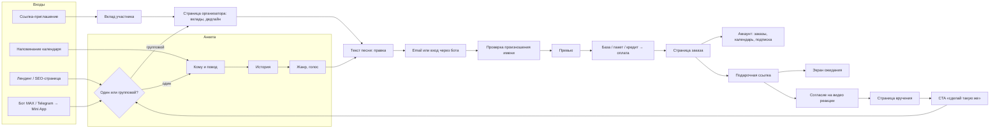
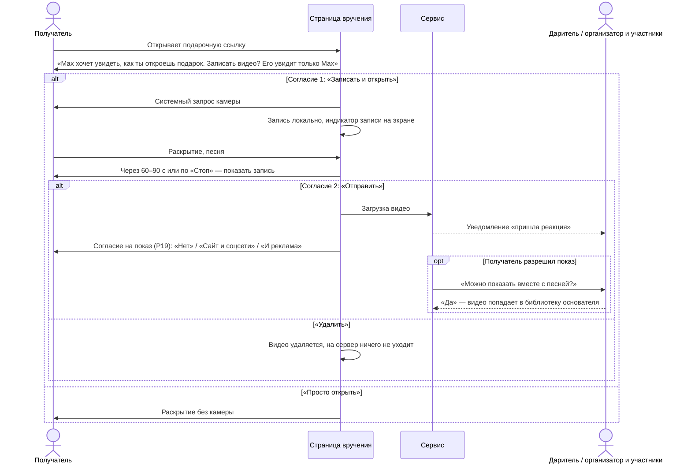
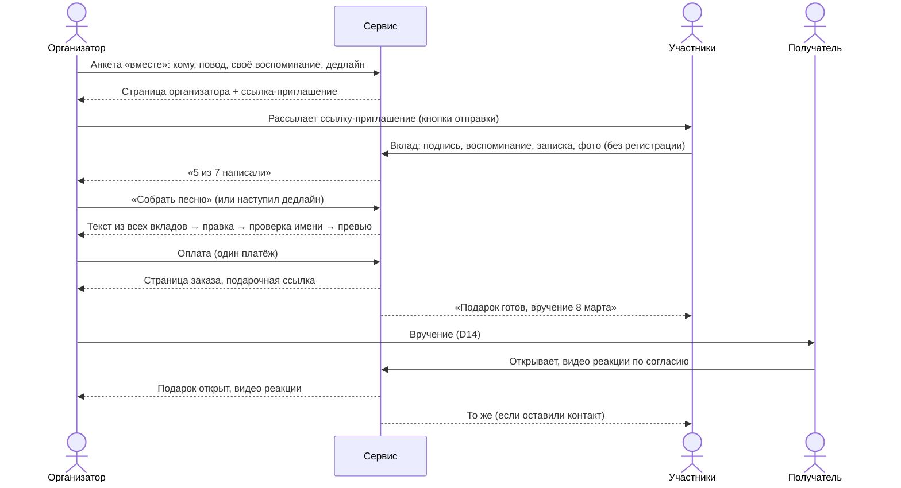
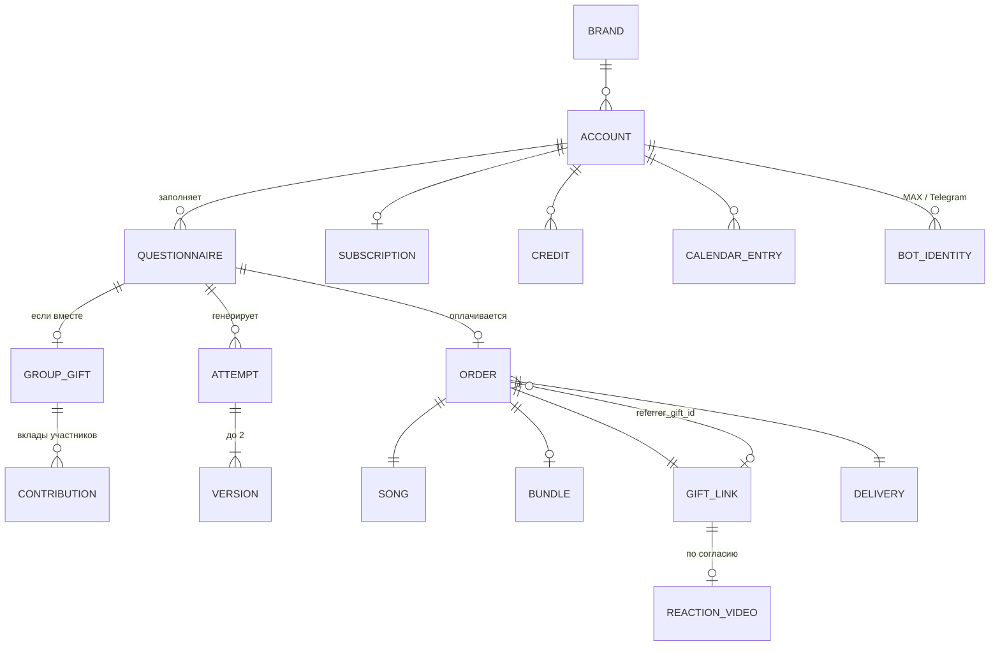
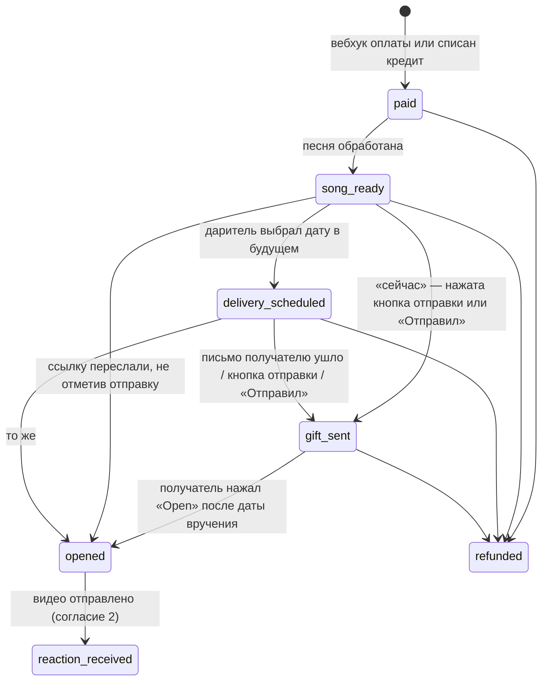
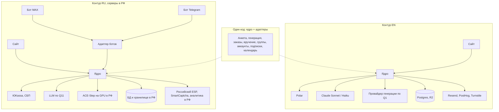

# 06. PRD: MVP песни-подарка

| | |
|---|---|
| Статус | **Черновик v0.3**, ждёт утверждения основателем (§15) |
| Дата | 2026-11-05, обновлён 2026-11-06 |
| Основа | [05-decisions.md](05-decisions.md) (D1–D19), цифры — [facts.md](facts.md), термины — [glossary.md](glossary.md) |
| Бренды | **EN** — рабочее название OpenYourSong (`openyoursong.com`); **RU** — откройпесню.рф или otkroipesnyu.ru. Рекомендации — [appendix/domains.md](appendix/domains.md), выбор — Q14 |
| Изменения v0.2 | По решениям основателя 05.11: RU-whitelabel с ботами MAX и Telegram, групповой подарок, подписки и аккаунты входят в MVP (D4, D7, D15, D17, D18); сроки не фиксируются (D19) |
| Изменения v0.3 | Пересчёт экономики (Q18, [04 §10](04-economics.md)): у помесячной подписки кредит — за каждые 3 оплаченных месяца (P13, P14); цель $300 с учётом контура RU (§2); риск контура RU (§14). Видео реакций с согласия — в маркетинг (P19, FR-11.6, FR-11.11–11.15) |

**Как читать.** PRD детализирует решения из 05 до уровня требований. Если PRD противоречит 05, facts или glossary, верны они ([README, иерархия](README.md)). Цифры повторяются из facts без изменений. Всё, что PRD добавляет сверх 05, собрано в §15 «Предложения на утверждение» (P1–P19): после утверждения они переносятся в 05 как новые D. Открытые вопросы ведутся только в [05 §6](05-decisions.md); здесь — ссылки на них.

**Приоритеты:** **M** — без этого MVP не запускается; **S** — желательно к запуску; **C** — после запуска. Сроков в PRD нет (D19): MVP — весь объём с приоритетом M. Требования нумеруются `FR-<раздел>.<номер>` по номеру раздела §6.

---

## 1. Кратко

Сервис превращает историю о близком человеке в персональную песню и вручает её как событие: в выбранную дату и время получатель открывает страницу вручения, видит раскрытие и слышит песню со своим именем, а даритель получает обратно видео реакции.

- **Даритель платит за вручение, а не за файл** (позиционирование C, D1). EN: база $29, пакет $49–59 (D2). Бесплатно до оплаты — превью 30–45 с с именем получателя (D3). Честно про AI (D5).
- **Два бренда на одном ядре.** EN — сайт для US, GB, CA, AU. RU — whitelabel: сайт плюс боты MAX и Telegram, ЮKassa и СБП, всё внутри контура РФ (D7, D15).
- **Групповой подарок:** несколько человек пишут историю вместе, платит организатор (D18).
- **Подписка «Календарь поводов»:** годовая и помесячная, с напоминаниями о поводах и кредитами на песни; для неё — аккаунты без паролей (D17).
- **Рост — органика и виральность** страницы вручения и группового подарка; платная реклама — только тест на $300 в EN (D11, D12). В Telegram платной рекламы нет (D15).

## 2. Цели и метрики успеха

### 2.1 Бизнес-цель

**≥ $300 в месяц чистыми.** Для EN без подписки и группового подарка это ≈ 13 заказов ≈ 480 целевых визитов в месяц при фиксированных расходах ~$85/мес ([facts §7](facts.md)). С групповым подарком и подпиской — ≈ 12 заказов ≈ 455 визитов. Контур RU до ~16 заказов в месяц убыточен (фикс ~$135/мес) и поднимает потребность EN до ~16.6 заказа и ~614 визитов ([04 §10](04-economics.md), Q18). Цель оцениваем по итогам первого сезонного пика после запуска ([05 §5](05-decisions.md)).

### 2.2 Продуктовые метрики

Метрики считаются по каждому бренду отдельно.

| Метрика | Цель | Как считаем | Источник цели |
|---|---|---|---|
| Визит → старт анкеты | 30% | `questionnaire_started` / визиты | facts §6 |
| Старт анкеты → превью | 60% | `preview_ready` / `questionnaire_started` | facts §6 |
| **Превью → оплата** | **15%** | `order_paid` / `preview_ready` | facts §6, главная метрика теста на $300 |
| Доля пакета | 25% | заказы с пакетом / все заказы | facts §6 |
| Возвраты | ≤ 4% | `refund_issued` / `order_paid` | facts §6 |
| **k-фактор** | 0.06 | заказы с `referrer_gift_id` / заказы | facts §6, главная метрика после запуска |
| Доля открытых подарков | ≥ 80% через 7 дней после вручения | `opened` / заказы с наступившей датой вручения | [E] |
| Доля открытых подарков с видео реакции | ≥ 20% | `reaction_received` / `opened` | [E] |
| Доля видео с разрешением на показ | замеряем | видео с `showcase_level` ≠ none и согласием дарителя / `reaction_received` | нет данных; от неё зависит контент для соцсетей (D11) |
| Доля групповых подарков | замеряем | групповые / все заказы | нет данных |
| Участников на групповой подарок | 5–15 | среднее число вкладов | economics-demand §5.2 [E] |
| Доля подписчиков среди плативших дарителей | 3% | активные подписки / плательщики за 12 мес. | economics-demand §5.1 [E] |
| Доля песен по кредитам | замеряем | `credit_redeemed` / все заказы | проверка каннибализации базы (§14) |
| Доля RU-заказов из ботов | замеряем | заказы с `sales_channel` = бот / заказы RU | нет данных |
| COGS на платный заказ | ≤ $5 (EN) | сумма затрат по заказу | facts §7 ($4.4) |
| Время до превью, p90 | ≤ 3 мин | от `preview_requested` до `preview_ready` | [E], проверяется в Q1 |

### 2.3 Тест на $300 (D12)

Пороги Kill / Base / Go — без изменений из [04-economics.md §6](04-economics.md). Ожидаемо ~265 визитов → ~80 анкет → ~48 превью → ~7 оплат. Только EN-бренд.

### 2.4 Не цели MVP

- Боты в EN-бренде, Telegram Stars (D15, D13).
- Платная реклама в Telegram (D15).
- Прямая отправка получателю в WhatsApp, SMS или ботом (D14).
- Физическая открытка, B2B (D4).
- Складчина в групповом подарке: платит только организатор (D18).
- Пароли: вход только по ссылке из письма или через бота.
- Ручная проверка песен человеком (D13).
- Языки кроме EN и RU — до Q3 (D6).
- Платный поиск (02 §1).

## 3. Пользователи и сценарии

| Кто | Ситуация | Что ему нужно от нас |
|---|---|---|
| **Даритель «в последний момент»** | Повод сегодня или завтра, сидит с телефона | Анкета за 3 минуты, превью, оплата и сразу подарочная ссылка («Я отправлю сам», вручение «сейчас») |
| **Даритель «планирует»** | Повод через 1–4 недели | Выбрать дату и время, чтобы письмо пришло само («Мы отправим») или напоминание пришло в нужный момент |
| **Даритель «на расстоянии»** | Не может быть рядом | Вручение в дату и время + видео реакции |
| **Организатор группового подарка** | Юбилей мамы, свадьба друга, 8 Марта в отделе | Собрать воспоминания от 5–15 человек без регистрации, не испортить сюрприз, заплатить один раз |
| **Участник** | Получил ссылку-приглашение в семейном чате | Написать пару строк за минуту, увидеть, что подарок открыт, и посмотреть видео реакции |
| **Подписчик** | 5–8 поводов в году (economics-demand §5.1) | Не забыть даты, получить напоминание заранее, платить за песню меньше |
| **RU-даритель в мессенджере** | Пришёл по ссылке на бота из MAX или Telegram | Пройти ту же анкету в Mini App, услышать превью в чате, оплатить по СБП, получать уведомления в боте |
| **Получатель** | Получил ссылку от знакомого человека | Открыть без регистрации, понять, что это подарок, а не спам; раскрытие, песня, скачивание; по желанию записать видео реакции; сделать такую же песню кому-то ещё |

Основной путь дарителя и получателя — схема в [05 §3a](05-decisions.md).

## 4. Объём MVP

| Блок | Пр. | Решение | Раздел |
|---|---|---|---|
| Лендинг и SEO-страницы обоих брендов | M | D11 | §6.1 |
| Анкета → текст песни → проверка имени → превью, две версии, лимиты | M | D3, D4 | §6.2–6.5 |
| Оплата: EN — Polar, RU — ЮKassa и СБП; база и пакет | M | D2, D10 | §6.6 |
| Страница заказа и подарочная ссылка | M | D16 | §6.7, §6.9 |
| Вручение: «Мы отправим» и «Я отправлю сам» | M | D14 | §6.8 |
| Экран ожидания, превью ссылки без спойлера | M | D16, Q12 | §6.9 |
| Страница вручения с раскрытием | M | D4 | §6.10 |
| Видео реакции с согласием получателя | M | D4, Q6 | §6.11 |
| Согласие на показ видео реакции в маркетинге, библиотека видео | M | D11, P19 | §6.11 |
| CTA «сделай такую же» с атрибуцией | M | D4 | §6.12 |
| PDF-открытка | M | D3 | §6.13 |
| Пакет: слайдшоу, принт текста, вторая версия | M | D2 | §6.14 |
| **Групповой подарок, платит организатор** | M | D18 | §6.15 |
| **Аккаунты, подписки (годовая и помесячная), календарь поводов** | M | D17 | §6.16 |
| **RU-whitelabel: контур в РФ, контент, оплата, генерация** | M | D7 | §6.17 |
| **Боты MAX и Telegram** | M | D15 | §6.18 |
| Записка дарителя | S | P8 | §6.10 |
| Страховочная автоотправка письма в «Я отправлю сам» | S | delivery-channels §4.2 | §6.8 |
| Доплата до пакета после оплаты | S | D2 | §6.6 |
| Публичные примеры песен с согласия (SEO) | C | 02 §7 | §16 |
| Ответ получателя текстом, если камера недоступна | C | — | §6.11 |

## 5. Карта экранов

---

## 6. Функциональные требования

### 6.1 Лендинг и SEO-страницы

Основа — [seo/top-pages-report.md §9.4–9.5](seo/top-pages-report.md) и [02 §7](02-seo-demand.md).

| ID | Требование | Пр. |
|---|---|---|
| FR-1.1 | Главная: ценность за 5 секунд («Песня с именем, которую вручают в нужный момент»), встроенный **пример песни** с плеером, видео раскрытия, цена базы видна сразу, CTA в анкету; блоки «Подарок от всей семьи» и «Календарь поводов» | M |
| FR-1.2 | EN: `/pricing` (база, пакет, подписки), `/how-it-works`, `/create`, `/group-gift`, `/faq` с явными фактами: цена, сроки, что получит получатель, что сделано с помощью AI (D5). Разметка FAQ и Product | M |
| FR-1.3 | EN: матрица `/occasions/{occasion}` и `/for/{relation}` — не меньше 6 поводов и 8 получателей на запуск, у каждой страницы свой текст и свой пример песни. `occasion` и `relation` из URL передаются в анкету | M |
| FR-1.4 | EN: варианты personalized (US/CA) и personalised (GB/AU), `hreflang` en-US / en-GB | M |
| FR-1.5 | EN: `/birthday-song-with-name` с реальным аудиопримером; программатик по именам — после Q7 | S |
| FR-1.6 | EN: сравнения `/vs/songfinch`, `/songfinch-alternatives`, «how much does a custom song cost» | S |
| FR-1.7 | RU: матрица по образцу pesinka — `/podarok/{komu}-na-{povod}`, `/povod/*`, `/komu/*`, URL латиницей; страницы 8 Марта, 23 Февраля, юбилей, свадьба, «песня маме / мужу / жене»; кластер «песня с именем» | M |
| FR-1.8 | Не публикуем пустые языковые разделы, блоги «синонимов happy birthday», массовые машинные переводы (02 §7, D6) | M |
| FR-1.9 | Подарочные ссылки, страницы заказа, вручения, организатора и участника — `noindex`, вне sitemap | M |

### 6.2 Анкета

| ID | Требование | Пр. |
|---|---|---|
| FR-2.1 | Первый вопрос: «Дарите сами или вместе?» — один даритель или групповой подарок (§6.15) | M |
| FR-2.2 | «Кому и зачем»: имя получателя (до 40 символов), кем приходится (12 вариантов + «другое»), повод (10 вариантов + «просто так»), имя дарителя для подписи. Списки поводов, получателей и жанров — из конфигурации бренда (EN: Valentine's, Mother's Day…; RU: 8 Марта, 23 Февраля, юбилей, Новый год…) | M |
| FR-2.3 | «История»: свободный текст 50–1 500 символов с подсказками-чипами (как познакомились, что любит, общая шутка, любимая фраза, чем гордитесь) | M |
| FR-2.4 | «Звук»: 8–10 жанров по бренду (EN: pop, acoustic, ballad, country, R&B, rock, hip-hop, jazz, kids; RU: поп, баллада, шансон, рок, рэп, диско 80-х, акустика, детская), настроение, голос (мужской / женский). У каждого жанра — пример 10 с | M |
| FR-2.5 | Без регистрации до оплаты. Прогресс сохраняется в браузере (в Mini App — тоже) | M |
| FR-2.6 | Анкета заполняется за ≤ 3 минуты на телефоне (проверяем на 5 людях до запуска) | M |
| FR-2.7 | Язык песни = язык бренда: EN-бренд — английский, RU-бренд — русский (P10) | M |
| FR-2.8 | Из напоминания календаря анкета открывается с заполненными получателем, кем приходится и поводом | M |
| FR-2.9 | `occasion`, `relation`, UTM и источник бота (`start`-параметр) подставляются из входа | M |

### 6.3 Текст песни

| ID | Требование | Пр. |
|---|---|---|
| FR-3.1 | EN: текст пишет Claude Sonnet 5.5 (D9) за ≤ 20 с. RU: модель без зарубежных API (D7), выбор — тестом в Q11. Модель задаётся конфигурацией бренда | M |
| FR-3.2 | Структура: куплет — припев — куплет — припев (бридж по жанру), длина под песню 2–2.5 мин. Имя получателя звучит в первых 30 секундах (чтобы попасть в превью) | M |
| FR-3.3 | Даритель правит текст по секциям; «Переписать» с пожеланием («смешнее», «добавь про собаку») — новый текст без генерации музыки, до 10 раз на анкету | M |
| FR-3.4 | Для группового подарка текст собирается из всех вкладов: самые яркие детали в куплетах, общий образ в припеве. Имена участников в песне не обязательны — они есть на странице вручения | M |
| FR-3.5 | Промпт запрещает: имена реальных артистов и «в стиле X», цитаты чужих песен, оскорбления получателя, сексуальный контент. Правки проходят модерацию (§6.21) | M |

### 6.4 Проверка произношения имени

| ID | Требование | Пр. |
|---|---|---|
| FR-4.1 | До оплаты даритель слышит, как выбранный провайдер генерации поёт имя получателя выбранным голосом | M |
| FR-4.2 | Кнопки «Звучит правильно» / «Исправить»; «Исправить» открывает поле **фонетического написания** с примерами | M |
| FR-4.3 | В данных два поля: `name_display` (в тексте песни на странице вручения, письмах, превью ссылки) и `name_phonetic` (что получает провайдер генерации) | M |
| FR-4.4 | Реализация по Q1: (а) отдельный фрагмент ~10 с с именем, если провайдер делает его дёшево и звучание совпадает с песней; (б) иначе — кнопка «Имя звучит не так?» под превью. Исправление имени даёт одну попытку сверх лимита | M |

### 6.5 Генерация, превью и версии

| ID | Требование | Пр. |
|---|---|---|
| FR-5.1 | Email дарителя запрашиваем после текста и до генерации музыки (P12). В ботах вместо email — аккаунт мессенджера. Согласие на маркетинговую рассылку — отдельный чекбокс, выключен по умолчанию | M |
| FR-5.2 | Провайдер генерации задаётся конфигурацией бренда (`music_provider`): EN — по итогам Q1 и Q2 (D8); RU — ACE-Step на российском GPU (D7). Код работает через общий интерфейс | M |
| FR-5.3 | **Превью и песня — одна запись.** Генерируем полную версию, до оплаты в браузер или чат уходит только фрагмент 30–45 с с именем (начало песни, затухание, 96–128 kbps) | M |
| FR-5.4 | Попытка = текст + до 2 версий; вторая версия — по клику «Послушать другой вариант» | M |
| FR-5.5 | Экран ожидания генерации с прогрессом; если дольше 5 минут — письмо или сообщение бота со ссылкой на превью | M |
| FR-5.6 | Лимиты (P2): до оплаты — 3 попытки на анкету + 1 за исправление имени; после оплаты — ещё 2 до открытия подарка | M |
| FR-5.7 | Ошибка провайдера: 1 автоматический повтор; затем запасной провайдер (если настроен) или «Пришлём, когда будет готово» и алерт основателю | M (повтор), S (запасной) |
| FR-5.8 | Неоплаченные попытки удаляются через 30 дней (04 §7) | M |
| FR-5.9 | Песня после оплаты: MP3 не ниже 256 kbps, нормализация громкости, метаданные («for Anna from Max» / «from Kate & family») | M |

### 6.6 Оплата, цены и пакет

| ID | Требование | Пр. |
|---|---|---|
| FR-6.1 | Экран выбора после превью: **база** и **пакет** со списком, что входит (D2, D3). EN: $29 / $55 (P1); RU: 790 ₽ / 1 490 ₽ (P14). У подписчика с кредитом — кнопка «Оплатить кредитом»; без кредитов — цена для подписчика (P13) | M |
| FR-6.2 | EN: Polar (D10), встроенный checkout, если поддерживается (Q16); цены в USD, местные валюты — по Q16 | M |
| FR-6.3 | RU: ЮKassa, карты и СБП, чек 54-ФЗ на email или телефон. В Mini App — тот же платёжный экран | M |
| FR-6.4 | Заказ создаётся только по вебхуку платёжного провайдера; обработка идемпотентна; после оплаты — страница заказа и письмо (или сообщение бота) со ссылкой на неё | M |
| FR-6.5 | Доплата до пакета на странице заказа: даритель платит разницу (Q16 для Polar) | S |
| FR-6.6 | Возвраты — по P3, через платёжного провайдера; после возврата подарочная ссылка и страница заказа отключаются | M |
| FR-6.7 | Промокоды основателя (для знакомых и инфлюенсеров) | S |
| FR-6.8 | Себестоимость каждого заказа (генерация, рендер, письма, комиссия) пишется в базу | M |

### 6.7 Страница заказа

Только для дарителя или организатора (D16). Открывается по секретной ссылке (≥ 128 бит случайности) или из аккаунта.

| ID | Требование | Пр. |
|---|---|---|
| FR-7.1 | Первый блок — «Когда и как вручить»: способ вручения, дата и время, часовой пояс получателя (§6.8) | M |
| FR-7.2 | Блок отправки: подарочная ссылка, кнопки отправки, QR, PDF-открытка | M |
| FR-7.3 | Песня, MP3, текст; для пакета — вторая версия, слайдшоу, принт текста | M |
| FR-7.4 | Статус заказа по шагам (§8.2) | M |
| FR-7.5 | «Посмотреть, как увидит получатель» — режим просмотра: не считается открытием, камеру не запрашивает | M |
| FR-7.6 | Видео реакции: плеер, скачивание, удаление | M |
| FR-7.7 | Правка текста и перегенерация до открытия подарка (в пределах FR-5.6) | S |
| FR-7.8 | «Напомнить в следующем году» (P15) и предложение подписки | M |
| FR-7.9 | «Сделать ещё одну песню» — анкета с заполненным дарителем | M |
| FR-7.10 | Устройство со страницей заказа помечается cookie, чтобы открытие подарочной ссылки дарителем не засчитывалось как «подарок открыт» | M |

### 6.8 Вручение (D14)

| ID | Требование | Пр. |
|---|---|---|
| FR-8.1 | Два способа: **«Мы отправим»** (`auto_email`) и **«Я отправлю сам»** (`self_send`). Выбор и дата — на странице заказа после оплаты, меняются до даты вручения | M |
| FR-8.2 | По умолчанию (P9) — «Я отправлю сам», вручение «сейчас»: подарочная ссылка работает сразу | M |
| FR-8.3 | Дата и время вручения хранятся с часовым поясом получателя (`delivery_at` + `delivery_tz`); по умолчанию — пояс браузера дарителя, выбор — поиском по городу; максимум 365 дней вперёд | M |
| FR-8.4 | «Мы отправим»: email получателя обязателен; письмо уходит в дату и время вручения, но с 08:00 до 21:00 по поясу получателя; «сейчас» — сразу (P9). Отправитель «Max via <бренд>», нейтральная тема («Max sent you a gift 🎁»), кнопка «Open your gift», без текста песни | M |
| FR-8.5 | «Я отправлю сам»: напоминание дарителю за 10 минут и в момент вручения — письмом, в RU также сообщением бота, если даритель пришёл из бота. Ведёт на блок отправки. Через 2 часа без отметки «Отправил» — повторное напоминание | M |
| FR-8.6 | Страховка: если даритель указал email получателя, а через 2 часа подарок не открыт и не отмечен как отправленный — письмо получателю (delivery-channels §4.2) | S |
| FR-8.7 | Кнопки отправки — набор из конфигурации бренда. EN: WhatsApp (`wa.me/?text=`), SMS/iMessage (`sms:?&body=`), Telegram (`t.me/share/url`), «Поделиться» (`navigator.share`), «Копировать ссылку», QR. RU (P18): MAX (через «Поделиться», пока нет share-ссылки — Q13), Telegram, VK, SMS, «Копировать», QR; WhatsApp выключен (заблокирован в РФ, facts §8). Текст сообщения без спойлера, даритель может его изменить | M |
| FR-8.8 | Подсказка: «Хотите ровно в полночь? Запланируйте в iMessage (Send Later) или Telegram» с готовым текстом | M |
| FR-8.9 | Свой планировщик (Resend планирует не дальше 30 дней, facts §8): проверка каждую минуту, точность ±2 мин, повторы при ошибке, идемпотентность | M |
| FR-8.10 | Email получателя удаляется через 30 дней после вручения (P6); телефоны получателей не собираем | M |

### 6.9 Подарочная ссылка, превью ссылки, экран ожидания (D16, Q12)

| ID | Требование | Пр. |
|---|---|---|
| FR-9.1 | Формат `https://<домен>/g/{имя}-{код}`: код 10 символов base32 (~50 бит) + ограничение частоты запросов; собственный домен, без сокращателей | M |
| FR-9.2 | OG-превью: картинка 1200×630 — обложка с надписью «A gift for Anna from Max» (группа: «from Kate & family»); нейтральный заголовок; без текста и названия песни; без `og:audio` и `og:video` до проверки Q12 | M |
| FR-9.3 | Запросы ботов превью (WhatsApp, Telegram, iMessage, Slack, facebookexternalhit, Twitterbot, VK, MAX и др.) не считаются открытием. «Подарок открыт» = нажато «Open» после даты вручения | M |
| FR-9.4 | До даты вручения — **экран ожидания**: обложка, от кого, таймер и «Opens February 14 at 9:00 AM» в поясе вручения. Песня, текст и записки в браузер не загружаются | M |
| FR-9.5 | «Добавить в календарь» (.ics) на экране ожидания | C |
| FR-9.6 | Ссылка работает не меньше 3 лет (P4); даритель может её отключить | M |
| FR-9.7 | Проверка на устройствах до запуска (Q12): iMessage, WhatsApp, Telegram, MAX, VK, Gmail, Apple Mail, Outlook, Яндекс Почта; iOS и Android | M |

### 6.10 Страница вручения

| ID | Требование | Пр. |
|---|---|---|
| FR-10.1 | Первый экран: «Max made you something» (группа: «Kate, Dad, Tom and 4 others made you something»), обложка, кнопка «Open». Нажатие запускает раскрытие и звук | M |
| FR-10.2 | Перед раскрытием — предложение записать видео реакции (§6.11); отказ не мешает открыть подарок | M |
| FR-10.3 | Раскрытие: анимация 2–4 с, затем песня | M |
| FR-10.4 | Во время песни: обложка, текст песни (`name_display`), плеер с перемоткой | M |
| FR-10.5 | Записка дарителя (до 300 символов) после раскрытия; в групповом подарке — записки участников каруселью | S (один), M (группа) |
| FR-10.6 | Скачивание MP3; для пакета — вторая версия и слайдшоу | M |
| FR-10.7 | После песни: «Поделиться песней» и CTA «сделай такую же» | M |
| FR-10.8 | Подпись «Made with AI + Max's story» и ссылка «Как это сделано» (D5) | M |
| FR-10.9 | Работает во встроенных браузерах WhatsApp, Instagram, Telegram, MAX, VK, Facebook, Gmail; LCP первого экрана ≤ 2.5 с на 4G | M |
| FR-10.10 | Синхронная подсветка строк (караоке) | C, зависит от Q1 |

### 6.11 Видео реакции (решение по Q6)

| ID | Требование | Пр. |
|---|---|---|
| FR-11.1 | **Два согласия:** до включения камеры (с текстом, кто увидит видео) и после записи («Отправить» / «Удалить»). До второго согласия видео не покидает устройство | M |
| FR-11.2 | В групповом подарке текст согласия называет круг зрителей: «Видео увидят Kate и ещё 6 участников подарка». Участники видят видео только если оставили email или пришли из бота | M |
| FR-11.3 | Запись: фронтальная камера и микрофон, до 90 с, 720p, MediaRecorder (iOS Safari 14.5+, Chromium); индикатор и «Стоп» видны всегда | M |
| FR-11.4 | Если камера недоступна — подарок открывается без записи; подсказка «Откройте в браузере, чтобы записать видео реакции» | M |
| FR-11.5 | Загрузка возобновляемая, до 50 МБ; видео приватное, только по подписанной ссылке. В боты отправляем ссылку, а не файл (ограничения Bot API, facts §8) | M |
| FR-11.6 | По умолчанию видео приватное: не индексируется и не используется в маркетинге. Показ другим людям — только по отдельным согласиям FR-11.11–11.15 (P19) | M |
| FR-11.7 | Отзыв согласия: «Удалить моё видео» на странице вручения (то же устройство) и адрес поддержки; удаление ≤ 72 часов | M |
| FR-11.8 | Хранение 12 месяцев; за 14 дней — уведомление «скачайте видео» (P5) | M |
| FR-11.9 | Возраст: «Мне 16 или больше, или рядом мой родитель»; для детских поводов и получателей — формулировка для родителя. Финальный текст — после Q17 | M |
| FR-11.10 | Ответ получателя текстом, если запись не сделана | C |
| FR-11.11 | **Согласие на показ** (P19) — отдельный экран после «Отправить», не раньше: «Можно показать ваше видео другим людям?» Три ответа: «Нет» (по умолчанию выделено), «Да, на сайте и в соцсетях бренда», «Да, и в рекламе». Отказ ничего не меняет в подарке: видео всё равно уходит дарителю | M |
| FR-11.12 | Согласие на показ даёт только человек в кадре и только 18+: «Мне 18 или больше, и все в кадре согласны». Если повод или получатель детский (FR-11.9) — экран не показываем | M |
| FR-11.13 | **Согласие дарителя:** в песне его история и имена, поэтому после «Да» получателя на странице заказа (и в боте) дарителю приходит вопрос «Получатель разрешил показать видео. Можно показать вместе с песней?» Без «Да» дарителя видео в маркетинг не идёт. В групповом подарке отвечает организатор | M |
| FR-11.14 | **Отзыв:** «Убрать моё видео из публикаций» — на странице вручения, по ссылке из письма-подтверждения и через поддержку. Срок: убираем со страниц сайта и из своих постов, останавливаем рекламу — ≤ 7 дней. Текст согласия честно говорит, что копии, которые другие люди уже сохранили или переслали, мы удалить не можем | M |
| FR-11.15 | **Библиотека видео** на внутренней странице основателя: только видео с обоими согласиями, уровень (`site_social` / `ads`), дата и текст согласий, отметки «опубликовано где». Видео из библиотеки хранится до отзыва согласия, а не 12 месяцев (FR-11.8). Поощрение за согласие — только если подарок без согласия ничем не хуже; в рекламе в US такие видео помечаем как поощрённые (FTC). Тексты согласий — Q17 | M |

### 6.12 CTA «сделай такую же» и атрибуция

| ID | Требование | Пр. |
|---|---|---|
| FR-12.1 | CTA после окончания песни и внизу страницы вручения, а также на странице участника группового подарка | M |
| FR-12.2 | Ссылка CTA несёт `ref=<gift_id>`; первый источник хранится 30 дней; заказ сохраняет `referrer_gift_id` | M |
| FR-12.3 | Считаем зрителей подарочной ссылки — для проверки допущения «4 зрителя на страницу» (economics-demand §5.2) | M |
| FR-12.4 | Поощрение получателю (скидка на первую песню) — эксперимент после запуска | C |

### 6.13 PDF-открытка

| ID | Требование | Пр. |
|---|---|---|
| FR-13.1 | PDF для печати на A4 и US Letter: обложка, «For Anna, from Max», QR на подарочную ссылку, без текста песни | M |
| FR-13.2 | Генерируется на сервере из HTML-шаблона; доступна на странице заказа при любом способе вручения (D14) | M |

### 6.14 Пакет (D2)

| ID | Требование | Пр. |
|---|---|---|
| FR-14.1 | **Слайдшоу:** 5–20 фото, видео 1080p под длину песни за ≤ 10 минут (Remotion Lambda, ~$0.04–0.06 за видео, economics-costs §b; в RU — рендер внутри контура РФ). На странице заказа и на странице вручения | M |
| FR-14.2 | В групповом подарке фото для слайдшоу могут загружать участники; организатор отбирает | M |
| FR-14.3 | **Принт текста:** PDF-постер (A4, US Letter), текст, имя, дата, QR | M |
| FR-14.4 | **Вторая версия** в полном качестве: MP3 и на странице вручения | M |
| FR-14.5 | Если фото нет за 2 дня до вручения — напоминание; если нет к дате — слайдшоу не показывается | M |

### 6.15 Групповой подарок (D18)

| ID | Требование | Пр. |
|---|---|---|
| FR-15.1 | Организатор проходит те же шаги анкеты, пишет своё воспоминание и задаёт дедлайн сбора: по умолчанию 3 дня, максимум 30 (P17) | M |
| FR-15.2 | **Ссылка-приглашение** `/join/{код}`: открывается без регистрации, показывает, для кого подарок и от кого приглашение, предупреждает «Это сюрприз — не пересылайте получателю». Песня и текст не видны | M |
| FR-15.3 | **Вклад участника:** подпись (обязательно), воспоминание до 500 символов, записка получателю до 200 символов (на странице вручения), фото для слайдшоу (если организатор выбрал пакет или собирается), email — необязательно, только для уведомлений об этом подарке. Каждый вклад проходит модерацию | M |
| FR-15.4 | До 20 участников (P17). После отправки вклада участник получает свою **страницу участника** (секретная ссылка): статус подарка, позже — «подарок открыт» и видео реакции (FR-11.2), CTA «сделай такую же» | M |
| FR-15.5 | **Страница организатора:** список вкладов, скрыть или поправить вклад, напомнить участникам (кнопки отправки с готовым текстом), «Собрать песню» — доступно при ≥ 1 вкладе кроме своего; по дедлайну — письмо организатору «пора собирать» | M |
| FR-15.6 | Дальше — обычный путь: текст из всех вкладов (FR-3.4), проверка имени, превью, оплата одним платежом организатора; цены те же, что у одиночного подарка (P17) | M |
| FR-15.7 | Страница вручения: «From Kate, Dad, Tom and 4 others», записки участников после песни (FR-10.5) | M |
| FR-15.8 | Уведомления участникам с контактом: подарок оплачен и запланирован, подарок открыт, пришла реакция | M |
| FR-15.9 | В RU-ботах: «Создать групповой подарок» и «Пригласить участников»; ссылка-приглашение может вести в Mini App (`start=join_<код>`) | M |
| FR-15.10 | Складчина — после MVP (D18) | — |

### 6.16 Аккаунты, подписки и календарь поводов (D17)

| ID | Требование | Пр. |
|---|---|---|
| FR-16.1 | **Аккаунт** создаётся автоматически при первой оплате или подписке по email дарителя; в боте — по аккаунту мессенджера (связывается с email при наличии). Вход — ссылкой из письма (действует 15 минут) или через бота; сессия 90 дней; паролей нет (P16) | M |
| FR-16.2 | В аккаунте: заказы и групповые подарки, календарь поводов, подписка и кредиты, отписка от рассылок, удаление аккаунта и данных | M |
| FR-16.3 | «Потеряли ссылку?» — письмо со ссылкой входа; секретные ссылки страниц заказа продолжают работать | M |
| FR-16.4 | **Подписки** (P13, P14): **годовая** — календарь + кредиты на год сразу; **помесячная** — календарь + кредит за каждые 3 оплаченных месяца (первый — при третьем платеже). Обе — цена для подписчика на песни сверх кредитов. Кредит = база; пакет — доплата обычной разницы | M |
| FR-16.5 | Кредиты действуют 12 месяцев; у помесячной копится не больше 3. За 14 дней до сгорания — напоминание | M |
| FR-16.6 | Оплата подписок: EN — подписки Polar; RU — автоплатежи ЮKassa (Q11, Q19). Управление способом оплаты — через портал провайдера | M |
| FR-16.7 | **Отмена в один клик** в аккаунте и в боте, действует до конца оплаченного периода. Никаких скрытых автоподписок на пробном периоде (антипример lyricgift, 03 §2) | M |
| FR-16.8 | Напоминание о продлении: годовая — за 30 и за 7 дней, помесячная в RU — за 3 дня; точные требования — Q17 | M |
| FR-16.9 | **Календарь поводов:** запись = человек (имя, кем приходится) + повод + дата (день и месяц, год необязателен). Подсказки из прошлых заказов. Напоминания за 14 и за 3 дня — письмом, в RU также ботом; кнопка ведёт в анкету с заполненными полями (FR-2.8) | M |
| FR-16.10 | Без подписки: после заказа — «Напомнить в следующем году» об этом поводе (одна запись, бесплатно, P15); в напоминании — предложение подписки | M |
| FR-16.11 | Где продаём подписку: `/pricing`, страница заказа после оплаты, напоминание календаря, экран выбора базы и пакета («Подписчикам песня дешевле») | M |

### 6.17 RU-whitelabel (D7)

| ID | Требование | Пр. |
|---|---|---|
| FR-17.1 | **Отдельный контур в РФ** из того же кода: база данных, файловое хранилище, генерация (ACE-Step на российском GPU), рендер слайдшоу — на серверах в РФ (152-ФЗ, локализация) | M |
| FR-17.2 | **Без зарубежных API с персональными данными** (D7): текст песни и модерация — модель из Q11; почта — российский ESP (Q13); капча — Yandex SmartCaptcha; аналитика и ошибки — внутри контура РФ (Яндекс Метрика или self-hosted) | M |
| FR-17.3 | Каждый внешний сервис подключается через адаптер, выбранный в конфигурации бренда: платежи, почта, LLM, провайдер генерации, капча, аналитика, хранилище, мессенджеры | M |
| FR-17.4 | Оплата: ИП + ЮKassa, карты и СБП, чеки 54-ФЗ, автоплатежи для подписок (Q19) | M |
| FR-17.5 | Цены в рублях (P14); контент, поводы, жанры, SEO-страницы — по-русски (FR-1.7, FR-2.2, FR-2.4) | M |
| FR-17.6 | Юридические документы: оферта, политика обработки ПДн, отдельное согласие на обработку ПДн, реквизиты ИП (Q17, Q19) | M |
| FR-17.7 | Качество русского вокала и произношения имён проверяется до запуска RU (Q11) | M |

### 6.18 Боты MAX и Telegram (D15)

Боты — второй вход в RU-воронку. Получателю бот ничего не отправляет.

| ID | Требование | Пр. |
|---|---|---|
| FR-18.1 | Один **адаптер** (`bot_adapter`) для MAX и Telegram: отправка сообщений и аудио, кнопки, deep links, проверка подлинности пользователя Mini App. Логика ботов общая | M |
| FR-18.2 | Deep link `start=<источник>` пишет источник трафика; `start=join_<код>` открывает вклад в групповой подарок; `start=order_<id>` — страницу заказа | M |
| FR-18.3 | Анкета, страница заказа, аккаунт и оплата — в **Mini App** (тот же веб-код RU-бренда). Пользователь Mini App автоматически входит в аккаунт | M |
| FR-18.4 | Превью приходит в чат аудиосообщением (фрагмент 30–45 с) с кнопками «Оплатить» и «Другой вариант» | M |
| FR-18.5 | Оплата — ЮKassa/СБП в Mini App с чеком 54-ФЗ. Telegram Stars не используем; нарушение правил Telegram принимаем осознанно (D15) | M |
| FR-18.6 | Уведомления дарителю в боте: песня готова, пора отправить подарок, подарок открыт, пришла реакция (ссылкой), напоминания календаря, новый вклад и дедлайн группового подарка, продление подписки | M |
| FR-18.7 | Кнопка «Переслать подарок»: Telegram — `t.me/share/url` и inline-режим с карточкой подарка; MAX — по итогам Q13, иначе «Копировать ссылку» | M |
| FR-18.8 | Команды: `/start`, `/new` (новая песня), `/orders`, `/calendar`, `/subscription`, `/help` | M |
| FR-18.9 | Бот MAX регистрируется на ИП и проходит модерацию (до 48 ч, facts §8; Q19). Платной рекламы в Telegram нет (D15) | M |
| FR-18.10 | Лимиты бесплатных попыток действуют и на аккаунт мессенджера (§6.22) | M |

### 6.19 Письма и уведомления

Письма — с собственного домена бренда (SPF, DKIM, DMARC): EN — Resend (Free 3k писем в месяц, facts §8), RU — российский ESP. Если даритель пришёл из бота, уведомления дублируются в бот. Все сообщения транзакционные; получателю — только письмо вручения.

| Сообщение | Кому | Когда | Пр. |
|---|---|---|---|
| Превью готово | Даритель | Генерация завершилась, вкладка закрыта | M |
| Заказ оплачен: ссылка на страницу заказа | Даритель | Вебхук оплаты | M |
| Подарок для вас | Получатель | Дата и время вручения, «Мы отправим» | M |
| Пора отправить подарок / повторное напоминание | Даритель | За 10 мин и в момент вручения / через 2 ч | M |
| Подарок открыт | Даритель, участники | Первое открытие | M |
| Пришла реакция | Даритель, участники | Видео загружено | M |
| Загрузите фото | Даритель с пакетом | Через 24 ч после оплаты и за 2 дня до вручения | M |
| Новый вклад / дедлайн сбора | Организатор | Вклад добавлен / дедлайн наступил | M |
| Подарок оплачен и запланирован | Участники | После оплаты организатором | M |
| Напоминание календаря | Подписчик / даритель с «Напомнить в следующем году» | За 14 и 3 дня до повода | M |
| Продление подписки / кредиты сгорают | Подписчик | FR-16.5, FR-16.8 | M |
| Ссылка для входа | Даритель | По запросу | M |
| Видео реакции скоро удалится | Даритель | За 14 дней | M |
| Оставьте отзыв | Даритель | Через 2 дня после открытия | C |

### 6.20 Поддержка и возвраты

| ID | Требование | Пр. |
|---|---|---|
| FR-20.1 | Поддержка по email (в RU — также в боте), ответ в течение 24 часов, AI-черновики ответов | M |
| FR-20.2 | Возвраты за песню (P3): до 2 бесплатных перегенераций, затем полный возврат в течение 14 дней после оплаты, пока подарок не открыт | M |
| FR-20.3 | Возврат подписки (P3): в течение 14 дней, если не использован ни один кредит; иначе — отмена продления без возврата | M |
| FR-20.4 | Внутренняя страница основателя: поиск по email или аккаунту мессенджера, перегенерация, возврат, отключение подарочной ссылки, удаление видео и аккаунта, начисление кредитов | M |

### 6.21 Модерация и контент

| ID | Требование | Пр. |
|---|---|---|
| FR-21.1 | Анкета, вклады участников и текст песни (включая правки) проходят модерацию до генерации музыки: EN — Claude Haiku 5.5 (D9), RU — модель из Q11 | M |
| FR-21.2 | Блокируем: сексуальный контент, сексуализацию несовершеннолетних, ненависть, угрозы, травлю получателя, призывы к насилию. Отказ — с причиной и предложением переписать | M |
| FR-21.3 | Не используем имена реальных артистов и «в стиле X»; не воспроизводим тексты существующих песен | M |
| FR-21.4 | Песни для публичных людей — отказ | S |
| FR-21.5 | «Пожаловаться» на странице вручения | S |

### 6.22 Защита от злоупотреблений и контроль затрат

| ID | Требование | Пр. |
|---|---|---|
| FR-22.1 | Капча перед генерацией превью: EN — Cloudflare Turnstile, RU — Yandex SmartCaptcha; в Mini App — проверка подлинности пользователя мессенджера | M |
| FR-22.2 | Лимиты неоплаченных попыток: 5 в сутки на email или аккаунт мессенджера, 8 на IP, 5 на устройство | M |
| FR-22.3 | **Дневной лимит расходов** на генерацию — свой у каждого бренда (по умолчанию $15 в сутки для EN): при 80% — алерт, при 100% — бесплатные превью ждут следующих суток, оплаченные заказы, кредиты и групповые подарки после оплаты обслуживаются всегда | M |
| FR-22.4 | Одноразовые email-домены блокируются | S |

---

## 7. Нефункциональные требования

| Область | Требование |
|---|---|
| **Устройства** | Mobile-first. iOS Safari 16+, Chrome Android (2 последние версии), evergreen-десктоп; Mini App в Telegram и MAX; встроенные браузеры мессенджеров — для страницы вручения обязательно |
| **Скорость** | Лендинг и страница вручения: LCP ≤ 2.5 с на 4G, первый экран ≤ 300 КБ без аудио |
| **Надёжность** | Вручение — критичный путь: повторы и алерты, сбой письма получателю виден основателю за ≤ 15 минут. Вебхуки оплат идемпотентны, сверка с провайдером раз в сутки. Продления подписок и начисления кредитов — идемпотентны |
| **Безопасность** | Секретные ссылки страниц заказа, организатора и участника ≥ 128 бит; подарочная ссылка ~50 бит + ограничение частоты; ссылки входа одноразовые, 15 минут; приватные файлы — по подписанным ссылкам; ключи провайдеров только на сервере |
| **Приватность** | Минимум данных о получателе: имя, история (её пишет даритель), email только для «Мы отправим» (удаляется через 30 дней), видео реакции только с двумя согласиями. Контакты участников — только для уведомлений об их подарке. Политика описывает обработку данных третьих лиц (получателя и участников). Для EN — DPA с обработчиками; для RU — всё внутри контура РФ (FR-17.1, FR-17.2) |
| **Cookies** | EN: аналитика без cookies (PostHog cookieless); Meta Pixel для теста на $300 — после согласия в GB (P11). RU: баннер о cookies и согласие по 152-ФЗ |
| **Доступность** | WCAG 2.1 AA для анкеты, вклада участника и страницы вручения |
| **i18n** | Все строки интерфейса, писем и ботов — в каталогах сообщений (ICU), даты и время — через локаль. Локали: en-US, en-GB, ru-RU (D6) |
| **Whitelabel** | Всё, что отличается между брендами, — в конфигурации бренда: домен, название, логотип, цвета, языки, валюта, цены, платёжный провайдер, провайдер генерации, LLM, почта, капча, аналитика, хранилище, набор кнопок отправки, каналы продаж, юридические страницы (D7, FR-17.3). Один код, два развёртывания |
| **Наблюдаемость** | Ошибки и алерты основателю в обоих контурах: сбой генерации, вебхука, вручения, продления подписки, бота; дневной лимит расходов |
| **Хранение** | Песни и подарочные ссылки ≥ 3 лет (P4); неоплаченные попытки 30 дней; видео реакции 12 месяцев (P5); незавершённые групповые подарки без оплаты — 60 дней после дедлайна |

## 8. Данные

### 8.1 Модель данных

Расширяет черновик [glossary §9](glossary.md).

| Сущность | Ключевые поля |
|---|---|
| `brand` | `domain`, `locales`, `currency`, `prices`, `payment_provider`, `music_provider`, `llm_provider`, `email_provider`, `captcha_provider`, `analytics_provider`, `share_buttons`, `sales_channels`, `legal_entity` |
| `account` | `email`, `display_name`, `marketing_opt_in`, `created_at`, `deleted_at` |
| `bot_identity` | `account_id`, `messenger` (max / telegram), `messenger_user_id`, `chat_id` |
| `subscription` | `plan` (annual / monthly), `status`, `provider_subscription_id`, `current_period_end`, `cancel_at_period_end` |
| `credit` | `source` (annual / monthly_renewal / manual), `expires_at`, `redeemed_order_id` |
| `calendar_entry` | `person_name`, `relation`, `occasion`, `day`, `month`, `year?`, `reminders_on`, `source_order_id` |
| `questionnaire` | `kind` (solo / group), `status` (draft / collecting / lyrics / preview / paid), `recipient_name_display`, `recipient_name_phonetic`, `relation`, `occasion`, `story`, `genre`, `mood`, `voice`, `language`, `gifter_note`, `utm_*`, `bot_start`, `referrer_gift_id`, `sales_channel` |
| `group_gift` | `invite_code`, `collect_until`, `max_contributors`, `organizer_page_token` |
| `contribution` | `signature`, `memory`, `note_to_recipient`, `photos[]`, `contact` (email или bot_identity), `hidden`, `participant_page_token` |
| `attempt` / `version` | `lyrics`, `music_provider`, `seed`, `cost`, `audio_full_key`, `audio_preview_key`, `selected` |
| `order` | `order_status`, `price`, `currency`, `paid_with` (money / credit), `bundle`, `provider_payment_id`, `order_page_token`, `cogs`, `refunded_at` |
| `delivery` | `delivery_mode`, `delivery_at`, `delivery_tz`, `recipient_email` (удаляется), `sent_at`, `gifter_marked_sent_at` |
| `gift_link` | `slug`, `enabled`, `opened_at`, `unique_viewers` |
| `reaction_video` | `video_key`, `audience` (gifter / gifter_and_contributors), `consent_recorded_at`, `consent_sent_at`, `showcase_level` (none / site_social / ads), `showcase_consent_at`, `showcase_consent_text_version`, `gifter_showcase_consent_at`, `showcase_revoked_at`, `published_in[]`, `delete_after` |

### 8.2 Статусы заказа

Коды `order_status` — по [glossary §2](glossary.md).

Групповой подарок до оплаты живёт в статусах анкеты: `collecting` (идёт сбор вкладов) → `lyrics` → `preview` → `paid`.

## 9. Аналитика

EN — PostHog без cookies; RU — аналитика внутри контура РФ (FR-17.2). Каждое событие несёт `brand`, `sales_channel`, `locale`, `utm_*`, `bot_start`, `referrer_gift_id`.

| Этап | События |
|---|---|
| Вход | `landing_viewed`, `seo_page_viewed`, `bot_started{messenger, source}`, `mini_app_opened` |
| Анкета | `questionnaire_started{kind}`, `questionnaire_step_completed{step}`, `questionnaire_completed` |
| Групповой подарок | `group_gift_created`, `invite_shared{channel}`, `invite_opened`, `contribution_added`, `contribution_hidden`, `group_collect_closed{contributors}` |
| Текст | `lyrics_generated`, `lyrics_edited`, `lyrics_rewritten`, `moderation_blocked{reason}` |
| Имя и превью | `email_captured`, `name_check_shown`, `name_fixed`, `preview_requested`, `preview_ready{duration_s, provider}`, `preview_played`, `bot_preview_sent`, `version2_requested`, `regeneration_requested`, `generation_failed` |
| Оплата | `checkout_started{tier}`, `order_paid{tier, price, paid_with}`, `credit_redeemed`, `bundle_upgrade_paid`, `refund_issued{reason}` |
| Аккаунт и подписка | `account_login{method}`, `subscription_started{plan}`, `subscription_renewed`, `subscription_canceled`, `credit_expired`, `calendar_entry_added{source}`, `calendar_reminder_sent`, `calendar_reminder_clicked` |
| Вручение | `delivery_scheduled{mode, lead_time_h}`, `delivery_email_sent`, `gifter_reminder_sent{channel}`, `share_clicked{channel}`, `gifter_marked_sent`, `pdf_card_downloaded` |
| Получатель | `gift_link_opened{state}`, `reveal_started`, `song_completed`, `mp3_downloaded` |
| Реакция | `reaction_prompt_shown`, `reaction_consent_given`, `reaction_camera_denied`, `reaction_recorded`, `reaction_sent`, `reaction_discarded`, `reaction_deleted`, `reaction_showcase_consent{level}`, `gifter_showcase_consent{answer}`, `reaction_showcase_revoked` |
| Виральность | `make_your_own_clicked{from}`, `gift_shared_by_recipient` |
| Затраты | `spend_cap_warning`, `spend_cap_hit` |

**Дашборд основателя (по брендам):** воронка визит → анкета → превью → оплата по источникам и каналам продаж; доля пакета; k-фактор и зрители подарочной ссылки; групповые подарки и участники на подарок; подписки, продления, отмены, доля песен по кредитам; доля открытых подарков; доля реакций; COGS на заказ; p90 времени генерации; чистая прибыль за месяц против цели $300.

## 10. Архитектура (ориентир)

Ограничения: только оплата за использование (D8), один код и два развёртывания (D7), RU — без зарубежных API с персональными данными. Сервисы EN — ориентир из [appendix/economics-costs.md](appendix/economics-costs.md); сервисы RU — по Q11, Q13.

- Генерация асинхронная: задача в очереди → провайдер → файлы в хранилище → событие в браузер или бот.
- Планировщик раз в минуту: вручения, напоминания, календарь, дедлайны групповых подарков, сгорание кредитов, удаление данных по срокам.
- Обложки (P7): шаблоны по поводам с типографикой имени; OG-картинка собирается на лету.

## 11. Юридические требования

| ID | Требование | Пр. |
|---|---|---|
| FR-23.1 | EN: Terms of Service — лицензия на личное некоммерческое использование песни (после Q2), правила контента, возвраты (P3), условия подписок и автопродления | M |
| FR-23.2 | EN: Privacy Policy — данные дарителя, получателя и участников, видео реакции, обработчики, сроки хранения, права по GDPR, UK GDPR, CCPA | M |
| FR-23.3 | RU: оферта, политика обработки ПДн, отдельное согласие на обработку ПДн, условия автоплатежей, чеки 54-ФЗ (FR-17.6) | M |
| FR-23.4 | Страница «Как это сделано»: что делает AI, а что даритель (D5) | M |
| FR-23.5 | Проверка ToS провайдеров генерации (Q2) и юридическая проверка согласия на видео реакции, записи несовершеннолетних и автопродления (Q17) — до запуска | M |

## 12. Зависимости и блокеры

| Блокер | Что блокирует | Вопрос в 05 §6 |
|---|---|---|
| Слепой тест моделей | Провайдер генерации EN, FR-4.4, качество продукта | Q1 |
| ToS провайдера генерации | Запуск EN, FR-23.1 | Q2 |
| Страна выплат Polar | Оплата EN | Q4 |
| Домены и названия брендов | Почта (прогрев домена), SEO, обложки | Q14 |
| Возможности Polar (checkout, налоги, валюты, подписки, доплата до пакета) | FR-6.2, FR-6.5, FR-16.6 | Q16 |
| Юрпроверка согласий и автопродления | FR-11.9, FR-16.8, FR-23 | Q17 |
| Превью ссылок и камера во встроенных браузерах | FR-9.2, FR-11.4 | Q12 |
| RU: спрос, русский вокал, LLM без зарубежных API, цены, ЮKassa | Запуск RU | Q11 |
| RU: возможности MAX, модерация Telegram, российский ESP | FR-8.7, FR-18 | Q13 |
| RU: ИП, ЮKassa с автоплатежами, верификация бота MAX | Запуск RU | Q19 |
| Serverless GPU в РФ с оплатой за использование | Контур RU: без него безубыточность с ~50 заказов в месяц ([04 §10](04-economics.md)) | Q11 |

## 13. Порядок сборки

Сроков нет (D19); порядок — по зависимостям. Каждый шаг заканчивается работающим путём на staging.

1. **Ядро и EN-сайт:** конфигурация бренда и адаптеры, анкета → текст → проверка имени → превью → оплата Polar → страница заказа → подарочная ссылка → страница вручения с раскрытием и экраном ожидания.
2. **Вручение и реакция:** оба способа вручения, планировщик, письма, видео реакции, PDF-открытка, CTA и атрибуция.
3. **Пакет:** слайдшоу, принт, вторая версия.
4. **Групповой подарок:** ссылка-приглашение, вклады, страницы организатора и участника, сборка текста.
5. **Аккаунты, подписки, календарь поводов.**
6. **Контур RU:** развёртывание в РФ, адаптеры (ЮKassa, ESP, LLM, ACE-Step, капча, аналитика), русский контент и SEO-страницы.
7. **Боты MAX и Telegram** на общем адаптере.
8. **Перед запуском:** юридические страницы, проверка Q12 на устройствах, 10+ реальных заказов от знакомых в каждом бренде (с них же — первые видео реакций с согласием на показ, P19), дашборд.

Тест на $300 (D12) проводим после запуска EN, перед ближайшим сезонным пиком ([05 §5](05-decisions.md)). SEO-страницы публикуем, как только готов шаг 1, чтобы они индексировались, пока идёт остальная разработка.

## 14. Риски продукта

| Риск | Признак | Что делаем |
|---|---|---|
| **Объём MVP откладывает первую выручку** | Сезонные окна проходят до запуска | SEO-страницы и примеры песен публикуем рано (§13); решение о запуске частями остаётся за основателем (D19) |
| Качество вокала и имени ниже ожиданий (EN и особенно RU) | Превью → оплата < 10%, жалобы на имя | Q1 и Q11 до разработки; проверка имени до оплаты; запасной провайдер |
| **Подписка съедает базу** | Высокая доля песен по кредитам при низкой доле продлений | Цены P13–P14: одна песня через подписку не дешевле базы. По Q18 подписчик в плюсе (+$45 за год), пока сам купил бы меньше ~2 песен в год; при 3 — минус $21. Следим за долей песен по кредитам |
| **Контур RU тянет цель вниз** | Меньше ~16 заказов в месяц в RU | Фикс ~10.8k ₽/мес (~$135) с взносами ИП; CM1 709 ₽ против $29.7 в EN. Serverless GPU в РФ — условие запуска (Q11); цену 990 ₽ проверить на спросе (P14) |
| Групповой сбор не доходит до оплаты | Много `group_gift_created`, мало оплат | Дедлайн, напоминания организатору, «Собрать песню» уже при 1 вкладе |
| Даритель пропускает момент отправки | Доля `gift_sent` < 80% к дате | Напоминания, страховочное письмо (FR-8.6) |
| Письмо получателю в спаме | Низкая доля открытий у `auto_email` | Прогрев доменов заранее, DMARC, нейтральная тема |
| Камера не работает во встроенных браузерах | Много `reaction_camera_denied` | Подсказка «Открыть в браузере»; проверка Q12 |
| Telegram в РФ: блокировка, санкции за внешнюю оплату | Падение трафика бота, удаление бота | MAX и сайт как основные входы; риск принят (D15) |
| Бот MAX не проходит модерацию, нет ИП | Нет запуска RU-бота | Q19, Q13 до начала шага 7 |
| Два контура обслуживает один человек | Сбои и ручная работа | Один код, автоматические алерты, внутренняя страница основателя |
| Жалобы на приватность видео | Обращения, удаления, отзывы согласия на показ | Два согласия, явный круг зрителей, быстрое удаление; показ в маркетинге только с согласием человека в кадре и дарителя (P19) |
| Мало видео для соцсетей | Доля видео с разрешением на показ низкая | Видео со знакомых до запуска; честный текст согласия; поощрение без условий для подарка (FR-11.15) |
| Рост расходов на бесплатные превью | Срабатывает дневной лимит | Капча, лимиты, дневной лимит расходов |
| Мало трафика | < 480 визитов в месяц в EN | Главный риск плана (05 §4): k-фактор, групповой подарок, органические соцсети с видео реакций, SEO-хвост |

## 15. Предложения на утверждение

Решения, которых нет в 05. Утверждение — Q15 в [05 §6](05-decisions.md); утверждённые переносятся в 05 как D20+.

| # | Предложение | Почему | Где |
|---|---|---|---|
| P1 | EN: пакет на запуске — **$55** (середина диапазона D2, как в сценарии Base); A/B $49 / $59 — по данным (Q8) | Совпадает с моделью, не ломает AOV $35.5 | FR-6.1 |
| P2 | Лимиты попыток: 3 до оплаты + 1 за исправление имени; ещё 2 после оплаты до открытия подарка | 1.5 попытки на дарителя и 0.3 перегенерации у плативших (04 §2); меньше возвратов | FR-5.6 |
| P3 | Возвраты: за песню — 2 бесплатные перегенерации, затем полный возврат в течение 14 дней, пока подарок не открыт; за подписку — 14 дней, если не использован ни один кредит | Превью снимает большинство претензий; срок как у MakeCustomSongs | FR-20.2, FR-20.3 |
| P4 | Подарочная ссылка и песня хранятся не меньше 3 лет | Подарок должен жить; хранение почти бесплатно | FR-9.6 |
| P5 | Видео реакции: два согласия, до 90 с, хранение 12 месяцев; показ другим людям — по P19 | Закрывает Q6 с минимумом данных | §6.11 |
| P6 | Email получателя удаляется через 30 дней после вручения; телефоны получателей не собираем | Минимизация данных | FR-8.10 |
| P7 | Обложки — шаблоны по поводам | Предсказуемо без дизайнера, ноль переменных затрат | §10 |
| P8 | Записка дарителя до 300 символов | Стандарт рынка, почти бесплатно | FR-10.5 |
| P9 | По умолчанию «Я отправлю сам», вручение «сейчас»; «Мы отправим» шлёт письма с 08:00 до 21:00 по поясу получателя | Большинство дарителей — «в последний момент»; ночные письма похожи на спам | FR-8.2, FR-8.4 |
| P10 | Язык песни = язык бренда (EN / RU) | Качество вокала проверяем только на этих языках (Q1, Q11) | FR-2.7 |
| P11 | EN: аналитика без cookies; согласие на cookies только для Meta Pixel в GB | Не нужен баннер для всех; Pixel нужен для D12 | §7 |
| P12 | Email дарителя — после текста и до генерации музыки | Защита от анонимных затрат; возврат брошенных превью | FR-5.1 |
| P13 | EN-подписки: **годовая $59** = календарь + 4 кредита; **помесячная $9.99** = календарь + 1 кредит за каждые 3 оплаченных месяца (первый — при третьем платеже); песня сверх кредитов для подписчика — **$19** | Одна песня через подписку не дешевле базы: $59 > $29; $9.99 + $19 = $28.99; 3 × $9.99 = $29.97. При кредите за каждый месяц песня выходила бы за $19.98 (подписаться, дождаться продления, отменить) — Q18. Годовая выгодна с 3 песен в год, как и задумано для «календаря» (ориентир ресерча $49/год даёт выгоду уже на 2 песнях и сильнее съедает базу) | FR-16.4 |
| P14 | RU-цены: база **790 ₽**, пакет **1 490 ₽**, годовая **2 490 ₽** (4 кредита), помесячная **290 ₽** (кредит за каждые 3 оплаченных месяца) + песня подписчику **500 ₽** | 790 ₽ — цена pesinka и пример в facts §8; та же защита базы, что в P13: 290 + 500 = 790 ₽, 3 × 290 = 870 ₽. По Q18 база 990 ₽ снижает точку безубыточности RU с 16 до 12 заказов в месяц — проверить спрос на эту цену в Q11 | FR-6.1, FR-16.4 |
| P15 | Календарь поводов целиком — для подписчиков; без подписки — одно бесплатное «Напомнить в следующем году» на заказ | Даёт повторные заказы по базовой цене и ведёт в подписку | FR-16.9, FR-16.10 |
| P16 | Аккаунты без паролей: ссылка из письма (15 мин) или вход через бота; аккаунт создаётся при первой оплате | Без лишнего шага регистрации до оплаты | FR-16.1 |
| P17 | Групповой подарок: цены как у одиночного, до 20 участников, дедлайн сбора по умолчанию 3 дня (максимум 30), сборка песни возможна при ≥ 1 вкладе кроме организатора | Не усложняем цену; не теряем подарок из-за неактивных участников | §6.15 |
| P18 | RU-кнопки отправки: MAX, Telegram, VK, SMS, «Копировать», QR; WhatsApp выключен | WhatsApp заблокирован в РФ (facts §8) | FR-8.7 |
| P19 | Видео реакций — в маркетинг по отдельным согласиям: человек в кадре (18+, отдельно «сайт и соцсети» и «реклама») и даритель; отзыв — ≤ 7 дней; библиотека видео у основателя | Рост держится на органических соцсетях с видео реакций (D11, 05 §4). GDPR и 152-ФЗ требуют отдельного согласия на каждую цель; в RU также ст. 152.1 ГК РФ (изображение гражданина). Объём мал: при ~13 заказах в месяц — порядка 1–3 пригодных видео в месяц [E], поэтому первые видео — с заказов знакомых (§13, шаг 8) | FR-11.6, FR-11.11–11.15 |

## 16. После MVP

- Складчина в групповом подарке.
- Физическая открытка с QR/NFC через партнёрскую печать.
- B2B: поздравления сотрудников и клиентов.
- Дополнительные языки (Q3) и программатик по именам (Q7).
- Публичные примеры песен с согласия как SEO-актив.
- Поощрение получателю за CTA «сделай такую же».
- Голос дарителя (клон с согласия) — идея из 03 §2, вне плана.
