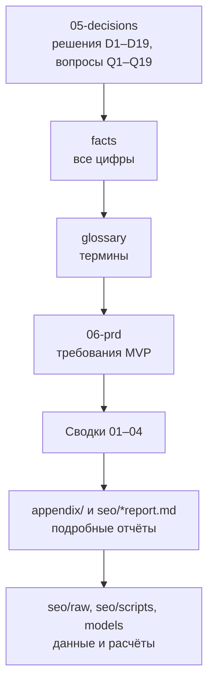

# Research: AI-песни-подарки

Ресерч для сервиса, который превращает историю о человеке в персональную песню и дарит её как событие. Аналог ohappy.ru для международного рынка; Россия — whitelabel на том же ядре, входит в MVP.

## С чего начать
1. [05-decisions.md](05-decisions.md) — решения, гипотеза, сроки и **единый список открытых вопросов**.
2. [facts.md](facts.md) — **реестр всех цифр**. При любом расхождении верен он.
3. [glossary.md](glossary.md) — **единые термины** для документов, PRD и кода.
4. [06-prd.md](06-prd.md) — **PRD MVP**: EN и RU-whitelabel, групповой подарок, подписки.
   Технические решения — в отдельной техспецификации (будет позже).
5. Сводки этапов: [01-landscape.md](01-landscape.md) → [02-seo-demand.md](02-seo-demand.md) → [03-competitors.md](03-competitors.md) → [04-economics.md](04-economics.md).
6. План и правила ведения документов: [00-plan.md](00-plan.md).

## Структура

| Путь | Что там |
|---|---|
| `00-plan.md` … `05-decisions.md` | Основные документы (сводки и решения) |
| `06-prd.md` | PRD MVP: требования FR-*, предложения на утверждение P1–P38 |
| `facts.md` | Канонические цифры с метками [V] / [S] / [E] |
| `glossary.md` | Термины, имена в коде, модель данных |
| `appendix/` | Подробные отчёты: [разбор конкурентов](appendix/competitors-teardown.md), [экономика — спрос](appendix/economics-demand.md), [экономика — затраты](appendix/economics-costs.md), [аудит противоречий от 05.11](appendix/audit-2026-11-05.md) (исторический, все пункты закрыты), [черновик seed-ключей](appendix/keywords-ahrefs.txt), [Telegram-бот как воронка](appendix/telegram-bot.md), [каналы доставки поздравлений](appendix/delivery-channels.md) |
| `seo/` | Отчёты Ahrefs ([US](seo/us_report.md), [Global](seo/global_report.md), [Top pages](seo/top-pages-report.md)), CSV результатов, `raw/` — исходные выгрузки, `scripts/` — анализ |
| `models/` | [unit_economics.py](models/unit_economics.py) — каноническая модель; `cogs.py` — черновик (справочно) |

## Иерархия источников

**05-decisions** (решения) > **facts** (цифры) > **glossary** (термины) > **06-prd** (требования) > сводки 01–04 > `appendix/` и `seo/*report.md`.

В каждом подробном отчёте вверху есть баннер с этим правилом. Если находите расхождение, исправьте документ ниже по иерархии.

## Следующий шаг
[06-prd.md](06-prd.md) — PRD MVP (черновик v0.8, без технических решений). Ждёт утверждения предложений P1–P38 (Q15) и закрытия блокеров Q1, Q2, Q4, Q14; для RU — Q11, Q13, Q19.
