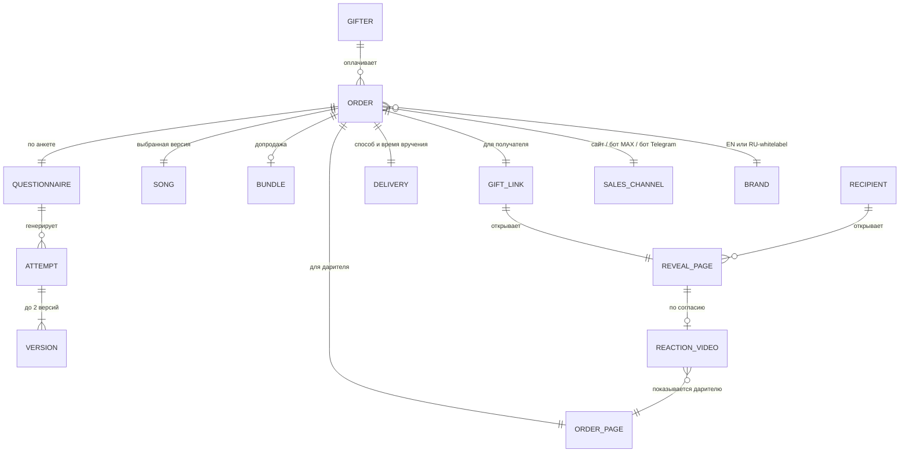

# Глоссарий

Единые термины для документации, PRD и кода. Дата: 2026-11-05.

**Правила:**
- В документах используем термин из колонки «Термин». Синонимы из колонки «Не использовать» не применяем, кроме цитат и описаний конкурентов.
- Имя в коде (`code`) — для сущностей, API и аналитики.
- Если появляется новое понятие, сначала добавляем его сюда, потом используем.
- Подробные отчёты в `appendix/` и `seo/` написаны до глоссария и могут использовать синонимы. При переносе в основные документы и PRD термины приводим к глоссарию.

## 1. Люди и роли

| Термин | В коде | Определение | Не использовать |
|---|---|---|---|
| **Даритель** | `gifter` | Тот, кто заказывает и оплачивает песню | «покупатель», «пользователь», «клиент» — допустимы только в метриках (CAC, LTV) и в общих фразах о рынке |
| **Получатель** | `recipient` | Тот, кому дарят песню. Не регистрируется, не платит, не обязан давать контакты | «адресат», «именинник» |
| **Основатель** | — | Владелец продукта, принимает решения D-* | — |

## 2. Продукт и заказ

| Термин | В коде | Определение | Не использовать |
|---|---|---|---|
| **Анкета** | `questionnaire` | Шаги, где даритель указывает имя получателя, кем тот приходится, повод, историю, жанр и голос | «форма», «бриф», «опрос» |
| **История** | `story` | Свободный текст в анкете: детали о получателе и отношениях | «описание» |
| **Повод** | `occasion` | День рождения, годовщина, Valentine's, Mother's Day и т. п. | «событие», «праздник» (как термин) |
| **Кем приходится** | `relation` | Роль получателя для дарителя: мама, жена, друг… | «тип получателя» |
| **Текст песни** | `lyrics` | Текст, который пишет LLM; даритель может править его до генерации музыки | «слова», «лирика» |
| **Проверка произношения имени** | `name_check` | Шаг до оплаты: даритель слышит, как модель поёт имя, и при необходимости задаёт фонетическое написание | — |
| **Фонетическое написание** | `name_phonetic` | Как имя пишется для провайдера генерации («Ah-NYA»), чтобы оно звучало правильно. Показываем везде `name_display` — обычное написание (06-prd FR-4.3) | «транскрипция» |
| **Попытка** | `attempt` | Одна генерация: текст песни + до 2 версий (превью второй версии можно генерировать по клику, 04 §7). Единица себестоимости ($0.035–0.185) | «генерация» (без уточнения) |
| **Версия** | `version` | Одна из двух аудиозаписей внутри попытки. Даритель выбирает одну для базы; вторая в полном качестве входит в пакет | «вариант», «дубль» |
| **Перегенерация** | `regeneration` | Новая попытка по той же анкете | «ремикс» |
| **Превью** | `preview` | Бесплатный фрагмент 30–45 с с именем получателя. Показывается до оплаты | «сэмпл», «демо», «тизер» |
| **Песня** | `song` | Полная запись выбранной версии после оплаты | «трек» — допустимо как синоним в тексте, в коде только `song` |
| **Заказ** | `order` | Оплаченная песня со всеми привязанными сущностями. Статус заказа (`order_status`): оплачен (`paid`) → песня готова (`song_ready`) → вручение запланировано (`delivery_scheduled`) → подарочная ссылка отправлена (`gift_sent`) → подарок открыт (`opened`) → пришла реакция (`reaction_received`); также возврат (`refunded`). Переходы — 06-prd §8.2 | «покупка», «сделка» |
| **База** | `base` | Базовый тариф $29: песня, MP3, страница вручения, вручение в дату и время, видео реакции, PDF-открытка (D3). Не путать со сценарием Base в модели (§7) | «стандарт», «основной пакет» |
| **Пакет** | `bundle` | Допродажа за $49–59: видео со слайдшоу фото, принт текста песни, вторая версия песни в полном качестве (D2) | «премиум», «апгрейд», «тариф Pro» |
| **Допродажа** | `upsell` | Общий термин для всего, что продаём сверх базы. Сейчас это только пакет | «апсейл», «аддон» |
| **PDF-открытка** | `printable_card` | Файл для печати с QR-кодом на подарочную ссылку. Входит в базу, доступна на странице заказа (D3, D14) | — |
| **Записка** | `gifter_note` | Короткое личное сообщение дарителя (до 300 символов), видно на странице вручения после раскрытия (06-prd P8) | «открытка» (это PDF-открытка), «послание» |
| **Пример песни** | `sample_song` | Демонстрационная песня, которую делает основатель для лендинга и SEO-страниц. Не заказ и не чужой подарок | «сэмпл», «демо» |
| **Физическая открытка** | `physical_card` | Открытка или магнит с QR/NFC через партнёрскую печать. После MVP | — |
| **Групповой подарок** | `group_gift` | Подарок, историю для которого пишут несколько человек: организатор и участники. Платит организатор (D18). Входит в MVP | «коллективный заказ» |
| **Организатор** | `organizer` | Даритель, который создаёт групповой подарок, собирает вклады и платит | «админ», «инициатор» |
| **Участник** | `contributor` | Человек, который по ссылке-приглашению добавляет вклад в групповой подарок. Не регистрируется и не платит | «соавтор», «гость» |
| **Вклад** | `contribution` | Что добавляет участник: подпись, воспоминание, записка получателю, фото | «ответ», «пост» |
| **Ссылка-приглашение** | `invite_link` | Ссылка `/join/{код}`, по которой участники добавляют вклады. Не показывает песню | «инвайт» в документах |
| **Складчина** | `split_payment` | Каждый участник платит свою долю. После MVP (D18) | — |
| **Подписка** | `subscription` | «Календарь поводов»: годовая или помесячная (D17). Даёт календарь, кредиты и цену для подписчика | «тариф Pro», «членство» |
| **Кредит** | `credit` | Право на одну песню по базе без оплаты; начисляется подпиской, действует 12 месяцев | «токен», «баланс» |
| **Цена для подписчика** | `member_price` | Сниженная цена базы для подписчика сверх кредитов (06-prd P13, P14) | «скидка» без уточнения |
| **Календарь поводов** | `occasion_calendar` | Список близких и дат их поводов в аккаунте; за 14 и 3 дня присылаем напоминание со ссылкой в анкету | «напоминалка» |

## 3. Ссылки и страницы

| Термин | В коде | Определение | Не использовать |
|---|---|---|---|
| **Страница заказа** | `order_page` | Личная страница дарителя: скачать MP3, выбрать способ вручения, статус, видео реакции (D16). Получатель её не видит | «личный кабинет» (это аккаунт), «ссылка на трек» |
| **Страница организатора** | `organizer_page` | Секретная страница организатора группового подарка: вклады, дедлайн, «Собрать песню» | «админка» |
| **Страница участника** | `contributor_page` | Секретная страница участника: статус подарка, «подарок открыт», видео реакции (если получатель согласился) | — |
| **Подарочная ссылка** | `gift_link` | Ссылка, которую получает получатель. Открывает страницу вручения | «ссылка на песню», «ссылка-подарок» |
| **Страница вручения** | `reveal_page` | Что видит получатель по подарочной ссылке: раскрытие, песня, текст, обложка, скачивание MP3, запись видео реакции, CTA «сделай такую же» | «страница-подарок»*, «страница раскрытия», «открытка», «gift page» |
| **Раскрытие** | `reveal` | Анимация на странице вручения, после которой начинает играть песня | «распаковка», «анимация поздравления» |
| **Экран ожидания** | `countdown` | Что показывает страница вручения до даты вручения: таймер и «Откроется 14 февраля», без спойлера (D16) | «заглушка» |
| **Обложка** | `cover` | Картинка песни; используется на странице вручения и в превью ссылки | — |
| **Превью ссылки** | `link_preview` | Карточка, которую мессенджер или почта показывает для подарочной ссылки (OG-теги). Не путать с превью песни | «превью» без уточнения |

\* «Страница-подарок» — только в описании конкурентов (ohappy, GiftSong), у которых нет раскрытия и вручения.

## 4. Вручение

| Термин | В коде | Определение | Не использовать |
|---|---|---|---|
| **Вручение** | `delivery` | Момент, с которого получатель может открыть подарок: наступила дата и время вручения, страница вручения показывает раскрытие. Подарочную ссылку можно получить и раньше — тогда виден экран ожидания (D16) | «доставка» — допустимо только в заголовках про каналы связи; «отправка» |
| **Дата и время вручения** | `delivery_at` | Когда открывается подарок и когда срабатывает способ вручения. Хранится с часовым поясом получателя. Даритель задаёт и может изменить на странице заказа | «дата открытия» |
| **Способ вручения** | `delivery_mode` | Один из двух вариантов D14: «Мы отправим» или «Я отправлю сам» | — |
| **«Мы отправим»** | `delivery_mode=auto_email` | Сервис сам отправляет получателю письмо с подарочной ссылкой в дату и время вручения | «автодоставка» |
| **«Я отправлю сам»** | `delivery_mode=self_send` | В дату и время вручения даритель получает напоминание с кнопками отправки и пересылает ссылку сам | «ручная доставка» |
| **Напоминание дарителю** | `gifter_reminder` | Для «Я отправлю сам»: в дату и время вручения письмо (в RU — также сообщение бота) со ссылкой на кнопки отправки | — |
| **Кнопки отправки** | `share_buttons` | WhatsApp (`wa.me`), SMS/iMessage (`sms:`), Telegram (`t.me`), системное «Поделиться», «Копировать ссылку», QR; в RU-whitelabel ещё MAX (D14). «Переслать подарок» — та же функция внутри бота | «шеринг» в документах |
| **Уведомление дарителю** | `gifter_notification` | Сообщение дарителю о статусе заказа: песня готова, пора отправить подарок, подарок открыт, пришла реакция. Письмо; в RU — также бот | — |
| **Видео реакции** | `reaction_video` | Запись реакции получателя на странице вручения. Только с явного согласия получателя; приходит дарителю на страницу заказа | «кружок», «реакция» без уточнения |
| **Согласие на показ** | `showcase_level` | Отдельное согласие человека в кадре показать видео реакции в маркетинге: нет / сайт и соцсети (`site_social`) / и реклама (`ads`). Видео используется, только если согласен и даритель (06-prd FR-11.11–11.15) | «разрешение на рекламу», «UGC» без уточнения |
| **Библиотека видео** | `showcase_library` | Видео реакций с обоими согласиями на внутренней странице основателя; источник роликов для соцсетей и рекламы | «архив», «галерея» |
| **CTA «сделай такую же»** | `make_your_own_cta` | Кнопка на странице вручения, ведущая получателя в анкету. Основа виральности | «реферальная кнопка» |

## 5. Каналы и платформы

| Термин | В коде | Определение | Не использовать |
|---|---|---|---|
| **Канал продаж** | `sales_channel` | Где даритель проходит анкету и платит: сайт, бот MAX, бот Telegram | «воронка» как синоним канала |
| **Сайт** | `web` | Основной канал продаж и ядро продукта | «лендинг» (это одна страница сайта) |
| **Бот** | `bot` | Канал продаж в мессенджере (MAX или Telegram), только в RU-whitelabel (D15). Шлёт дарителю уведомления; получателю ничего не отправляет | «чат-бот» |
| **Deep link** | `deep_link` | Ссылка, которая открывает бота с параметром (`t.me/<bot>?start=…`, аналог в MAX): источник трафика или заказ | — |
| **Telegram Stars** | — | Внутренняя валюта Telegram для цифровых товаров. Не используем (D15) | — |
| **Mini App** | `mini_app` | Веб-анкета, открытая внутри мессенджера. Тот же код, что на сайте | «веб-апп» |
| **Адаптер** | `bot_adapter` | Слой, который отличает MAX от Telegram: транспорт сообщений, deep links, кнопки отправки | — |
| **Ядро** | `core` | Общий бэкенд: анкета, генерация, заказы, вручение, платежи (через конфигурацию) | — |
| **Аккаунт** | `account` | Учётная запись дарителя без пароля: вход по ссылке из письма или через бота. Хранит заказы, групповые подарки, календарь поводов, подписку и кредиты (06-prd §6.16) | «личный кабинет», «профиль» |
| **Контур** | `deployment` | Отдельное развёртывание ядра под бренд со своими серверами и сервисами. RU-контур целиком в РФ (D7) | «инстанс», «стенд» (стенд — это staging) |
| **Whitelabel** | `brand` | Отдельный бренд на том же ядре: свой домен, язык, платёжка, провайдер генерации. RU — первый whitelabel | «клон», «форк» |
| **Провайдер генерации** | `music_provider` | Модель, которая делает музыку: ACE-Step 1.5, MiniMax 2.0 на fal или Lyria 3.5 (D8) | «движок» |
| **MoR** | `payment_provider` | Merchant of Record: платёжный сервис, который продаёт от своего имени и платит налоги. У нас Polar, запасной Paddle | «эквайринг» — это про ЮKassa |

## 6. Фазы и рынки

| Термин | Определение |
|---|---|
| **MVP** | Весь объём D4: EN-сайт, RU-whitelabel с ботами MAX и Telegram, групповой подарок, подписки и аккаунты. Сроки не фиксируются (D19) |
| **После MVP** | Физическая открытка, B2B, складчина, дополнительные языки. Термин «фаза 2» в документах до 05.11 означал то же, но включал RU и групповой подарок |
| **EN-рынок** | US, GB, CA, AU. EN high-CPC — плюс NZ и IE (в выгрузках Ahrefs) |
| **Дополнительный язык** | 1–2 языка помимо EN по итогам Q3 (кандидаты DE, PL, PT/BR, ES) |
| **Позиционирование C** | «Через впечатление»: продаём вручение подарка, а не файл (D1). Варианты A (массовый дешёвый) и B (премиум с проверкой человеком) отклонены (D13) |
| **Ценовая лестница** | $2–7 демпинг · $20–40 массовый AI · $79 MakeCustomSongs · $179–395 живые артисты (facts §2) |
| **i18n-ядро** | Архитектура, где язык и локаль — конфигурация, а не код |

## 7. Экономика и метрики

| Термин | Определение |
|---|---|
| **AOV** | Средний чек до возвратов (сценарий Base $35.5). «Чистый AOV» — после возвратов ($34.1) |
| **COGS** | Переменная себестоимость платного заказа: генерация (включая превью для тех, кто не заплатил), хранение, видео реакции, поддержка, комиссия MoR, аффилиаты |
| **CM1** | Чистый AOV минус COGS. Без рекламы и фиксированных расходов |
| **CAC платный** | Стоимость одного оплатившего дарителя из рекламы: $42 (бленд 4 стран) / $47 (только US) в Meta |
| **CAC блендированный** | Платный CAC с учётом бесплатных дарителей (30% в сценарии Base): $30; с k-фактором — $28 |
| **LTV** | CM1 × заказов на дарителя за 24 мес. (1.25 в сценарии Base) |
| **k-фактор** | Сколько новых дарителей приводит один заказ через страницу вручения и CTA «сделай такую же» |
| **Воронка** | Визит → старт анкеты → превью → оплата. Сценарий Base: 30% → 60% → 15%, итого 2.7% |
| **Сценарии Bear / Base / Bull** | Пессимистичный, базовый и оптимистичный наборы допущений модели (04 §2). «Base» — сценарий, не путать с тарифом «База» |
| **Стек A / A2 / A3 / L** | Варианты провайдера генерации в модели: ACE-Step на serverless GPU / ACE-Step на fal / MiniMax 2.0 на fal / Lyria 3.5 |
| **Повторный заказ** | Новый заказ того же дарителя (15% в год в сценарии Base) |
| **SAM / SOM** | Доступный рынок ($128M в год, US+GB+CA+AU) / реалистичная доля при платном масштабе ($1.9M на 2-й год) |
| **Конверсия превью → оплата** | Доля дарителей, услышавших превью и оплативших. Главная метрика теста на $300 |
| **Слепой тест моделей** | Q1: 10 реальных анкет × 3 провайдера генерации, оценка без знания модели |
| **Тест на $300** | D12: разовая реклама в Meta на EN-рынке перед Valentine's для проверки воронки |
| **Пороги Kill / Go** | Значения метрик теста на $300, при которых меняем оффер или продолжаем (04 §6) |
| **Фиксированные расходы** | Платежи, которые не зависят от числа заказов (~$85/мес в плане 05) |
| **Дневной лимит расходов** | `spend_cap`: предел расходов на генерацию бесплатных превью в сутки; при достижении новые превью ждут следующих суток, оплаченные заказы обслуживаются (06-prd FR-18.3) |
| **Зрители подарочной ссылки** | Уникальные устройства, открывшие подарочную ссылку (кроме дарителя и ботов превью). Входит в расчёт k-фактора |

## 8. Ресерч и SEO

| Термин | Определение |
|---|---|
| **[V] / [S] / [E]** | Метки источника: проверено на первоисточнике / вторичный источник или заявление компании / наша оценка |
| **KE / SVH / SE** | Выгрузки Ahrefs: Keywords Explorer (объём ключа), история объёмов, Site Explorer (трафик домена) |
| **KD, CPC** | Сложность ключа в Ahrefs (0–100); стоимость клика в контекстной рекламе |
| **Seed-ключ** | Исходный запрос, от которого Ahrefs строит Matching terms |
| **Кластер** | Группа ключей одного намерения: GIFT_CORE, BIRTHDAY_NAME, OCCASION_*, RECIPIENT, AI_GENERATOR, BRAND_COMPETITOR |
| **LFL** | Like-for-like: рост только по ключам, которые были в базе оба периода |
| **Программатик-SEO** | Массовые страницы по шаблону (повод × получатель, имена) |
| **Аномальный ключ** | «how to create a personalized song gift»: похоже на запросы ботов или AI-ассистентов, из расчётов исключён |
| **D-\* / Q-\*** | Номер решения и открытого вопроса в [05-decisions.md](05-decisions.md) |

## 9. Модель данных (черновик; полная версия — [06-prd §8](06-prd.md))

